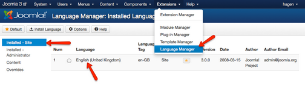
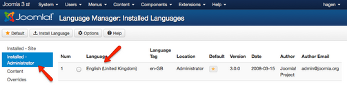
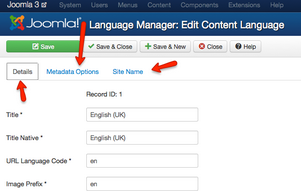
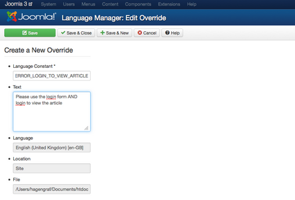
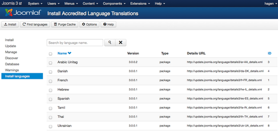
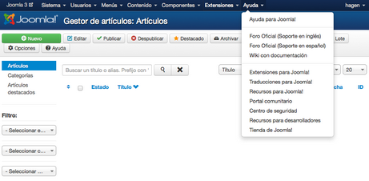

# Joomla! 3 十步建站第三步：让Joomla!使用您的语言

### 3. 让Joomla使用您的语言

本系列教学转自 [Cocoate免费书库](http://cocoate.com/j3/what-is-joomla) ，英文原著由[Hagen Graf](http://cocoate.com/user/hagen-graf)编写，中文翻译由[Derek Joe](http://cocoate.com/zh-hans/derek-joe)完成

至此，您的网站和控制面板还都只是英文版。这是Joomla的基础语言。安装时我们选择的语言，仅仅只在安装时起作用。  
因为有很多Joomla用户的母语都不是英语，因此本章内容非常重要。

### 语言管理器

首先我们来看看怎么设置您想要的语言。当然现在我们的Joomla网站还没有多种语言，只有英文。

语言管理器（*扩展 → 语言管理*）分为四个部分：

### 1. 已安装 - 网站前台

这里是一个已为网站前台安装的语言的列表。您可以将其中一种设置为网站前台默认的语言，激活或灭活其它语言（*图1*）。

*图1: 网站前台的语言*

### 2. 已安装 - 后台管理

这里是一个已为网站管理后台安装的语言的列表。您可以将其中一种设置为网站后台默认的语言，激活或灭活其它语言（图2）

*图2: 网站管理后台的语言*

### 3. 内容

在此您可以设置某语言下的网站名称、元数据、语言代码，等等（*图3*）。

*图3: 某语言的参数设置*

### 4. 语言覆盖

您可以个性化语言词条。当您只需要改变少量词条的时候，这是非常有用的。  
Joomla语言管理系统将词条，如*“请登录以阅读文章”*存储于如“*COM\_CONTENT\_ERROR\_LOGIN\_TO\_VIEW\_ARTICLE”*这样的变量中。如果您觉得这个词条的翻译不合您的心意，您可以在此覆盖它（*图4*）。您可以通过搜索找到某个词条对应的文本字串。

*图4: 语言覆盖*

### 安装一种新语言

在语言管理器前两项的左上方都有安装语言的按钮，点击后Joomla带您转至*扩展 → 扩展管理 → 安装语言*。如果您是第一次使用这一功能，您会看到所有可以使用的语言包。选择您想要的语言后，点击安装按钮即可。（*图5*）.

*图5: 可以使用的语言包*

安装后您还要返回语言管理器 （*扩展 → 语言管理*），将您安装的语言设置为网站前台或（和）网站管理后台的默认语言，增设网站的内容语种。

*图6: 使用西班牙语的管理后台*

---

除特殊标明文章转自第三方网站，文章均由JOOMLASK.COM原创提供  
欢迎友情转载，请务必保留本文出处并引用本文链接： [Joomla! 3 十步建站第三步：让Joomla!使用您的语言](http://www.joomla178.com/joomla-share/joomla3-in-10-easy-steps/joomla3-in-10-easy-steps-third-get-local-language.html)
