# 300+Jquery, CSS, MooTools 和 JS的导航菜单

Multithumb found errors on this page:  
  
There was a problem loading image http://www.1stwebdesigner.com/wp-content/uploads/2008/09/orange-menu.jpg  
There was a problem loading image http://www.1stwebdesigner.com/wp-content/uploads/2008/09/css-dock-menu.jpg  
There was a problem loading image http://www.1stwebdesigner.com/wp-content/uploads/2008/09/navigation-6.jpg  
There was a problem loading image http://www.1stwebdesigner.com/wp-content/uploads/2008/09/nav-7.jpg  
There was a problem loading image http://www.1stwebdesigner.com/wp-content/uploads/2008/09/jquery-nav.jpg  
There was a problem loading image http://www.1stwebdesigner.com/wp-content/uploads/2008/09/cssplay.jpg  
There was a problem loading image http://www.1stwebdesigner.com/wp-content/uploads/2008/09/nav-jquery.jpg  
There was a problem loading image http://www.1stwebdesigner.com/wp-content/uploads/2008/09/apple-nav.jpg  
There was a problem loading image http://www.1stwebdesigner.com/wp-content/uploads/2008/09/accordion-menu.jpg  
There was a problem loading image http://www.1stwebdesigner.com/wp-content/uploads/2008/09/nav-8.jpg  
There was a problem loading image http://www.1stwebdesigner.com/wp-content/uploads/2008/09/treeview.jpg  
There was a problem loading image http://www.1stwebdesigner.com/wp-content/uploads/2008/09/quick-navi.jpg  
There was a problem loading image http://www.1stwebdesigner.com/wp-content/uploads/2008/09/jquery-cool.jpg  
There was a problem loading image http://www.1stwebdesigner.com/wp-content/uploads/2008/09/contextmenu.jpg  
There was a problem loading image http://www.1stwebdesigner.com/wp-content/uploads/2008/09/navigation-1.jpg  
There was a problem loading image http://www.1stwebdesigner.com/wp-content/uploads/2008/09/tabbed-navigation.jpg  
There was a problem loading image http://www.1stwebdesigner.com/wp-content/uploads/2008/09/block-navigation.jpg  
There was a problem loading image http://www.1stwebdesigner.com/wp-content/uploads/2008/09/navigation-2.jpg  
There was a problem loading image http://www.1stwebdesigner.com/wp-content/uploads/2008/09/navigation-3.jpg  
There was a problem loading image http://www.1stwebdesigner.com/wp-content/uploads/2008/09/navigation-4.jpg  
There was a problem loading image http://www.1stwebdesigner.com/wp-content/uploads/2008/09/navigation-5.jpg  
There was a problem loading image http://www.1stwebdesigner.com/wp-content/uploads/2008/09/listamatic.jpg  
There was a problem loading image http://www.1stwebdesigner.com/wp-content/uploads/2008/09/listamatic2.jpg  
There was a problem loading image http://www.1stwebdesigner.com/wp-content/uploads/2008/09/css-menu-vertical.jpg  
There was a problem loading image http://www.1stwebdesigner.com/wp-content/uploads/2008/09/accordion.jpg

Joomla很多模板的菜单都是用的mootools，如果不是基于Joomla的站的话，这篇文章就有用了

来自：<http://www.onlinecomputersciencedegree.com/resources/jquery/>

If You are web developer great navigation menus always comes handy. I united this list for people like me, who sometimes wants to do job fast and choose from already prepared examples, which are easy to use. So here are many resources starting from very simple HTML and CSS navigation menus, until very complicated and advanced jQuery, JavaScript and MooTools techniques used to get maximal control with fading, sliding, dragging etc. effects. Be sure to bookmark this site for later use!

1.[Fancy menu](http://devthought.com/cssjavascript-true-power-fancy-menu/) – very cool navigation menu:

2. Excellent CSS dock menu for MAC lovers made with jQuery:

[Download dock menu](http://www.ndesign-studio.com/file/css-dock-menu.zip)

3. 37 different CSS navigation techniques:

[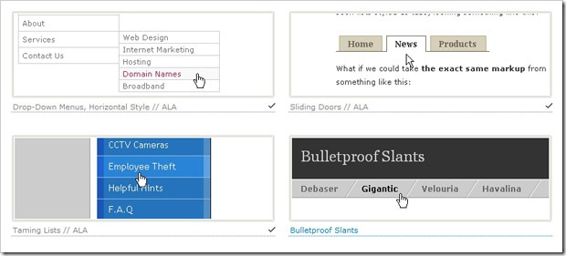](http://www.alvit.de/css-showcase/css-navigation-techniques-showcase.php)

4. Almost 5 years old menu, but looks great:

[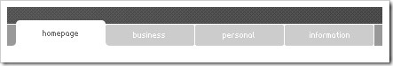](http://superfluousbanter.org/archives/2003/12/the-art-of-navigation/ "http://www.cssjuice.com/30-free-css-based-navigation-menus/")

5. Nice jQuery sliding effect menu with 4 different examples:

[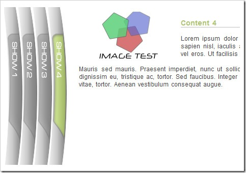](http://dev.portalzine.de/index?/Horizontal_Accordion--print)

6. [Updated JQuery Nested Tab Set with Demo](http://blog.cutterscrossing.com/index.cfm/2007/6/15/Updated-JQuery-Nested-Tab-Set-with-Demo);

7. [Vertical Flyout JavaScript Menu](http://www.leigeber.com/2008/05/vertical-flyout-javascript-menu/);

8. [13 hand-picked Vertical and horizontal CSS Menus](http://developerfox.com/13-hand-picked-vertical-and-horizontal-css-menus/274) ;

9. [Different tutorials for CSS menu creation](http://www.projectseven.com/tutorials/index.htm);

10. [Big library of vertical CSS menus from dynamicdrive.com](http://www.dynamicdrive.com/style/csslibrary/category/C2/);

11. Nice collection of  ~150 different CSS menus from CSSplay.com – regularly updated.

I really recommend You to visit this site:

12. [Menu with simple show/hide effect](http://woork.blogspot.com/2008/03/two-css-vertical-menu-with-showhide.html) – 2 examples with CSS and MooTools;

13. [Superfish v1.4.8 – jQuery menu plugin](http://users.tpg.com.au/j_birch/plugins/superfish/#a);

14.[Accessible Image-Tab Rollovers](http://www.simplebits.com/bits/tab_rollovers.html);

15. [Simple CSS vertical menu Digg-like](http://woork.blogspot.com/2008/01/simple-css-vertical-menu-digg-like.html);

16. [Simple Javascript Accordions](http://www.dezinerfolio.com/2007/07/19/simple-javascript-accordions/);

17. [Unique navigation menu using jQuery and MooTools](http://nettuts.com/html-css-techniques/how-to-create-a-mootools-homepage-inspired-navigation-effect-using-jquery/):

[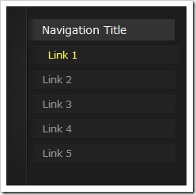](http://nettuts.com/html-css-techniques/how-to-create-a-mootools-homepage-inspired-navigation-effect-using-jquery/)

18.[CSSmenumaker.com](http://www.cssmenumaker.com/) – offers professional CSS menus;

19. [Cool JavaScript menus](http://javascriptkit.com/script/cutindex23.shtml) from JavaScriptkit.com;

20. [Create a multilevel Dropdown menu with CSS and improve it via jQuery](http://www.kriesi.at/archives/create-a-multilevel-dropdown-menu-with-css-and-improve-it-via-jquery)

21. [jdMenu Hierarchical Menu Plugin for jQuery](http://jdsharp.us/jQuery/plugins/jdMenu/) – vertical multilevel dropdown list;

22. [Amazing apple style navigation menu](http://www.kriesi.at/archives/apple-menu-improved-with-jquery):

23. [Accordion style jQuery menu](http://roshanbh.com.np/2008/06/accordion-menu-using-jquery.html):

[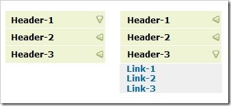](http://roshanbh.com.np/2008/06/accordion-menu-using-jquery.html)

24. [Cool animated navigation with CSS and jQuery](http://nettuts.com/javascript-ajax/create-a-cool-animated-navigation-with-css-and-jquery/):

25. [jQuery Treeview Plugin](http://jquery.bassistance.de/treeview/demo/):

[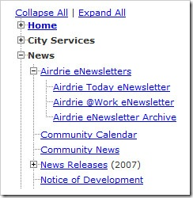](http://jquery.bassistance.de/treeview/demo/)

26. [35 different unique Jquery demos with different features](http://interface.eyecon.ro/demos/?page=demos)

27. [Jquery fastfind menu](http://www.webappers.com/2007/09/05/smooth-and-clean-fastfind-menu-jquery-plugin/) – click toogle menu, to get popup navigation menu:

[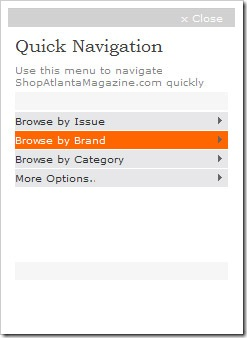](http://www.webappers.com/2007/09/05/smooth-and-clean-fastfind-menu-jquery-plugin/)

28. [jQuery idTabs](http://www.sunsean.com/idTabs/) – 8 different cool jQuery examples:

[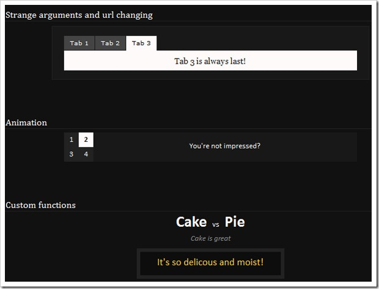](http://www.sunsean.com/idTabs/)

29. [jQuery ContextMenu](http://www.trendskitchens.co.nz/jquery/contextmenu/) – lightweight jQuery plugin that lets You selectively override the browser’s right-click menu with a custom one of your own:

[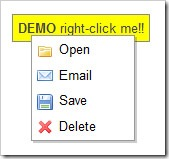](http://www.trendskitchens.co.nz/jquery/contextmenu/)

30. [jQuery UI tabs](http://stilbuero.de/jquery/tabs_3/) – different tab effects as simple tab, start with custom tab, slide effect, fade effect and much more;

31. [iconDock jQuery](http://icon.cat/wiki/IconDock_En#iconDock_jQuery_Plugin) – one more similar navigation to MAC OS X dock effect;

32. [SlidingMenu](http://www.getintothis.com/blog/2006/09/26/my-first-jquery-plugin-a-sliding-menu/) – very simple sliding menu using the effects provided by Interface (think Script.aculo.us for Prototype)

33. Tabbed navigation

These eleven menus are created using the [Sliding Doors](http://www.alistapart.com/articles/slidingdoors2/) technique, these menus work also correctly in Internet Explorer.

[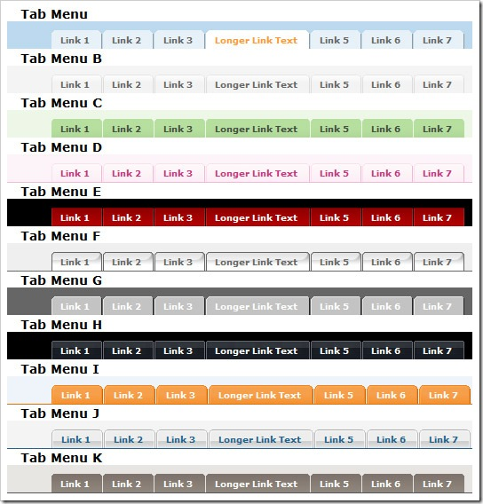](http://exploding-boy.com/images/cssmenus/menus.html)

[Download all menus](http://exploding-boy.com/mint/pepper/tillkruess/downloads/download.php?uri=http%3A//exploding-boy.com/images/CSSmenus.zip)

34. Another CSS tabbed navigation:

[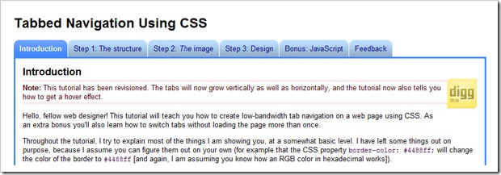](http://tutorials.mezane.org/tabbed-navigation-using-css/)

35. 9 different CSS block menus:

[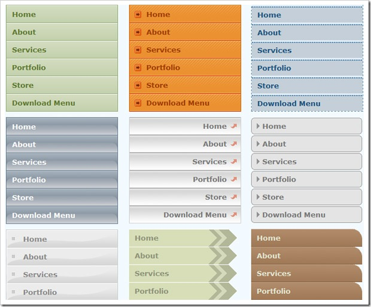](http://e-lusion.com/design/menu/)

[Download all menus](http://e-lusion.com/design/menu/full.zip)

36. 12 more different CSS menus.

[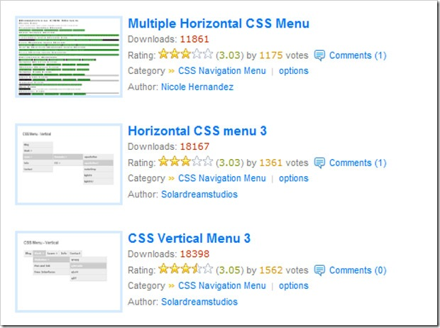](http://www.ex-designz.net/template/tempcat.asp?cat_id=14)

37. ADxMenu – 4 different examples of cool navigation menus:

[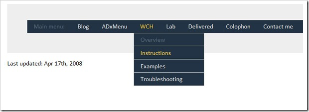](http://aplus.rs/adxmenu/)

[Download](http://aplus.rs/adxmenu/adxmenu-v4.zip)

39. At CSSmenubuilder is huge list of different and modern look menus, take Your best pick:

[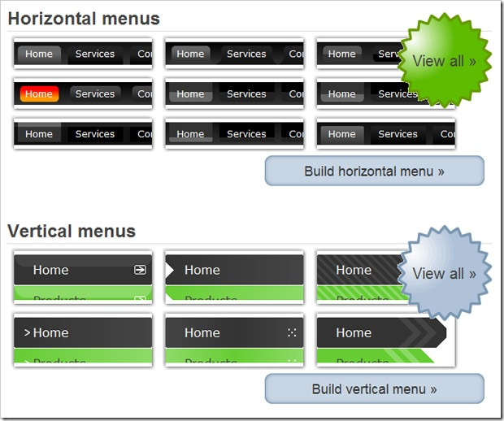](http://www.cssmenubuilder.com/menus)

[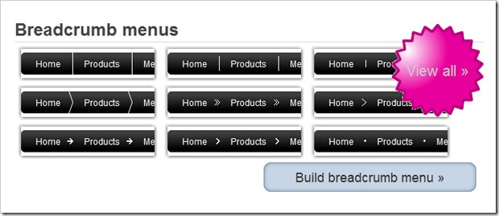](http://www.cssmenubuilder.com/menus)

40. Huge list of different menu examples:

41. CSSmenus: horizontal and vertical:

[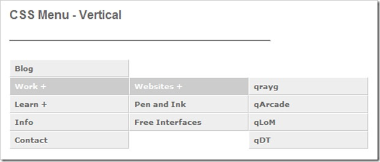](http://qrayg.com/learn/code/cssmenus/)

42. Great navigation and little more, one of the popular accordion versions:

[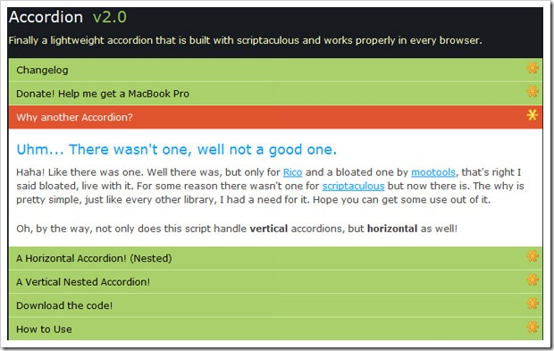](http://stickmanlabs.com/accordion/)

[Download accordion menu](http://stickmanlabs.com/accordion/accordion.zip)

CSS menu generators:

[List-u-Like CSS Generator](http://www.listulike.com/generator/)

[This generator allows You to create 3 different styles of menu](http://www.webmaster-toolkit.com/css-menu-generator.shtml)

---

除特殊标明文章转自第三方网站，文章均由JOOMLASK.COM原创提供  
欢迎友情转载，请务必保留本文出处并引用本文链接： [300+Jquery, CSS, MooTools 和 JS的导航菜单](http://www.joomla178.com/joomla-share/other/147.html)
