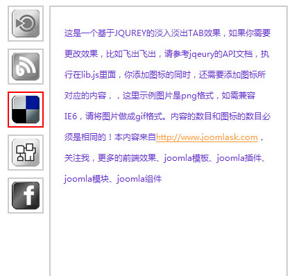

# 基于Jquery的一个淡入淡出TAB效果[附飞入飞出修改方法,修正下载错误]



演示地址：[http://www.Joomla178.com/download/Front-end/base-on-jquery-tabs-slide/index.html](http://www.joomla178.com/download/Front-end/base-on-jquery-tabs-slide/index.html)

下载地址：[http://www.Joomla178.com/download/file/24-base-on-jquery-tabs-slide.html](http://www.joomla178.com/download/file/24-base-on-jquery-tabs-slide.html)

效果在lib.js里面修改调用，先看看淡入淡出代码：

```
$(document).ready(function() { //默认TAB项 $(".Joomla178_con").hide(); //隐藏内容区域 $("ul.Joomla178_nav li:first").addClass("active").show(); //添加第一个活动样式 $(".Joomla178_con:first").show(); //显示第一个TAB内容  //鼠标点击事件 $("ul.Joomla178_nav li").click(function() { $("ul.Joomla178_nav li").removeClass("active"); //移除 "active" 样式 $(this).addClass("active"); //添加 "active" 样式到当前TAB上 $(".Joomla178_con").hide(); //隐藏不显示的TAB内容 var activeTab = $(this).find("a").attr("id"); //找到对应的锚点 $(activeTab).fadeIn(); //淡入效果 return false; });});
```

找到Jquery的API文档，比如我们想要它飞入飞出效果，这个对应的Jquery效果就是slideUp、slideDown，代码改为：

```
$(document).ready(function() { //默认TAB项 $(".Joomla178_con").hide(); //隐藏内容区域 $("ul.Joomla178_nav li:first").addClass("active").show(); //添加第一个活动样式 $(".Joomla178_con:first").show(); //显示第一个TAB内容  //鼠标点击事件 $("ul.Joomla178_nav li").click(function() { $("ul.Joomla178_nav li").removeClass("active"); //移除 "active" 样式 $(this).addClass("active"); //添加 "active" 样式到当前TAB上 $(".Joomla178_con").slideUp(); //飞出内容，并隐藏 var activeTab = $(this).find("a").attr("id"); //找到对应的锚点 $(activeTab).slideDown(); //飞入 return false; });});
```

如果想在速度上控制，也可以写为slideUp('slow')，这些参数都在jquery的api文档中有参考，不再细述。

---

除特殊标明文章转自第三方网站，文章均由JOOMLASK.COM原创提供  
欢迎友情转载，请务必保留本文出处并引用本文链接： [基于Jquery的一个淡入淡出TAB效果[附飞入飞出修改方法,修正下载错误]](http://www.joomla178.com/joomla-share/other/161.html)
