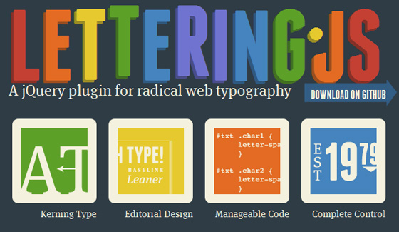

# Web开发人员必备的20款超赞的jQuery插件

Multithumb found errors on this page:  
  
There was a problem loading image http://www.chinaz.com/upimg/allimg/110219/1048031.jpg  
There was a problem loading image http://www.chinaz.com/upimg/allimg/110219/1048032.jpg  
There was a problem loading image http://www.chinaz.com/upimg/allimg/110219/1048033.png  
There was a problem loading image http://www.chinaz.com/upimg/allimg/110219/1048034.jpg  
There was a problem loading image http://www.chinaz.com/upimg/allimg/110219/1048035.jpg  
There was a problem loading image http://www.chinaz.com/upimg/allimg/110219/1048036.jpg  
There was a problem loading image http://www.chinaz.com/upimg/allimg/110219/1048037.jpg  
There was a problem loading image http://www.chinaz.com/upimg/allimg/110219/1048038.jpg  
There was a problem loading image http://www.chinaz.com/upimg/allimg/110219/1048039.png  
There was a problem loading image http://www.chinaz.com/upimg/allimg/110219/10480310.jpg  
There was a problem loading image http://www.chinaz.com/upimg/allimg/110219/10480311.jpg  
There was a problem loading image http://www.chinaz.com/upimg/allimg/110219/10480312.jpg  
There was a problem loading image http://www.chinaz.com/upimg/allimg/110219/10480313.jpg  
There was a problem loading image http://www.chinaz.com/upimg/allimg/110219/10480314.jpg  
There was a problem loading image http://www.chinaz.com/upimg/allimg/110219/10480315.jpg  
There was a problem loading image http://www.chinaz.com/upimg/allimg/110219/10480316.jpg  
There was a problem loading image http://www.chinaz.com/upimg/allimg/110219/10480317.jpg  
There was a problem loading image http://www.chinaz.com/upimg/allimg/110219/10480318.jpg  
There was a problem loading image http://www.chinaz.com/upimg/allimg/110219/10480319.jpg

导语：jQuery的易扩展性吸引了来自全球的开发者来共同编写jQuery插件。jQuery插件不仅能够增强网站的可用性，有效地改善用户体验，还可以大大减少开发时间。现在的jQuery插件很多，可以根据您的项目需要来选择。这里为您介绍20款非常不错的插件。

**Creative Radical Web Typography**

Lettering.js是一个轻量经的、易于使用的jQuery插件，可创造出极具个性的网页排版，是2010年最佳jQuery插件之一。

**New FancyMoves Jquery Product Slider**

Jquery Product Slider是一款效果很不错的产品幻灯片插件。

**Jquery Space Gallery**

Jquery Space Gallery是一款很有空间感的图片库插件。

**Fancy Thumbnail Hover Effect**

这是一款非常不错的Hover效果插件。

**Jquery Inline Form Validation**

这是一款表单验证插件。

**Site Switcher**

这是一款站点切换插件。

**AnythingSlider**

这是一款效果很棒的幻灯片插件。

**Jquery Tooltip Coda Bubble**

这是一款简洁的jQuery信息提示插件。

**Jquery Upload and Crop Image**

这是一款图片上传和裁剪插件。

**jQuery Carts**

这是一款jQuery图表插件。

**Twitter-like login box**

这是一款类似Twitter登陆框效果的插件。

**File Download**

这是一款文件下载插件。

**Polaroid Photo Viewer**

这是一款宝丽莱效果图片浏览插件。

**jquery Hover Sub Tag Cloud**

这是一款子标签云显示插件。

**Graph Visualization**

这是一款图标可视化插件。

**Show/Hide Jquery Panel**

这是一款控制面板显示和隐藏的插件。

**Drop Down with CSS and jQuery**

这是一款下拉菜单插件。

**Quick & Easy Zooming With jQuery – Zoomy**

这是一款非常好用的缩放插件。

**Horizontal Accordions**

这是一款横向手风琴效果插件。

**Flexible Rating**

这是一款非常灵活的评分插件。

（编译来源：[梦想天空](http://www.cnblogs.com/lhb25/) 原文来自：[20 Useful jQuery Plugins Every Developer Should Know About](http://www.topdesignmag.com/20-useful-jquery-plugins-every-developer-should-know-about/)）

---

除特殊标明文章转自第三方网站，文章均由JOOMLASK.COM原创提供  
欢迎友情转载，请务必保留本文出处并引用本文链接： [Web开发人员必备的20款超赞的jQuery插件](http://www.joomla178.com/joomla-share/other/20-useful-jquery-plugins-every-developer-should-know-about.html)
