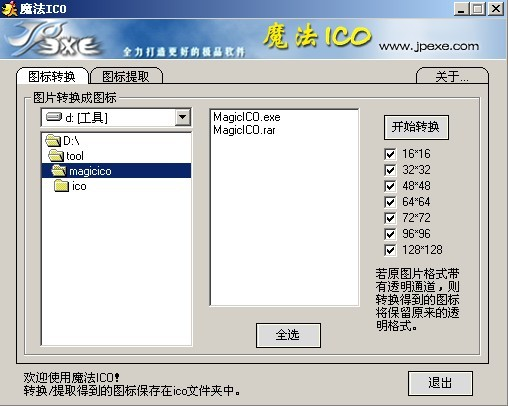

# Favicon快速制作绿色版MagicICO（下载）

让浏览器的收藏夹中除显示相应的标题外，还以图标的方式区别不同的网站。当然，这不仅仅是Favicon的全部，根据浏览器的不同，Favicon显示也 有所区别：在大多数主流浏览器如FireFox和Internet Explorer (5.5及以上版本)中，favicon不仅在收藏夹中显示，还会同时出现在地址栏上，这时用户可以拖曳favicon到桌面以建立到网站的快捷方式；除 此之外，标签式浏览器甚至还有不少扩展的功能，如FireFox甚至支持动画格式的favicon等。

网站建设中，为网站打造一个契合网站主题的个性化标志则是必需的，这直接关系到能否成功地塑造网站的品牌。这从某些角度看仍在网站推广的范畴之内，而欲取得成功，不仅包括良好的页面设计、令人印象深刻的网站Logo，也包括favicon。favicon显示位置从 特定的技术角度看，favicon也并不只是仅仅让网站给人更专业的观感，也可以在一定程度上减轻服务器的流量带宽占用：一般为了提高网站的可用性，我们 都会为自己的网站创建一个自定义的404错误文件，在这种情况下，如果网站没有相应的favicon.ico文件，每当有用户收藏网站/网页时， Web服务器都会调用这个自定义的404文件，并在网站的错误日志中记录。这显然是应该予以避免的。

绿色小软件，快速生成favicon ，本站检测方便可用

可将任意图转换为16X16、32X32、48X48、64X64、72X72、96X96、128X128 的ico图标，还可提取现有ico，软件为免费，下载解压点击MagicICO.exe即可使用.

下载地址：[点我下载](http://hotfile.com/dl/68705479/9d38552/MagicICO.rar.html)

---

除特殊标明文章转自第三方网站，文章均由JOOMLASK.COM原创提供  
欢迎友情转载，请务必保留本文出处并引用本文链接： [Favicon快速制作绿色版MagicICO（下载）](http://www.joomla178.com/joomla-share/other/34.html)
