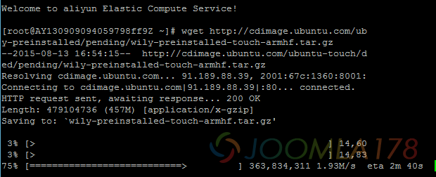

# 巧借阿里云下载龟速资源

海外的一些资源常常因为网速、其它一些政策原因，下载时要么龟速，要么就不理不睬！在没有国内镜像的情况下，只好借助一些第三方工具，比如百度云、115这些的离线下载功能。如果还不理想，这个时候有个远程服务器就显得那么优秀了。

近日想给Google Nexus7 II换个ROM，找到了Ubuntu touch，下载镜像6K/S，换百度云，一样10K/s以下的速度，登录到阿里云服务器，wget http://cdimage.ubuntu.com/ubuntu-touch/daily-preinstalled/pending/wily-preinstalled-touch-armhf.tar.gz，峰值1.9M/s，其它资源类似，留个笔记备他人之用

---

除特殊标明文章转自第三方网站，文章均由JOOMLASK.COM原创提供  
欢迎友情转载，请务必保留本文出处并引用本文链接： [巧借阿里云下载龟速资源](http://www.joomla178.com/joomla-share/other/aliyun-download-files.html)
