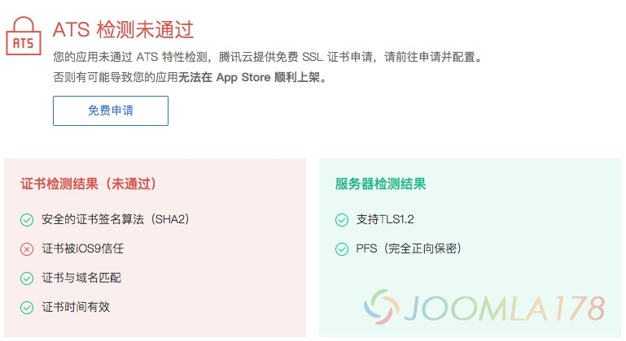

# Apache下SSL证书不被iOS信任或者服务器缺少中间证书

自从苹果开始要求开发者使用SSL数字证书后，SSL数字证书也是顺势被普及了！但是严格的信任机制下，部署证书总会遇到各种问题，比如在Apache中配置Comodo的时候，如果中级根证书没有部署在服务器上，就会出现证书不被IOS信任，例如下图



上图自腾讯提供的ATS检测工具结果。此外本人也开发了一套全面的ssl安装部署验证工具：<https://sslzoo.com/sslcheck/>

另外使用一些其它的证书检测工具检测也会提示 COMODO RSA Domain Validation Secure Server CA 对应的提示错误：

```
证书来源： 缺失证书
状态： 错误： 服务器缺少中间证书
```

但证书能正常访问，只是在Firefox下却提示此链接不受信任，参考：**[关于Comodo PositiveSSL在Firefox上不受信任的数字证书](https://www.sslzoo.com/47?show=47#q47)**

```
所以我们要将Comodo颁发的证书进行合成，例如证书邮件中有4个文件：
```

```
sslzoo_com.crt
COMODORSADomainValidationSecureServerCA.crt
COMODORSAAddTrustCA.crt
AddTrustExternalCARoot.crt
```

因为AddTrustExternalCARoot.crt是根证书，所以不需要只要使用以下命令将上述另外3个证书合成就可以了：

```
cat sslzoo_com.crt COMODORSADomainValidationSecureServerCA.crt COMODORSAAddTrustCA.crt > sslzoo_com_last.crt
```

合成结果，就是该目录下出现了一个 sslzoo\_com\_last.crt 最终证书。

在Apache配置（Windows和Linux通用）和ssl相关的conf文件，例如Windows下的 /extra/http\_ssl.conf

```
DocumentRoot "..."
ServerName www.sslzoo.com:443
SSLEngine on
SSLCertificateKey D:/ssl/sslzoo_com_last.crt
SSLCertificateKeyFile D:/ssl/sslzoo.com.key
SSLCertificateChainFile D:/ssl/sslzoo_com_last.crt
```

在Apache中重点就是SSLCertificateChainFile的配置，也是合成后的证书文件，保存后重启Apache服务就可以了

来源：[Apache下的Comodo证书不被iOS信任或者服务器缺少中间证书](http://www.sslzoo.com/110)

---

除特殊标明文章转自第三方网站，文章均由JOOMLASK.COM原创提供  
欢迎友情转载，请务必保留本文出处并引用本文链接： [Apache下SSL证书不被iOS信任或者服务器缺少中间证书](http://www.joomla178.com/joomla-share/other/apache-ssl-ios.html)
