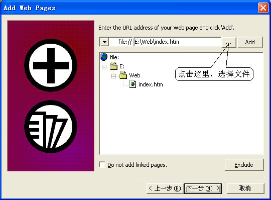
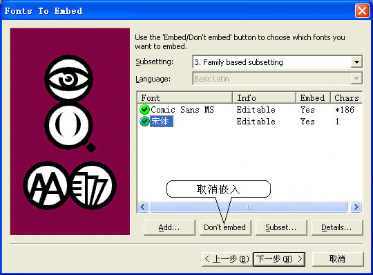
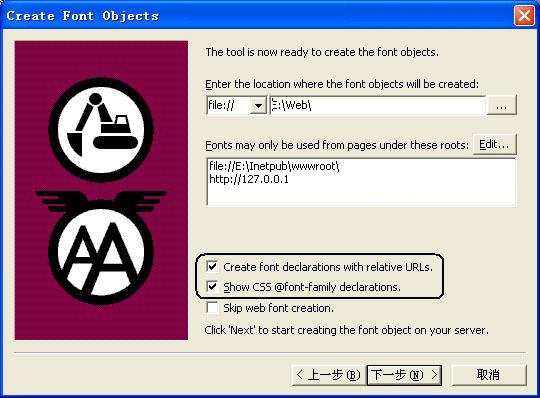
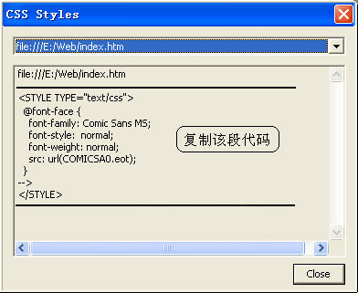

# 用Microsoft WEFT工具制作EOT字库,让网页字体轻松秀出来

编者语：网站上的大号字体用微软雅黑相对宋体、黑体都比较好看！而winxp用户的电脑上是没有这款默认的系统字体，那么网站建设者就需要考虑网站自带此字体，找到这篇转载教程分享一下。

有不少初学做网页的朋友，会犯这样一个错误――在网页中使用了很多种特殊的精美的字体，当网友们浏览时，却因没有安装相 应的字库，只能看到默认的宋体字，效果惨不忍睹。利用图片的方式来显示这些特殊字体，会使网页的体积增大很多，而且还不能方便地复制网页的内容。好在微软 公司发布了一款名为Microsoft Web Embedding Font Tool （WEFT）的软件，可以很方便地解决在网页中嵌入特殊字体的这一难题。

Microsoft Web Embedding Font Tool（网页字体嵌入工具，下载地址：<http://www.microsoft.com/typography/web/embedding/weft3/weft01.htm>）能够将网页中的字体制作成一个EOT格式的压缩字库，这个字库中仅包含了你在网页中使用到的那些文字，因此体积非常小巧。当网友们访问这个页面的时候，浏览器会自动下载该字库，将其中的字体在网页上完美地显示出来。下面就让我把WEFT的应用介绍给大家：

1．安装并运行WEFT，点击工具栏上的"Wizard"进入向导界面，输入你的姓名和电子信箱地址；

2．（如图1），在"Add Web Pages"窗口中，选中要嵌入字体的网页，点"下一步"继续；

3．接下来会弹出一个对话框，大意是说，制作出的网页需要Unicode 和Uniscribe 的支持，所以在Windows 98 和MacOS 上可能会出现显示不正常的情况，询问是否继续。真啰嗦，当然要继续了！

4．WEFT会分析你的网页中使用了那些字体，并将其显示在列表中（如图2），如果你不想将某种字体嵌入网页的话，选中该字体，点击"Don't embed"即可；

5．然后在"Create Font Objects"窗口（如图3）， "Enter the location where the font objects will be created"一栏中指定生成的字体文件的路径，并且勾选上"Show CSS @ font-family Declarations",其它的使用默认值就行了；

6．生成EOT字体文件和CSS样式表，（如图4）所示，复制两横线间的代码，粘贴到网页源代码的部分。我们很容易理解代码中"src:

url(\*.eot);"指向的就是EOT字库的路径，如果你的网页和EOT字库不在同一目录下，请根据情况修改url的指向；

7．后面的步骤我们可以不必理会，直接点"下一步"，最后"完成"就行了。

现在把你的网页和EOT字库上传到网上，找个朋友帮你测试一下，看看效果吧！怎么样？很有成就感吧！

文章来自：http://www.zhaozi.cn/article/20080827/121980020131.html

---

除特殊标明文章转自第三方网站，文章均由JOOMLASK.COM原创提供  
欢迎友情转载，请务必保留本文出处并引用本文链接： [用Microsoft WEFT工具制作EOT字库,让网页字体轻松秀出来](http://www.joomla178.com/joomla-share/other/creat-eot-font-by-microsoft-weft-let-web-page-support-special-font.html)
