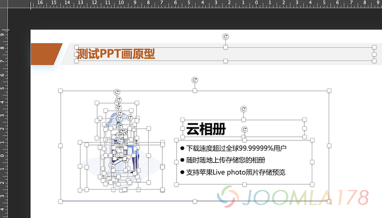
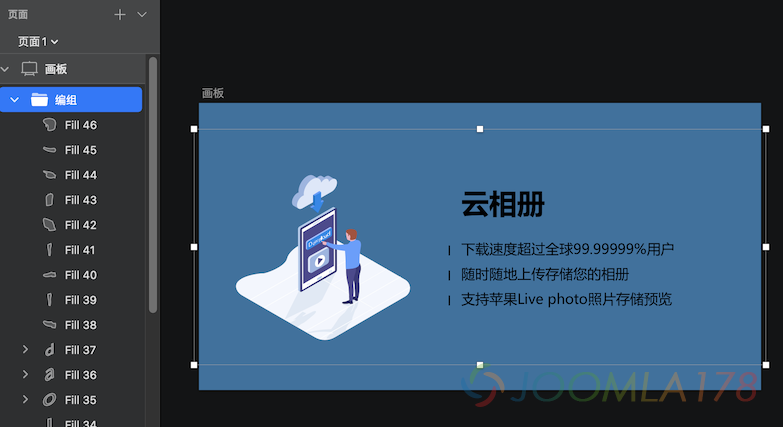
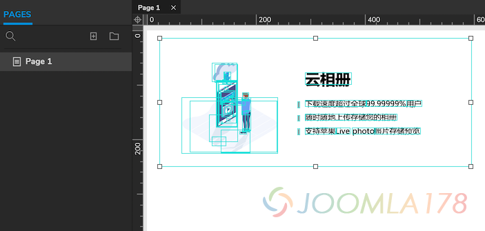
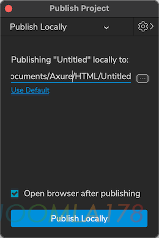
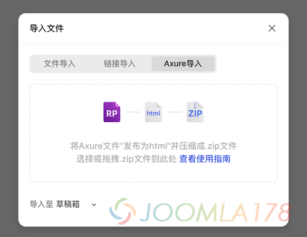
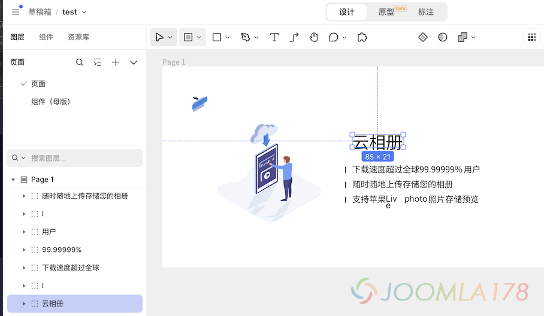
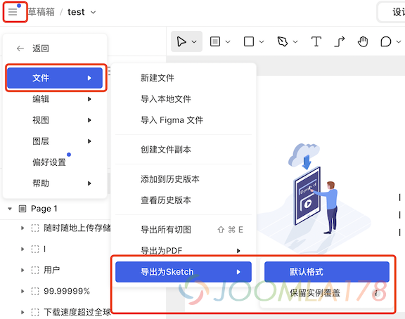
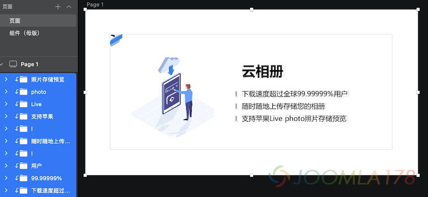
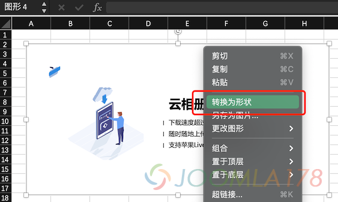
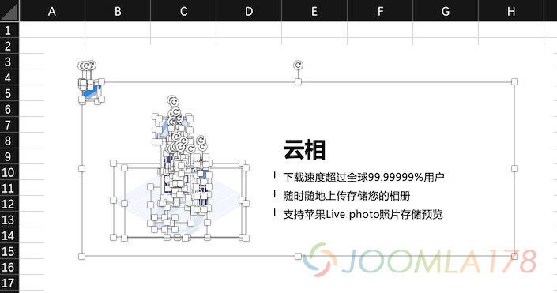

# Axure与Office系列软件绘制图形互转方法

上一次写文已是2019年了，新冠疫情对工作生活也产生了非常大的影响，期待疫情尽快结束。近期与朋友聊产品设计的“原型设计工具”选择，讨论Axure、墨刀、蓝湖优劣时，得知竟还有使用OFFICE工具进行设计，所以对Axure和OFFICE文档内容行互转产生了兴趣，今天我们来测试一下相关的途经和方法。

首先，市面任何图形工具都提供了矢量几何图形的设计绘制，比如线、面二维图形，只要使用一个兼容各软件格式的方式进行转换，即可达成目标，所以最好的介质就是svg，那么题目要解决的就是Axure和OFFICE之间只要把图形的svg进行导入、导出即可达成。

### 1. OFFICE绘图转到Axure

以PPT类工具为例，在PPT中绘制图形如果直接复制到剪贴板中，再粘贴Axure会被直接粘贴为位图，而非矢量图，故此路不通，Word、Excel中绘图也不可行。

因此需要一款中间软件，识别剪贴板中的OFFICE图形并转化为SVG，并复制SVG代码后，在Axure中粘贴SVG代码即可完成矢量图形复制，这里我们选择Sketch

1.1. 这里准备了一些矢量图形、文字在PPT中，并选择内容复制到剪贴板中

1.2. 接着在Sketch中新建画板，粘贴刚才复制的内容，可以在下图中看到，原来PPT中的矢量图形被分层在Sketch的画板中

1.3. 右击画板中复制进来的SVG图形，选择“拷贝SVG代码”，这时候进入剪贴板的内容是代码级的svg。这时候在Axure中空白页中粘贴代码（非文本中粘贴，直接粘贴，或右键空白处再点击“粘贴”）

1.4. 粘进来的图形默认作为位图表现，但Axure提供转换为图形的工具，右点刚才粘进来的图形，选择“变换图片(Transform Image) - 转换SVG图片为形状(Convert to SVG Shapes)”

这时候，就转化为矢量图形了，可以任意编辑，这里需要注意的是，从Sketch复制过来时，可能图形会有背景，粘贴到Axure并转换SVG图片为形状后，打散分组再将背景移除即可。

### 2. Axure绘图转到OFFICE

相比上文转换，Axure绘图转到OFFICE就没有那么方便了，核心原因是Axure绘制的线、面在剪贴板中并非以SVG形式存在，而是以位图进入剪贴板，故直接借助Sketch复制粘贴是无解的。所以仍然要借助将Axure绘制的图形内容转换至SVG，笔者找了一圈终于找了一款名为“MasterGo”的Saas化软件，作为中间媒介。

2.1. 这里仍然以上面图形为例，在Axure中选择发布原型为HTML

接着将HTML打包名为test.zip（文件名随意）

2.2. 在MasterGo控制台主页面板中点击“导入文件”，并导入刚才的test.zip

稍等片刻解析转换后，打开该导入的项目，解析过程可能存在一些损耗，但整体不受影响

需要注意的是，选中在MasterGo中刚才导入的图形，右键点击图形，选择“复制/粘贴为... - 复制SVG代码”，这里复制的SVG代码比较冗余，相当于是多串<svg>...</svg>的代码组合，不适合保存为单个SVG文件，因此该功能暂不可用，取尔用MasterGo导出Sketch文件方式。

2.3 在MasterGo导入该图形的项目中，点击左上角三道杠 - 选择“文件 - 导出为Sketch - 默认格式”，并保存该Sketch文件

2.4. 接着使用Sketch打开该文件，并选中图形后，右击画板中的图形，选择“拷贝SVG代码”，这时候进入剪贴板的内容是代码级的SVG，并且是一个完整的<svg>...</svg>代码串。

然后使用任意代码编辑器，如记事本、sublime、vscode，粘贴该段代码，并保存文件为 aaa.svg，即可形成矢量图形，可以尝试在浏览器中打开该aaa.svg，可预览该图。

2.5. 最后，我们以Excel为例实现Axure导入后接着在OFFICE中绘制修改原型，在Excel中导入该图形，导入的图形需要右键点击图形，选择“转换为形状”，然后该图形在Excel中就以矢量图形式存在。

转换为形状的图形是以分组形式存在，可以根据需要进行“取消分组”进而持续编辑。

到此这两种极为少见的互转场景的可行性研究就完成了，在这个过程中仍然有图形失真、损耗情况存在，需要手动进行调整。本文仅为此方案提供可行性探索，仅供有需要的朋友参考，并不构成指导性意见。

---

除特殊标明文章转自第三方网站，文章均由JOOMLASK.COM原创提供  
欢迎友情转载，请务必保留本文出处并引用本文链接： [Axure与Office系列软件绘制图形互转方法](http://www.joomla178.com/joomla-share/other/import-axure-svg-to-office-doc.html)
