# 打补丁神器使用小乌龟在SVN和Git项目中批量导出变更文件

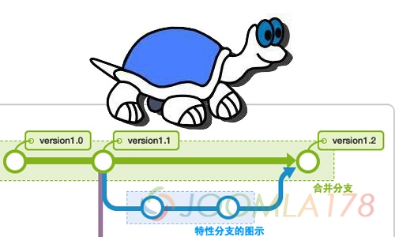

我们在项目开发中会遇到类似主干分支合并问题，代码迭代更新问题，过去我们可能手动的创建对应的目录结构文件夹，然后把变更的文件放在对应的文件夹中，最后再将这些文件夹及文件打包成patch覆盖到项目中，但是有了小乌龟(Totoise)就大大节省了人工操作，SVN对应的是TotoiseSVN，Git对应的是TotoiseGit。

下面我们分别介绍一下TotoiseSVN和TotoiseGit批量导出变更文件的方法：

## 1. 准备

- 首页安装TotoiseSVN或者TotoiseGit客户端工具。
- TotoiseSVN依赖SVN服务器，推荐安装VisualSVN Server，可安装在自己电脑，也可选择内网服务器。
- TotoiseGit相对简单，Git可在本机项目直接建立仓库，不依赖Git服务器。

以上安装部署不进行阐述。

## 2. TotoiseSVN实际操作

### 2.1 检出项目

首先我们需要把项目检出到本地，比如说我们有的朋友借助的是Eclipse内带的SVN工具的话，我们在导出补丁时可以单独借助小乌龟(TotoiseSVN)检出项目，这样小乌龟(TotoiseSVN)只作为导出功能。

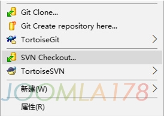

右击需要存放文件的文件夹空白处，选择SVN Checkout

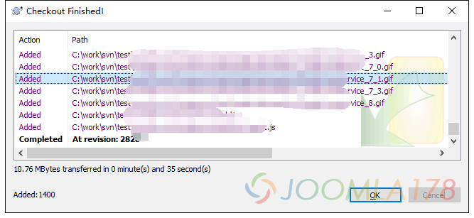

显示Checkout Finished!(检出完成)，此时可以看到文件夹中有检出的大量项目文件（这是所有文件，不单是变更文件）

### 2.2 查看日志

小乌龟(TotoiseSVN)提供大批量的文件日志浏览器，通过日志浏览器，我们选择变更、新增的文件导出。

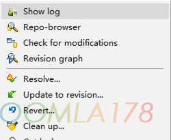

右点空白处选择TotoiseSVN - Show log 可以看到日志浏览器

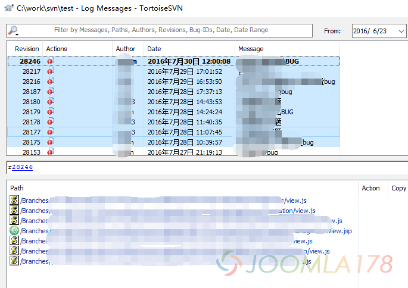

我们可以通过按住ctrl多选或shift全选来选择上部的文件，下面则看到这些变理文件的路径，这就表示这些文件发生过变更。

### 2.3 选择导出

在SVN项目中，大多数文件状态就是“新增(Added)”、“已修改(Modified)”、“已删除(Deleted)”这些，所以我们在批量导出的时候注意这些文件，所以在日志浏览器中，我们看到Actions一栏都是感叹号，表示已修改(Modified)。

**但是我们要注意的是，如果日志文件中的文件状态是已删除(Deleted)的状态，就意味着这个文件是不存在的，所以不用导出，如果你全选了的话，就会报出文件不存在的错误。**

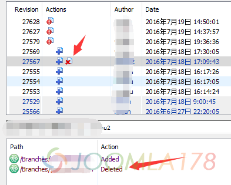

注意上图Actions一栏有一个文件发生了新增后又删除的状态，这个文件在多选的时候要规避掉，意思就是不用导出。

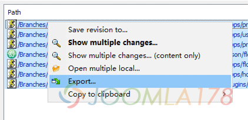

全选下部分带路径的变更文件，选择Export进行导出

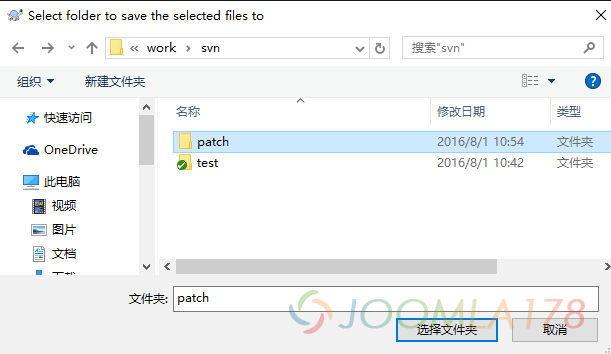

选择好创建的patch目录用于存放这些变更文件，即可完成导出

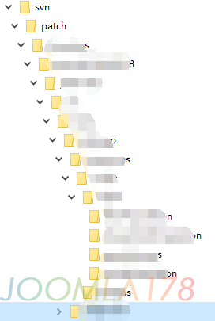

可以看到文件目录生成了开发目录的同级别目录下面存在的导出文件，这时候就可以将patch目录打包覆盖主干项目，或者生产环境中了。

## 3. TotoiseGit实际操作

TotoiseGit和TotoiseSVN差不多，区别较大的就是前者可以在本机建立仓库，不依赖服务器。

### 3.1 TotoiseGit拉取(pull)项目

如果环境中有git项目，则通过Git Clone拉取项目，如果只是本地创建仓库，则选择Git Create repository here...

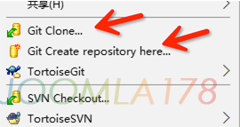

我们选择Git Create repository here...创建一个新的仓库

### 3.2 TotoiseGit查看日志

和TotoiseSVN的操作基本一样，也是选择Show log

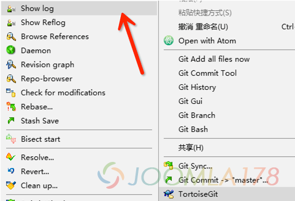

右点空白处选择TotoiseGit - Show log 然后看到日志浏览器

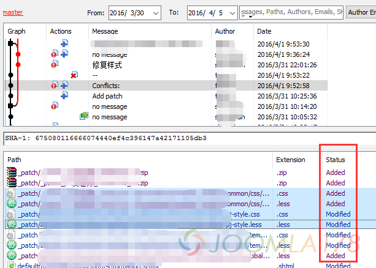

要注意的是TotoiseGit比SVN要好用的一点是，除了Actions图标能看到文件状态，还能在下面Status中看到多选的文件状态，和TotoiseSVN一样的是，如果文件是已删除(Deleted)的话，就肯定导不出了

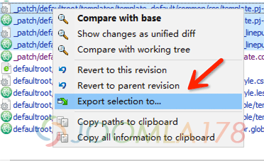

多选下面的文件，右点选择Export selection to...，选择导出存放的文件夹，这样就完成了TotoiseGit的批量导出，它和TotoiseSVN没太大区别。

---

除特殊标明文章转自第三方网站，文章均由JOOMLASK.COM原创提供  
欢迎友情转载，请务必保留本文出处并引用本文链接： [打补丁神器使用小乌龟在SVN和Git项目中批量导出变更文件](http://www.joomla178.com/joomla-share/other/patch-tools-how-to-use-to-totoise-export-changed-files.html)
