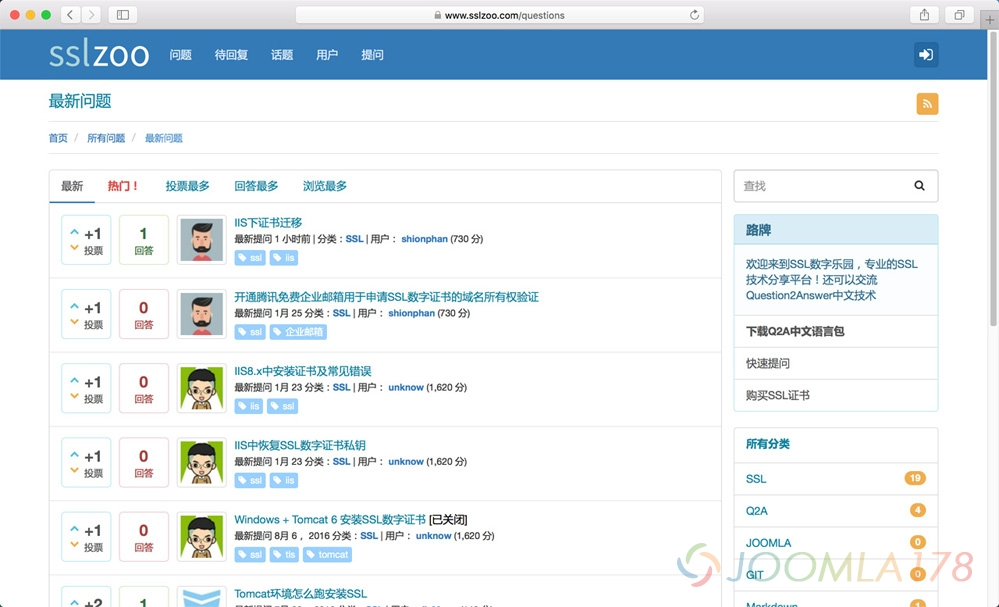

# Question2Answer 响应式模板sslzoo开源共享

本着开源的精神，基于Question2Answer的Dount开源主题修改的SSLZOO.COM主题免费共享，并且做了深度定制汉化。该主题需要Q2A 1.7.x版本，需要安装相应的几个插件并配置得到 <http://www.sslzoo.com> 的效果，本文不作细述，详细请参考 <https://github.com/shionphan/sslzoo>，如果觉得速度慢，可访问备用Git仓库站 <https://www.sslzoo.com/git/shionphan/q2a-sslzoo>

---

除特殊标明文章转自第三方网站，文章均由JOOMLASK.COM原创提供  
欢迎友情转载，请务必保留本文出处并引用本文链接： [Question2Answer 响应式模板sslzoo开源共享](http://www.joomla178.com/joomla-share/other/question2answer-q2a-theme-sslzoo.html)
