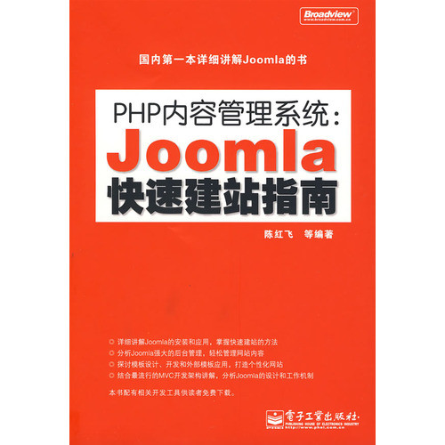

# 《Joomla快速建站指南》扫描版[PDF]

Joomla内容管理系统是目前最流行的内容管理系统之一。本书由浅入深，循序渐进地讲授如何使用Joomla架构网站。全书内容包括认识Joomla 和内容管理系统、开发工具安装和Joomla安装、后台管理系统学习、内容管理学习、模板开发应用、组件开发应用、插件开发应用、模块开发应用、常见模块 应用、架构和源码剖析、综合网站实例开发。  
 为了便于读者学习，本书有一章综合了Joomla中几乎所有的知识点，对一个完整网站进行架构，实 例具有很强的实用价值，具体讲解了开发环境和开发软件安装、用户注册登录模块、内容管理模块、评论系统、首页模板开发、产品展示模块、相册模块、积分模 块、用户系统开发、论坛模块和站内短信模块应用。  
 本书适合广大Web网站开发人员、网站管理维护人员、个人站点和企业门户创建者、大专院校学生阅读，尤其是有一定PHP网站编程技术的人员。

下载地址：[电驴下载](ed2k://|file|%5BPHP%E5%86%85%E5%AE%B9%E7%AE%A1%E7%90%86%E7%B3%BB%E7%BB%9F_Joomla%E5%BF%AB%E9%80%9F%E5%BB%BA%E7%AB%99%E6%8C%87%E5%8D%97%5D.%E9%99%88%E7%BA%A2%E9%A3%9E.%E6%89%AB%E6%8F%8F%E7%89%88.pdf|46141277|591456d217033cae515311169e2b5366|h=arkjrbbi6ssylxzekvelzqbszad2dlzr|/)

---

除特殊标明文章转自第三方网站，文章均由JOOMLASK.COM原创提供  
欢迎友情转载，请务必保留本文出处并引用本文链接： [《Joomla快速建站指南》扫描版[PDF]](http://www.joomla178.com/joomla-share/recommended-books/181.html)
