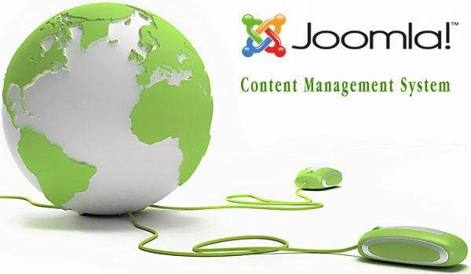

# 《Joomla系列英文书（17本，PDF&CHM）》

  
引用及下载地址：<http://www.verycd.com/topics/2783591/>  
  
Joomla!是一套获得过多个奖项的内容管理系统(Content Management System, CMS)。Joomla!采用PHP+MySQL数据库开发，可运行在Linux、Windows、MacOSX、Solaris等各种平台上。 Joomla!除了具有新闻/文章管理，文档/图片管理，网站布局设置，模板/主题管理等一些基本功能之外。还可通过其提供的上千个插件进行功能扩展包 括：电子商务与购物车引擎，论坛与聊天软件，日历，博客软件，目录分类管理，广告管理系统，电子报，数据收集与报表工具，期刊订阅服务等。   
  
**Beginning Joomla!, Second Edition (PDF英文版 附源码)**  
By: Dan Rahmel  
ISBN10: 1-4302-1642-5  
ISBN13: 978-1-4302-1642-1  
448 pages  
Published: Apr 2009 (Apress)  
详细介绍：[www.apress.com/book/view/1430216425](http://www.apress.com/book/view/1430216425)  
  
**Building Websites with Joomla! 1.5 (PDF英文版 附源码)**  
by Hagen Graf  
Paperback: 384 pages  
Publisher: Packt Publishing (March 28, 2008)  
ISBN-10: 184719530X  
ISBN-13: 978-1847195302  
  
  
 \* Learn Joomla! 1.5 features  
 \* Install and customize Joomla! 1.5  
 \* Configure Joomla! administration  
 \* Create your own Joomla! templates  
 \* Extend Joomla! with new components, modules, and plug-ins  
  
  
详细介绍：<http://www.packtpub.com/joomla-version-1-5/book>  
  
  
**Joomla! 1.5 Content Administration (PDF英文版)**  
by Tracey Porst  
Paperback: 212 pages  
Publisher: Packt (October 26, 2009)  
ISBN-10: 184719804X  
ISBN-13: 978-1847198044  
  
详细介绍在此：[www.packtpub.com/joomla-1-5-content-administration](http://www.packtpub.com/joomla-1-5-content-administration)  
  
  
**Joomla! 1.5 Development Cookbook (PDF英文版 附源码)**  
by James Kennard  
Paperback 360 pages  
Release date September 2009 (Packt)  
ISBN 1847198147  
ISBN 13 978-1-847198-14-3  
  
详细介绍：[www.packtpub.com/joomla-1-5-development-cookbook](http://www.packtpub.com/joomla-1-5-development-cookbook)  
  
  
**Joomla! 1.5 SEO (PDF英文版)**  
  
by Herbert-Jan van Dinther  
Paperback: 324 pages  
Publisher: Packt (October 27, 2009)  
ISBN-10: 1847198163  
ISBN-13: 978-1847198167  
  
详细介绍在此：[www.packtpub.com/joomla-1-5-search-engine-optimization-seo](http://www.packtpub.com/joomla-1-5-search-engine-optimization-seo)  
  
  
**Joomla! 1.5 Template Design (PDF英文版 附源码)**  
by Tessa Blakeley Silver  
Paperback 284 pages  
Release date June 2009 (Packt)  
ISBN 1847197167  
ISBN 13 978-1-847197-16-0  
  
详细介绍：[www.packtpub.com/joomla-1-5-template-design-2nd-edition](http://www.packtpub.com/joomla-1-5-template-design-2nd-edition)  
  
  
**Joomla! 1.5x Customization: Make Your Site Adapt to Your Needs (PDF英文版)**  
by Daniel Chapman  
Paperback 288 pages  
Release date August 2009 (Packt)  
ISBN 1847195164  
ISBN 13 978-1-847195-16-6  
  
详细介绍，勘误在此：[www.packtpub.com/joomla-1-5x-customization](http://www.packtpub.com/joomla-1-5x-customization)  
  
  
**Joomla! A User's Guide: Building a Successful Joomla! Powered Website(CHM 英文版)**  
  
by Barrie M. North  
Publisher: Prentice Hall  
Pub Date: December 11, 2007  
Print ISBN-10: 0-13-613560-9  
Print ISBN-13: 978-0-13-613560-9  
Pages: 480  
  
  
 \* Understanding content management, what Joomla! does, and how its components fit together  
 \* Building Joomla! sites from scratch, and systematically customizing them to your needs  
 \* Organizing content with sections, categories, blogs, and tables  
 \* Creating dynamic pages and effective navigation  
 \* Working with Joomla! modules and components  
 \* Search engine optimization for Joomla! sites  
 \* Start-to-finish case studies: building a school website, an e-commerce site, and a blog  
 \* The most valuable Joomla! extensions and add-ons: finding them, and using them  
 \* Key differences between Joomla! 1.0 and 1.5, and what they mean to you  
  
  
详细介绍，勘误在此：[www.informit.com/store/product.aspx?isbn=0136135609](http://www.informit.com/store/product.aspx?isbn=0136135609)  
  
  
**Joomla! Cash (PDF英文版)**  
by Brandon Dawson , Tom Canavan  
Paperback 180 pages  
Release date November 2007 (Packt)  
ISBN 1847191401  
ISBN 13 978-1-847191-40-3  
  
  
 \* Tips for generating revenues for your site  
 \* Setup of your shopping cart  
 \* Good layout and design for your site  
 \* VirtueMart shopping cart setup  
 \* Details of the iDevAffiliate affiliate system  
 \* Marketing your website  
  
  
详细介绍在此：[www.packtpub.com/joomla-cash-open-source-content-management](http://www.packtpub.com/joomla-cash-open-source-content-management)  
  
  
  
**Joomla! E-Commerce with VirtueMart (PDF英文版)**  
by Suhreed Sarkar  
Paperback 476 pages  
Release date March 2009 (Packt)  
ISBN 1847196748  
ISBN 13 978-1-847196-74-3  
  
Build feature-rich online stores with Joomla! 1.0/1.5 and VirtueMart 1.1.x.  
  
详细介绍在此：www.packtpub.com/joomla-e-commerce-with-virtuemart-1-1-x  
  
  
  
**Joomla! For Dummies (PDF英文版)**  
  
by Steve Holzner, Ph.D., Nancy Conner  
ISBN: 978-0-470-43287-7  
Paperback: 360 pages  
Published: January 2009 (For Dummies)  
  
详细介绍在此：[http://as.wiley.com/WileyCDA/WileyTitle/pr...87X.html](http://as.wiley.com/WileyCDA/WileyTitle/productCd-047043287X.html)  
  
  
**Joomla! Web Security (PDF英文版 附源码)**  
by Tom Canavan  
Paperback: 264 pages  
Published: October 2008 (Packt)  
ISBN 10: 1847194885  
ISBN 13: 978-1-847194-88-6  
  
  
 \* Learn how to secure your Joomla! websites  
 \* Real-world tools to protect against hacks on your site  
 \* Implement disaster recovery features  
 \* Set up SSL on your site  
 \* Covers Joomla! 1.0 as well as 1.5  
  
  
详细介绍，勘误在此：[www.packtpub.com/joomla-web-security-guide](http://www.packtpub.com/joomla-web-security-guide)  
  
  
  
**Joomla! with Flash (PDF英文版)**  
  
by Suhreed Sarkar  
Paperback: 260 pages  
Publisher: Packt Publishing (October 29, 2009)  
ISBN-10: 1847198244  
ISBN-13: 978-1847198242  
  
Build a stunning, content-rich, and interactive web site with Joomla! 1.5 and Flash CS4.  
  
详细介绍在此：[www.packtpub.com/joomla-with-flash](http://www.packtpub.com/joomla-with-flash)  
  
  
  
**Learning Joomla! 1.5 Extension Development (PDF英文版 附源码)**  
  
Learning Joomla! 1.5 Extension Development: Creating Modules, Components, and Plugins with PHP  
  
by Joseph LeBlanc  
Paperback: 176 pages  
Publisher: Packt Publishing (May 25, 2007)  
ISBN-10: 1847191304  
ISBN-13: 978-1847191304  
  
  
 \* Code Joomla! components, modules, and plugins from the ground up  
 \* Create toolbars, list screens, and menu items  
 \* Maintain a consistent look and reduce repetitive code using HTML functions  
 \* Automate database record management  
 \* Validate input and resist hack attempts  
 \* Configure your modules through XML parameters  
 \* Package and distribute your extensions  
  
  
详细介绍：<http://www.packtpub.com/Joomla-Extensions/book>  
  
  
  
**Make a Joomla Template in 5 Easy Steps: A Beginner's Guide (PDF英文版)**  
By Gary Reid, 2006  
  
  
 \* A 91 page instructional e-book  
 \* Over 100 step by step visual illustrations  
 \* 5 easy steps to create your own Joomla template  
  
  
官网：<http://clubtvk.com/>  
  
  
  
**Mastering Joomla! 1.5 Extension and Framework Development (PDF英文版 附源码)**  
  
by James Kennard  
Paperback: 488 pages  
Publisher: Packt Publishing (November 7, 2007)  
ISBN-10: 1847192823  
ISBN-13: 978-1847192820  
  
  
 \* Joomla!'s directory and URI structure along with a brief overview of its libraries  
 \* Joomla's common classes, variables and constants crucial for creating Joomla! extensions  
 \* Extending the database, following conventions for database schema, and common fields  
 \* Storing common types of data in standard fields and dealing with multilingual requirements.  
 \* Getting data from the Joomla! database  
 \* Using the JTable class to display and edit tables of cells  
 \* Designing components using the MVC design pattern  
 \* Configuring the component and its various elements and parameters.  
 \* Packaging components with the required install and uninstall files  
 \* Getting modules and components to work together  
 \* Writing, loading, and translating plugins  
 \* Working with Joomla!'s registry  
 \* Working with the User, Session, and Browser classes  
 \* Render output and maintain consistency throughout the application  
 \* Controlling paging of lists  
 \* Using JavaScript effects from the mootools librarys included with Joomla!  
 \* Creating and using Web Services in Joomla!  
 \* Handling errors, warnings and notices  
 \* Building secure Joomla! extensions  
 \* Working with dates, arrays, tree structures and other Joomla! utility classes  
 \* An in-depth reference guide to the most significant parts of the Joomla! framework  
  
  
详细介绍：[www.packtpub.com/joomla-one-point-five-extension-framework](http://www.packtpub.com/joomla-one-point-five-extension-framework)  
  
  
  
**Professional Joomla! (PDF英文版 附源码)**  
by Dan Rahmel  
Paperback: 480 pages  
Publisher: Wrox (October 1, 2007)  
ISBN-10: 0470133945  
ISBN-13: 978-0470133941  
  
  
 \* How each server of a Joomla! system can be installed and configured for maximum performance  
 \* The process of creating a module from scratch  
 \* Ways to use Ajax to add dynamic data retrieval to Joomla!  
 \* Techniques for using design patterns to solve common programming problems  
 \* How to create and retain a virtual community  
 \* Procedures for tuning a Joomla! site for both Search Engine Optimization (SEO) and Search Engine Management (SEM)  
  
  
详细介绍，勘误在此：[www.wrox.com/WileyCDA/WroxTitle/productCd-0470133945.html](http://www.wrox.com/WileyCDA/WroxTitle/productCd-0470133945.html)  
  
  
**Up and Running with Joomla, Second Edition (PDF英文版)**  
By R. Allen Wyke, Skip Matheny  
Pages: 81  
ISBN 10: 0-596-80647-7  
ISBN 13: 9780596806477  
Published: July 2009 (O'Reilly)  
  
Need to launch a feature-rich website quickly where you have one or more people authoring the content? Want to use a powerful, robust, and scalable Content Management System (CMS) you can trust? This Short Cut will get you up and running with Joomla 1.5, a freely available open source CMS. Learn how to install, configure, customize, and extend your Joomla installation. Also learn the tricks of the trade in how to set up and manage both your content and your users. Joomla can be a challenge to understand at first, so drastically cut your "get up to speed" time by taking the Short Cut!  
  
详细介绍在此：<http://oreilly.com/catalog/9780596806477/>

---

除特殊标明文章转自第三方网站，文章均由JOOMLASK.COM原创提供  
欢迎友情转载，请务必保留本文出处并引用本文链接： [《Joomla系列英文书（17本，PDF&CHM）》](http://www.joomla178.com/joomla-share/recommended-books/182.html)
