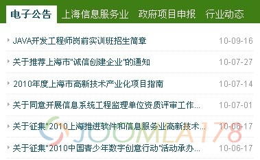
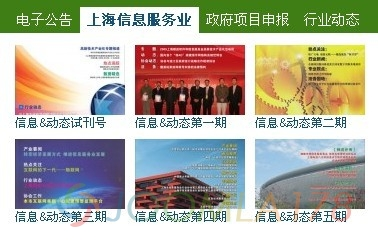

# 分享两个常用文章展示模块[荐]

Joomlart的模块、模板对中文网站适用性较强！笔者也对Joomlart有些偏爱，做了不少站，总结了两个常用模块，并在原模块基础上定制了一下，增加了几个功能。

jaslidenews 推荐这个模块，主要是它的适用范围广告，可以用来作为文章列表，可以用它来作为产品展示（每篇文章作为产品） ，也可以用来做博客形式文章展示，包含了“标题”、“文章introtext”、“缩略图”、“时间”、“更多”。这些都是原有的功能，在此基础上我定制了“标题字数限制”、“introtext和标题是否显示”等，另外重新编写了字符限制的中文适用版（utf-8下中英文按字节数截取参考：[joomla用php引言截断函数，符合utf-8编码](http://www.joomla178.com/joomla/joomla15/item/86-joomla%E7%94%A8php-%E5%BC%95%E8%A8%80%E6%88%AA%E6%96%AD%E5%87%BD%E6%95%B0%EF%BC%8C%E7%AC%A6%E5%90%88utf-8%E7%BC%96%E7%A0%81.html)）

jabulletin 这个模块也很好用，定制后可以实现国内网站常用的新闻标题…………时间，也可以作为产品展示

原版我就不发了，下面贴一下定制后的模块安装包

下载地址：[mod\_jasidenews.v1.0.1\_jk](http://hotfile.com/dl/76561199/28d537b/mod_jasidenews.v1.0.1_jk.zip.html)

下载地址：[mod\_jabulletin.v1.0.1\_jk](http://hotfile.com/dl/76561299/d0a145c/mod_jabulletin.v1.0.1_jk.zip.html)

---

除特殊标明文章转自第三方网站，文章均由JOOMLASK.COM原创提供  
欢迎友情转载，请务必保留本文出处并引用本文链接： [分享两个常用文章展示模块[荐]](http://www.joomla178.com/joomla-share/research-and-development/102.html)
