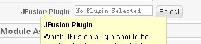
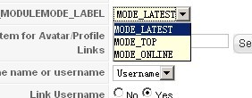
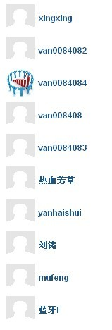

# JFusion整合PHPBB3之 模块按活跃、最新方式显示所有会员

Multithumb found errors on this page:  
  
There was a problem loading image 'file:///C:/DOCUME~1/shion.van/LOCALS~1/Temp/moz-screenshot.png'

原先尝试过Kunena 1.5系列，它显得有点累赘，Kunena1.6倒是很专业，可惜必须要开启Mootool1.2，为了一些老的JS菜单、slideshow只能暂时放弃Kunena1.6。期间也了解过agora，agora内嵌也很不错，测试下来之后明显感觉拖慢整站速度！PHPBB3的执行效率非常高，专业的论坛程序！总结之后，当前的Joomla版本的话，个人认为还是外置论坛比较好。

那么外置论坛最大的问题就是用户整合，Rockbridge这个东西慎用，关于Rockbridge的整合原理这里不做阐述，JFusion整合Joomla\PHPBB3的原理，GOOGLE上的文章一大把，可以去搜索一下，主要讲讲它的会员显示模块的应用，用外部论坛当然想把会员的信息、动态显示在Joomla站的页面上。

安装好JFusion之后，几个模块也一并被安装了！找到模块JFusion Whos Online Module，这个模块只有显示在线会员的功能，**下面开始定制让它显示“最新会员”、“活跃会员”。**

找到打开文件：administrator\components\com\_jfusion\views\advancedparam\paramfiles\whosonline.xml

需要在whosonline.xml这里面写入一个选择参数（也就是后台可以设置以何种方式显示会员）这里就显示在会员数量的后面，找到代码：

```
 <param name="member_limit" type="text" size="20" default="10" label="MEMBER_LIMIT" description="MEMBER_LIMIT_DESCR" />
```

在其后插入代码修改为

```
 <param name="member_limit" type="text" size="20" default="10" label="MEMBER_LIMIT" description="MEMBER_LIMIT_DESCR" /><param name="modulemode" type="list" default="" label="MODULEMODE_LABEL" description="MODULEMODE_DESC"> <option value="latest">MODE_LATEST</option> <option value="top">MODE_TOP</option> </param>
```

传入两个选择的两个值:latest和top

回到后台模块JFusion Whos Online Module配置界面，选择jfusion plugin里面的phpbb3，然后可以看到刚才添加的选择参数



选择之后...显示



回到模块文件夹并打开文件：modules\mod\_jfusion\_whosonline\mod\_jfusion\_whosonline.php

代码约47行左右，找到：

```
 $config["member_limit"] = $pluginParam->get('member_limit');
```

在其后插入刚才需要传入的参数，modulemode,修改为：

```
 $config["member_limit"] = $pluginParam->get('member_limit'); $config['modulemode'] = $pluginParam->get('modulemode');
```

显示模式的参数已经传入，这个模块的输出部分是写在modules\mod\_jfusion\_whosonline\helper.php里面，打开它

代码约86行，找到：

```
 $query = $public->getOnlineUserQuery($config["member_limit"]); $db->setQuery($query); $results = $db->loadObjectList();
```

修改为：

```
 if ($config["modulemode"]=='latest'){ $sql = "SELECT user_id, user_type, username, user_avatar, user_avatar_type, user_avatar_width, user_avatar_height, user_regdate, FROM_UNIXTIME(user_regdate,'%a %b %D %x %h:%i %p') AS reg_date FROM #__users WHERE user_type != 2 ORDER BY user_regdate DESC  LIMIT 0, ".$config["member_limit"] ;}  elseif($config["modulemode"]=='top') { $sql = "SELECT user_id, user_type, username, user_avatar, user_avatar_type, user_avatar_width, user_avatar_height, user_lastvisit, user_posts, FROM_UNIXTIME(user_lastvisit,'%a %b %D %x %h:%i %p') AS last_visit FROM #__users WHERE user_type != 2 ORDER BY user_posts DESC  LIMIT 0, ".$config["member_limit"] ;     } $db->setQuery($sql); $results = $db->loadObjectList();
```

\*大致思路就是判断模式分别为latest和top时候执行SQL查询满足条件的会员,这里查询的是user\_id,所以原有输出的$result->userid全部替换成$result->user\_id，分别是原程序的99行、102行、107行、120行

另外修复了一个无头像的时候显示默认图的BUG，代码155行，找到：

```
 $avatarImg = JFusionFunction::getJoomlaURL() . 'components/com_jfusion/images/noavatar.png';
```

改为：

```
 $avatarImg = JURI::base() . 'components/com_jfusion/images/noavatar.png';
```

完了，需要给头像加上链接到PHPBB3会员的的链接，代码159-162行，找到代码

```
 $avatar = "";
```

改为：

```
 $avatar = "<a href= ". $user_url ." target='_blank'></a>";
```

修改除了加链接之外，还有CSS的max-width和max-height，这里我改成了width和height，考虑到IE6下不认max-width和max-height

完了之后测试的效果




$avatar = "<a href= ". $user\_url ." target='\_blank'></a>";

---

除特殊标明文章转自第三方网站，文章均由JOOMLASK.COM原创提供  
欢迎友情转载，请务必保留本文出处并引用本文链接： [JFusion整合PHPBB3之 模块按活跃、最新方式显示所有会员](http://www.joomla178.com/joomla-share/research-and-development/108.html)
