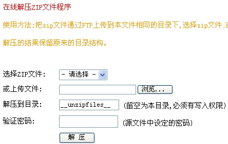

# 让国内PHP主机支持在线解压解决方法

现在国内的许多主机不支持在线（解）压缩，如果你是PHP主机的话，并且不支持这样功能的话，那么今天Anliu介绍的方法就派上用场了。只要在PHP安装一个小程序就可以实现这样功能，其实只有几KB大小的一个PHP文件。具体方法如下：

首先在此声明的是此做法只适用于zip文件的（解）压缩。这个方法事我以前看到的就一直放在QQ硬盘里，没有想到这次用上了。首先得下载zip这个小程序，只有8KB,然后解压后会发现有两个文件，一个是：myunzip.php，另一个是myzip.php。第一个实际上就是解压缩功能所需要的，第二个是压缩用的。我在这里说一下如何解压缩主机的上文件。

**1.上传你要解压的文件到主机上**  
**2.用文本打开myunzip.php，修改里面的密码（可选），原来是123，可以自己修改**  
**2.上传myunzip.php到主机上**

如果你的域名是an-liu.cn，如果myunzip.php是上传到根目录那么打开an-liu.cn/myunzip.php，这个时候页面是这样的：

这个时候就可以操作了，选择要解压的zip文件，解压目录如果和myunzip.php同一目录就清空，验证密码就是123，或者你自己填写上的，再点“解压”。

**注意**：解压完要删除掉myunzip.php文件，不删除后果自负；如果解压的是另外一个目录，把该目录属性改为“777”；在线压缩也是同样的原理；这个方法只支持zip压缩文件。

**\***还有什么不懂的可以留言，我尽量的解答！

**[下载文件](http://www.joomla178.com/download/down-others/file/17-php-host-online-decompression-procedure.html)**

文章来自：<http://an-liu.cn/novel-skills/post/618.html>

---

除特殊标明文章转自第三方网站，文章均由JOOMLASK.COM原创提供  
欢迎友情转载，请务必保留本文出处并引用本文链接： [让国内PHP主机支持在线解压解决方法](http://www.joomla178.com/joomla-share/research-and-development/138.html)
