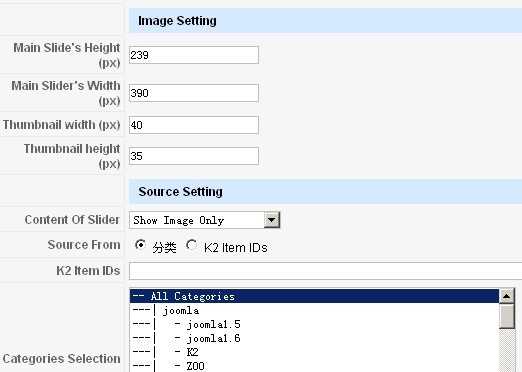

# 分享K2的幻灯片模块Lof K2 SlideShow Module，类似ja_rasite模板首页的效果

本站首页的幻灯片模块，有很多朋友在问，今天分享出来！

首先站点内容是基于K2的内容管理，所以幻灯片就只能用K2特定的一些模块，演示：[Lof K2 SlideShow Module](http://landofcoder.com/demo/joomla15x/k2-slideshow.html)

模块下载：[点我就下载](http://www.joomla178.com/download/modules/file/18-lof-slideshow-for-k2.html)

---

除特殊标明文章转自第三方网站，文章均由JOOMLASK.COM原创提供  
欢迎友情转载，请务必保留本文出处并引用本文链接： [分享K2的幻灯片模块Lof K2 SlideShow Module，类似ja\_rasite模板首页的效果](http://www.joomla178.com/joomla-share/research-and-development/145.html)
