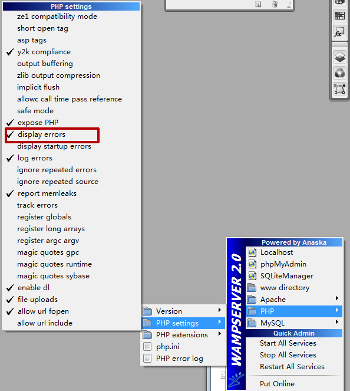

# 关闭Display errors解决Joomla某些代码错误提示

这里的解决方案只是排除“组件、插件、模板、模块等源代码没有错误编写”的情况

或许在安装过程，或是设置过程等等多种情况下，碰到一些代码提示错误 xxx/xxxx/xxx/xxxx/xxx.php on line yyy，还是那句话，排除程序无错的情况下，尝试关闭PHP的Display errors，会解决一些不必要的问题，但这方法不是万能的！其实为什么关闭PHP的Display errors,就会解决呢，不知道怎么解释，经验告诉我，这在某些情况下是可行的。

这里主要是告诉大家解决办法

修改php.ini配置文件，最直接有效，但是，修改前要备份

打开php.ini，找到代码display\_errors = On

改成display\_errors = Off 即可。另外可能很多朋友在用wamp本地服务端，图解关闭wamp中的display errors

下图，红圈处，不勾选display errors

另外，强调的是，在交流过程中，有的新手朋友安装了joomla1.0的一些模板，会有提示模板文件错误，再次提醒，安装joomla1.0相关东西的时候请开启joomla1.5的兼容模式

开启办法：*joomla*后台管理扩展——>插件管理--启用System - Legacy

---

除特殊标明文章转自第三方网站，文章均由JOOMLASK.COM原创提供  
欢迎友情转载，请务必保留本文出处并引用本文链接： [关闭Display errors解决Joomla某些代码错误提示](http://www.joomla178.com/joomla-share/research-and-development/153.html)
