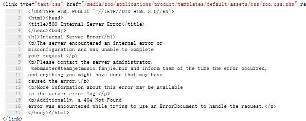

# ZOO布局突然无故混乱

ZOO在使用了部分应用（模板）之后，在本地测试该应用（模板）前台显示均正常，而打包上传至服务器之后，前端布局无故混乱。  
出现这个问题，首先就要考虑CSS是否被丢失！不要慌乱的去查找ZOO的配置问题，在火狐的Firebug插件帮助下，查到该CSS文件的位置

/media/zoo/applications/product/templates/default/assets/css/zoo.css.php  
但firebug显示出500 internal server error，如下图  
   
当然出现这个问题不要紧张，Joomla的media目录默认访问权限是有限的，在FTP等工具，将media目录权限改为755即可（注意包括子目录，如果是WINSCP 目录属性最下面有个复选框“循环设定组，拥有者和权限”， 勾上后子，子目录和父目录就是一样的属性了），如果media已经是755权限，将zoo.css.php权限改成644

---

除特殊标明文章转自第三方网站，文章均由JOOMLASK.COM原创提供  
欢迎友情转载，请务必保留本文出处并引用本文链接： [ZOO布局突然无故混乱](http://www.joomla178.com/joomla-share/research-and-development/173.html)
