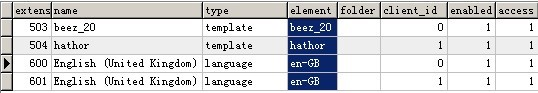

# Joomla1.6官方中文语言包无法安装临时解决方案

Joomla控们迫不及待地体验了joomla1.6，但是发现从Joomla官方下载的中文语言包无法安装！通常情况下，将zh-CN-site下的语言文件复制到language\zh-CN\，zh-CN-admin下的文件复制到administrator\language\zh-CN\下，后台刷新即可看到语言选项，唯独这次正式版却不曾看见。现发布一个临时解决方案

打开joomla1.6的数据表找到jos\_extensions表，拉到600多条记录会发现有en-GB的记录，如下图  
   
  
依葫芦画瓢，在下面添加新记录为  
   
  
刷新后台便可看到中文选项，client\_id字段是设定前台后台之分！  
此方案非官方给出，仅供参考

---

除特殊标明文章转自第三方网站，文章均由JOOMLASK.COM原创提供  
欢迎友情转载，请务必保留本文出处并引用本文链接： [Joomla1.6官方中文语言包无法安装临时解决方案](http://www.joomla178.com/joomla-share/research-and-development/174.html)
