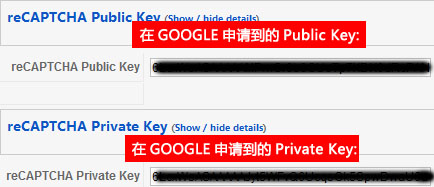
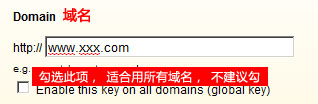
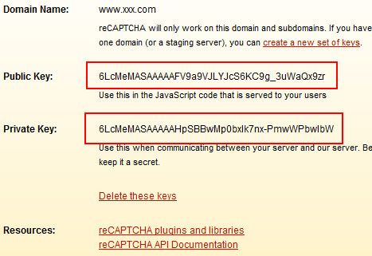
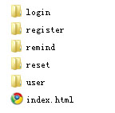

# JEZ reCAPTCHA 谷歌验证码插件及使用方法

基于谷歌的Joomla验证码插件主要是FC reCAPTCHA和JEZ reCAPTCHA，前者与部分模板不兼容，不作细述！  
由于作者没有开发语言文件，帮暂时不提供中简体中文版。 插件下载：[JEZ\_reCAPTCHA](http://www.joomlaez.com/downloads/doc_download/8-jez-recaptcha-integrator-v100.html)

安装成功之后，进入插件页面，右侧见如下图

   
那么这两个KEY是要到GOOGLE 那去申请：<https://www.google.com/recaptcha/admin/create>

  
点击Creat Key，创建成功后即如下图，请妥善保管：  
  
  
将上图所得两个Key分别填入图1中的JEZ reCAPTCHA控制台。  
 **完成这些步骤之后，还需要将官方给定代码插入到指定位置，从控制台可以看出**

Inclusion Syntax和Auto-verify两种配选方案  
  
1、Inclusion Syntax 插入式语法，在该项启用的情况下，可在文章、自定义模块中插入{captcha}来实现，若Inclusion Syntax未启用，那么需要在对应的扩展中添加如下代码（该项尝试未果，不推荐此种方法）

global $mainframe; $mainframe->triggerEvent('onCaptchaDisplay');

2、Auto-verify如果此项选择开启，那么其它相关的reCAPTCHA可能会受到影响，比如K2的reCAPTCHA留言功能，会和JEZ reCAPTCHA冲突，不建议开启此项。选择关闭Auto-verify，就需要手动在注册页面添加代码

global $mainframe;  
$mainframe->triggerEvent('onCaptchaConfirm');

3、那么，最终圈定关闭auto-verify的情况下，以修改注册页为例，找到文件夹  
\components\com\_user\views   
复制其下的所有文件夹、文件  
   
4、粘贴至\templates\xxxx\html\com\_user\ 目录下  
**注：通常情况下，模板开发商已有\templates\xxxx\html\com\_user\该目录，就不用执行上述复制文件操作，跳过第3、4步（此举是保护核心文件不改变）**  
5、打开文件 \templates\xxxx\html\com\_user\register\default.php，找到代码：

<button class="button validate" type="submit"></button>，

在此行代码前面的

<fieldset>....</fieldset>  
  
  

之间插入下述代码：

<?php global $mainframe;  
$mainframe->triggerEvent('onCaptchaConfirm');?>

6、所有操作代码均保存为utf-8编码，由于google给定的key是针对域名，不建议本地环境中操作。  
7、如需改变输入验证码错误后的英文提示，请至文件\plugins\system\jezReCaptcha\helper.php中修改The captcha wasn't entered correctly. reCAPTCHA said为中文，一定要保存为utf-8，否则乱码  
8、其它诸如登陆修改方法同注册。

---

除特殊标明文章转自第三方网站，文章均由JOOMLASK.COM原创提供  
欢迎友情转载，请务必保留本文出处并引用本文链接： [JEZ reCAPTCHA 谷歌验证码插件及使用方法](http://www.joomla178.com/joomla-share/research-and-development/176.html)
