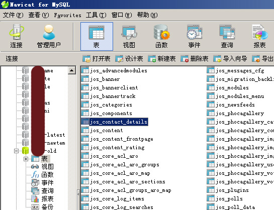

# Navicat 9.0.10专业MYSQL数据库软件

不错的软件，可以像access、SQLSERVER一样操作，简单好用，可执行SQL语句，大批量数据添加、更新、备份好用工具。

Navicat 9.0.10中文版下载地址：[迅雷下载](thunder://QUFodHRwOi8veGlhemFpLnhpYXphaWJhLmNvbS9Tb2Z0L04vTmF2aWNhdF9mb3JfTXlTUUxfOS4wLjEwX1hpYVphaUJhLmV4ZVpa)

Navicat 9.0.10中文破解补丁下载：[下载](http://wap.winzheng.com/soft/view-46156.html) （注意，该破解补丁亲测无毒，但360等软件均提示为木马病毒）

---

除特殊标明文章转自第三方网站，文章均由JOOMLASK.COM原创提供  
欢迎友情转载，请务必保留本文出处并引用本文链接： [Navicat 9.0.10专业MYSQL数据库软件](http://www.joomla178.com/joomla-share/research-and-development/85.html)
