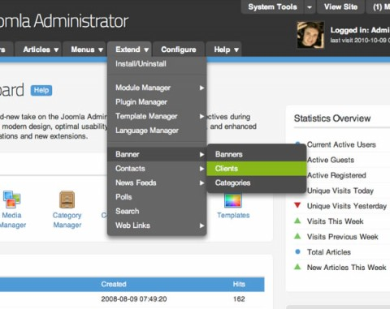

# 免费精美的Joomla! 2.5后台模板-MissionControl

Multithumb found errors on this page:  
  
There was a problem loading image http://www.cn4jd.com/sites/default/files/styles/large/public/field/postimage/mc-login.jpg  
There was a problem loading image http://www.cn4jd.com/sites/default/files/styles/large/public/field/postimage/mc-article-edit-1.jpg  
There was a problem loading image http://www.cn4jd.com/sites/default/files/styles/large/public/field/postimage/mc-article-manager\_0.jpg

这是一款来自[RocketTheme](http://www.rockettheme.com/) 的joomla2.5后台模板，JD译站曾使用过一段时间，界面十分酷且实用，像后台登陆界面，登录时间倒计时，快速清除缓存，文本编辑器快速切换等等的一些功能，让人记忆犹新，如果你还在使用系统默认的后台模板，为什么不尝试下这款后台模板呢？

**主要特色**：支持joomla 2.5；自定义菜单功能；可以自定义logo；基于Ajax的编辑器转换；新的文章预览功能；支持Firefox, Safari, Chrome, Opera, IE7+等浏览器

下载地址：

### [MissionControl Admin Template J2.5](http://www.rockettheme.com/joomla-downloads/free/missioncontrol/2566-missioncontrol-admin-template-j2/download)

JD译站也打算找个时间把它汉化，分享给大家，敬请期待！

文章来自：<http://www.cn4jd.com/joomla-2.5-admin-template-missioncontrol>

---

除特殊标明文章转自第三方网站，文章均由JOOMLASK.COM原创提供  
欢迎友情转载，请务必保留本文出处并引用本文链接： [免费精美的Joomla! 2.5后台模板-MissionControl](http://www.joomla178.com/joomla-share/research-and-development/best-backend-template-for-joomla25.html)
