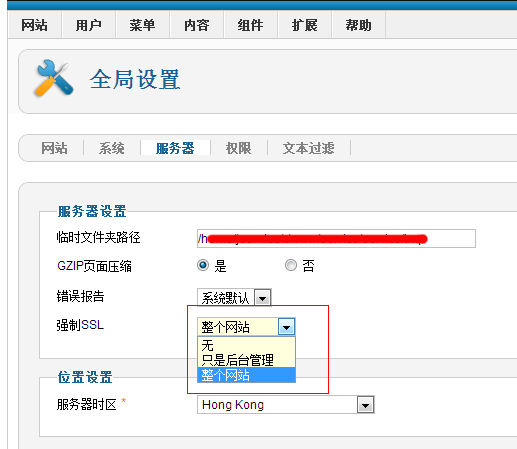

# Joomla!开启SSL浏览及出现的问题

### 数字证书？

SSL是指安全套接层协议层（以及传输层协议TLS）是目前使用最广泛的安全协议。通俗点就是用户通过浏览器安全浏览网站时（即https://）显示出的小锁图标，可得知目前正使用SSL传输，如果使用了更先进的EV SSL，除显示小锁图标外，浏览器的地址栏也会变成绿色，这是用户的直观体验。

大多数情况下，电子商务类的网站都会有安装SSL证书，如果用户用了信用卡支付，就不会在传输数据过程中被黑客窃取信用卡等信息，而且先进的SSL证书也会验证网站服务商的企业名称。现在国内大多数电子商务网站都有安装SSL证书，例如淘宝、支付宝、5173交易平台、京东商城等等。

由于SSL数字证书需要捆绑独立IP，所以大多用户在购买虚拟主机时都会买一个SSL数字证书得以获得一个独立IP，这是除SSL证书外的第二个用途。

### **Joomla!开启SSL安全浏览，及开启后遇到的问题**

登入后台，进入“网站”-“全局配置”-“服务器”选项卡中，看到如下图其中的“强制SSL”根据所需，如果只是希望管理员后台安全登入，选择“只是后台管理”，如果希望全站都是安全访问，就选择“整个网站”。确定之后保存测试浏览，JOOMLA会自动将所有http://链接方式变为https://。

那么用https://预览前台后有两个问题：

1、如果网站并未针对网站子域名安装绑定SSL证书，如https://www.Joomla178.com，那么浏览器会弹出安全警告，如果强制浏览，浏览器中的小锁或者地址栏是红色（黑色），而不是安全的绿色，所以未安装绑定SSL证书通常不建议开启SSL安全浏览。

2、如果网站针对子域名安装绑定了SSL证书，如https://www.Joomla178.com，然后浏览网站是正常，但是有时候小锁是灰色的，这是因为网站里面还有很多所谓的“不安全链接”，例如网站友情链接到它站的时候，它站的地址是http://，当然还有一些图片的链接，尽量都有网站根目录方式，包括内链接等都要认真仔细排查！

---

除特殊标明文章转自第三方网站，文章均由JOOMLASK.COM原创提供  
欢迎友情转载，请务必保留本文出处并引用本文链接： [Joomla!开启SSL浏览及出现的问题](http://www.joomla178.com/joomla-share/research-and-development/browser-as-ssl-on-joomla.html)
