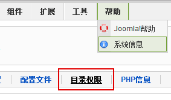
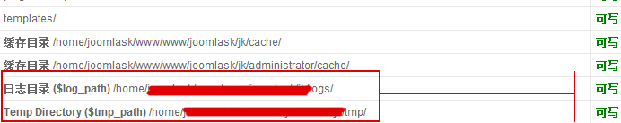

# Could not create directory 解决方案

Joomla在迁移网站后，或者更改网站目录后，安装文件的时候会提示这样一条错误信息Could not create directory，第一时间可能大家会觉得这是目录权限问题，而大家都肯定是目录权限正确无误！问题确实是权限问题，但不是需要安装的扩展目录，如component、module、plugin的目录权限问题，主要是因为在迁移目录之后，记录日志的目录logs 和临时目录tmp权限受限。**（原创文章转载请标明出处，请引用本文地址）**

如下图，选择“帮助->系统信息”，查看选项卡的“目录权限”



完了拉到底部有两条关于目录logs 、tmp的权限提醒，正常情况下是如图显示“可写”，当然错误的情况下就是“不可写”



而且图中提示的“日志目录”和“Temp Directory”后面是有路径的，当“不可写”的时候，这个路径就说明是错误的。由于网站迁移，管理员大多数并未重新配置configration.php文件，所以问题还是在配置文件中，打开configration.php，找到代码 ：

```
var $log_path = '/home/www/logs/';var $tmp_path = '/home/www/tmp';
```

将隐号中的目录填写成你网站所在的/path/logs/和/path/tmp/ 这个path是空间的绝对路径，所以必须填写准确，然后保存文件，再回到后台的“目录”权限中检查是否正常。

所以总结下来，它其实就是目录权限的问题，因为错误的目录情况下，这个目录并不存在，固然也就是“不可写”了！

---

除特殊标明文章转自第三方网站，文章均由JOOMLASK.COM原创提供  
欢迎友情转载，请务必保留本文出处并引用本文链接： [Could not create directory 解决方案](http://www.joomla178.com/joomla-share/research-and-development/could-not-create-directory-solved.html)
