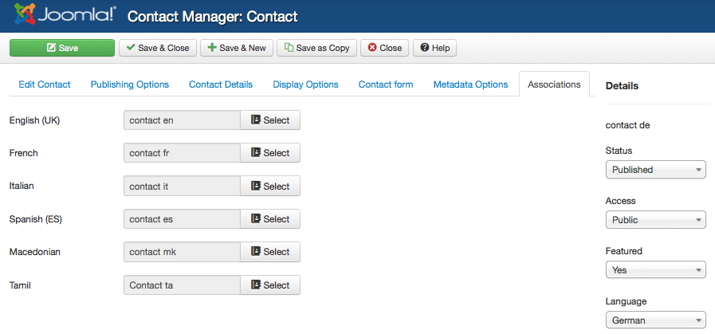
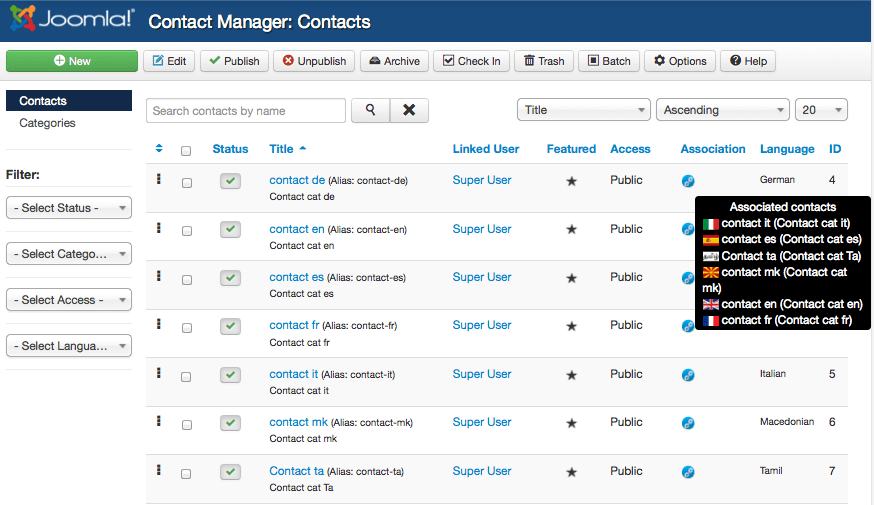
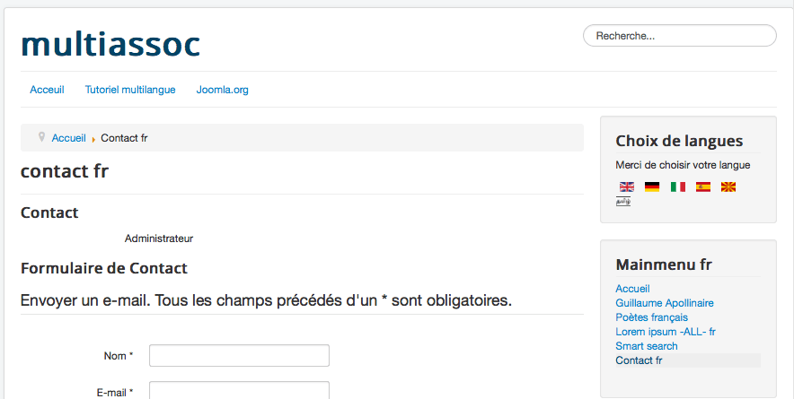
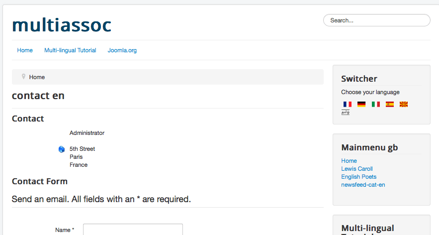
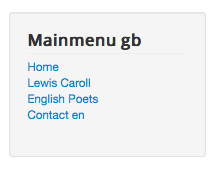

# Joomla! 3新特性 - 扩展的多语言及快捷筛选器功能

Multithumb found errors on this page:  
  
There was a problem loading image http://community.joomla.org/images/translationteams/assoc\_2\_contacts\_single.png  
There was a problem loading image http://community.joomla.org/images/translationteams/assoc\_3.png  
There was a problem loading image http://community.joomla.org/images/translationteams/assoc\_4\_contact-fr.png  
There was a problem loading image http://community.joomla.org/images/translationteams/assoc\_5\_contact-en.png  
There was a problem loading image http://community.joomla.org/images/translationteams/assoc\_6\_contact-en-menu.png

在[Joomla! 3.0.2更新发布](http://www.Joomla178.com/news/10-joomla-news/467-joomla302-security-release.html)的时候，我们的版本有了一个新特性，文章的语言关联筛选功能，详情参考：**[Joomla! 语言快捷筛选器使用教程»»](joomla-language-quick-set-info.md)**

**Benjamin Trenkle在Joomla! 3.0.3的版本中完成了对所有的**核心扩展分类、联系我们项目中、新闻订阅、友情链接等扩展的多语言支语多言快捷筛选器的支持。

以联系我们扩展为示例：

1. 打开扩展-联系我们，会发现一个新的选项卡“Associations”，这个就是我们要说的[快捷筛选](joomla-language-quick-set-info.md)功能，如图中可以选择联系我们项目的对应语言。

2. 当然回到联系我们项目列表中，也会发现每行项目都有一个小地球供点击选择即可快速的指定语言类别。

3. 前台仍然以法语为示例，在前台我们看到'Contact fr' 显示出来了，如果开启了伪静态的话，以这个地址浏览：**Joomla178.com/fr/contact-fr.html**

4. 但是此时如果你没有建立一个指向英文联系我们的菜单的话，点击右侧英语旗帜会显示这个链接**Joomla178****.com/en/component/contact/contact/15-contact-cat-en/1-contact-en.html?Itemid=103**所以为了SEO优化，请老老实实建立好每个对应菜单。

5. 反之如果建立了对应的英文菜单，那么链接自然是：**Joomla178****.com/en/contact-en.html**

6. 总结一下

这项功能总归是为了用户的便利操作，在以后的版本中[Joomla!](http://www.Joomla178.com/) 只会显得越来越人性化。

---

除特殊标明文章转自第三方网站，文章均由JOOMLASK.COM原创提供  
欢迎友情转载，请务必保留本文出处并引用本文链接： [Joomla! 3新特性 - 扩展的多语言及快捷筛选器功能](http://www.joomla178.com/joomla-share/research-and-development/extension-of-items-associations-to-remaining-core-components.html)
