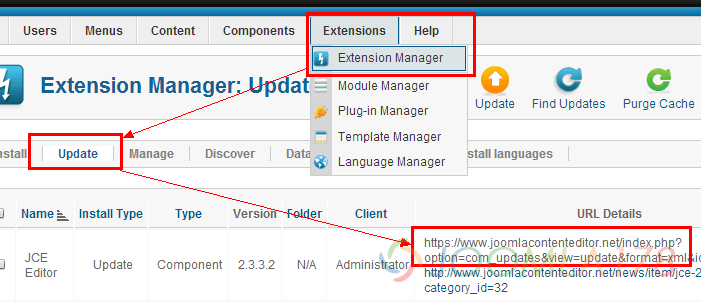
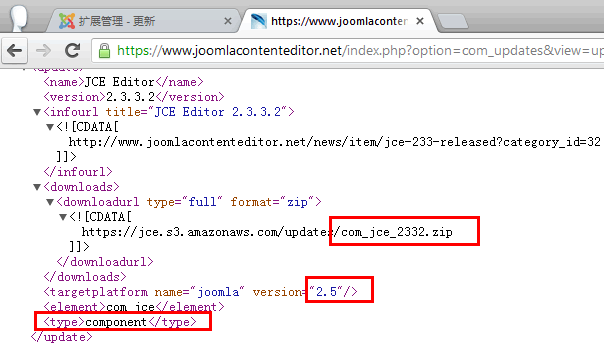

# Joomla!后台更新失败解决办法

我们都知道Joomla! 2.5推出了[一键更新](joomla-one-click-updates.md)，还有扩展能够直接后台更新 ，但是我们总会遇到不同的更新不了，或者没反应之类的错误，分析一下基本上是两个原因，一来是本地环境，二来是更新服务器“挂了”（有的内地无法访问，有的是网络超时）。

新的2.5架构下，扩展开发者提供了一个更新服务器，用来在线更新补丁，避免新版本发布后繁琐于更新的工作上，在线更新固然方便，总会碰到上面说的问题，所以我们以JCE编辑器为例讲讲在线更新的技巧。

打开后台 - 扩展 - 扩展管理 - 选择“更新”选项卡，看到了我们的JCE扩展是等待更新状态。



注意到后面“URL 细节” 特指该扩展的xml更新配置文件，如果在本地测试服务器无法更新，或者正式服务器请求超时之类的错误，亦或是开发者的配置文件错误，我们都尝试打开结尾是xml的URL链接。

如上图中第三块，链接为：https://www.joomlacontenteditor.net/index.php?option=com\_updates&view=update&format=xml&id=1/extension.xml

打开链接，我们看到有类似下图中的代码，例如下载链接、Joomla!版本号、扩展的类型。



所以我们根据Joomla!对应的版本号，尝试下载对应的链接，手动再进行更新安装，我们再看看这个配置文件，也利于咱们开发者以后学习开发，代码如下：

```
<update>	<name>JCE Editor</name><!--扩展名称-->	<version>2.3.3.2</version><!--扩展版本-->	<infourl title="JCE Editor 2.3.3.2"><!--扩展地址-->		<![CDATA[			http://www.joomlacontenteditor.net/news/item/jce-233-released?category_id=32		]]>	</infourl>	<downloads><!--扩展下载地址-->		<downloadurl type="full" format="zip">			<![CDATA[				https://jce.s3.amazonaws.com/updates/com_jce_2332.zip			]]>		</downloadurl>	</downloads>	<targetplatform name="joomla" version="2.5"/><!--扩展适用的Joomla!版本-->	<element>com_jce</element><!--扩展元素名-->	<type>component</type><!--扩展类型--></update>
```

大多扩展目前均支持此类方法手动更新，也算不上教程，给碰上困难的人用吧！

---

除特殊标明文章转自第三方网站，文章均由JOOMLASK.COM原创提供  
欢迎友情转载，请务必保留本文出处并引用本文链接： [Joomla!后台更新失败解决办法](http://www.joomla178.com/joomla-share/research-and-development/failed-to-update-joomla-extensions.html)
