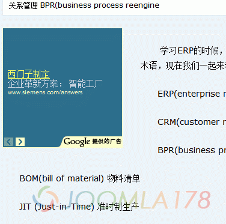
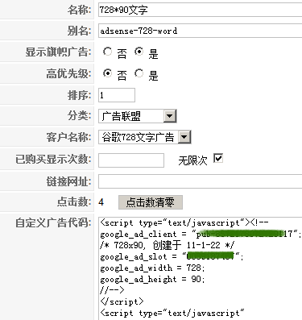

# 教你在Joomla正文中插入google广告、图片广告

如上图，下面我们讲解如何在Joomla文章内容页面添加广告。先了解一下关于Joomla的旗帜广告，即Joomla默认Banners组件，下面即称“旗帜广告”，如果做的广告不需要做数据统计的话，Joomla的旗帜广告组件基本上可以胜任广告管理。**（原创文章转载请标明出处，请引用本文地址）**

首先需要在旗帜广告管理中创建一个新的分类：**组件(Components)->旗帜广告(Banner)->广告分类(categories)**，这个过程比较简单，跟着需要创建“客户(client)”来区分广告客户类别，**组件(Components)->旗帜广告(Banner)->客户(Client)**，创建新的客户类别，Client Name、Contact Name、Contact E-mail将此三项填写准确。

然后我们就可以创建一个广告内容了，**组件(Components)->旗帜广告(Banner)->广告管理(Banners)**，创建一个新的广告，下图以插入谷歌Adense的JS广告为例，选择分类以及客户类别（除了可以插CODE广告外，还可以插入图片广告，插入图片广告比较简单，在下方选择“设置广告图片（Banner Image Selector），不作多讲）

最后，在前面的准备工作完成了之后，需要在网站的文章位置显示该广告，也就是模块！扩展(extensions)->模块管理(modules)->创建模块(new)->旗帜广告(mod\_banners)，选择窗口打开方式、广告客户、广告类别等！当然如果想把这个广告显示在模板中的指定位置倒是很简单，选择位置(position)即可

这时候先不要急着保存，因为我们要插入到文章中，上面最后一步我们是创建了一个旗帜广告(banners)模块，现在就需要在文章中创建一个广告位置！其实原理就是在文章中展示个模块，说到这就相当于结束了，剩下的就要了解一下**[Joomla文章中插入模块实现方法](joomla-article-insert-module.md)**

---

除特殊标明文章转自第三方网站，文章均由JOOMLASK.COM原创提供  
欢迎友情转载，请务必保留本文出处并引用本文链接： [教你在Joomla正文中插入google广告、图片广告](http://www.joomla178.com/joomla-share/research-and-development/get-how-to-creat-ads-and-google-adsense.html)
