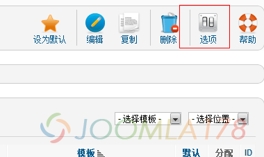
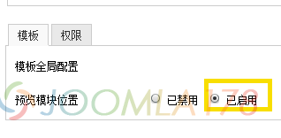

# 查看Joomla! 2.5模板的模块位置

在Joomla! 1.5.x时代，我们知道在网址后面加 /?tp=1 即可查看模板的模块位置，然后在1.6,1.7到现在的正式版Joomla! 2.5.x时代，这个用法失效啦，其实不然，只是在Joomla! 2.5.x中出于安全考虑，开发者们增加了一个新的开关显示模块功能。

这个开关开启很简单，一看便知，轻松两小步。

STEP1 进入“扩展”-“模板管理”-右上角“选项”

STEP2 看到下图，启用即可

然后什么保存、清空缓存前台测试  <http://www.Joomla178.com/?tp=>1 就可以啦！就是域名后面 /?tp=1

---

除特殊标明文章转自第三方网站，文章均由JOOMLASK.COM原创提供  
欢迎友情转载，请务必保留本文出处并引用本文链接： [查看Joomla! 2.5模板的模块位置](http://www.joomla178.com/joomla-share/research-and-development/how-to-view-module-position-on-joomla25.html)
