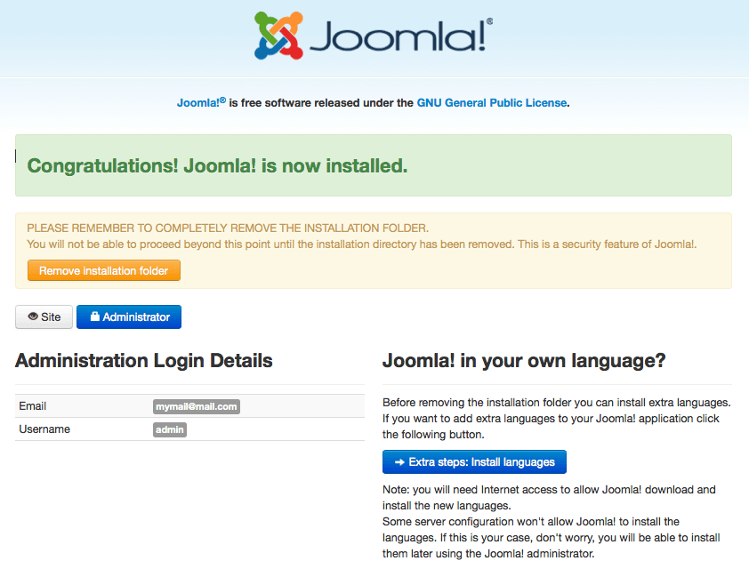
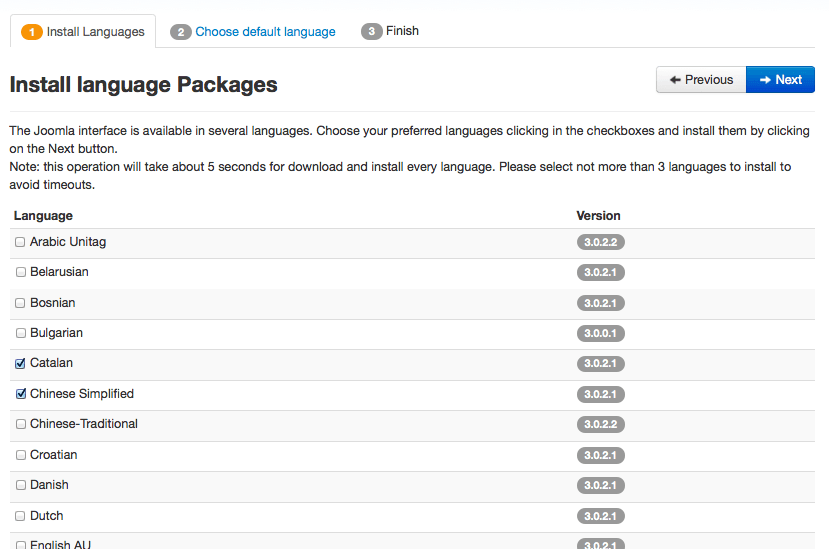
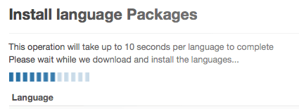
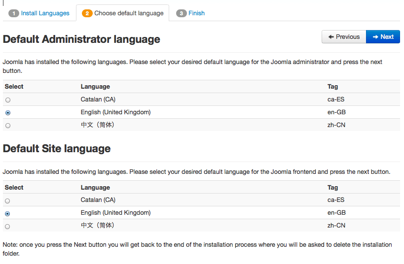
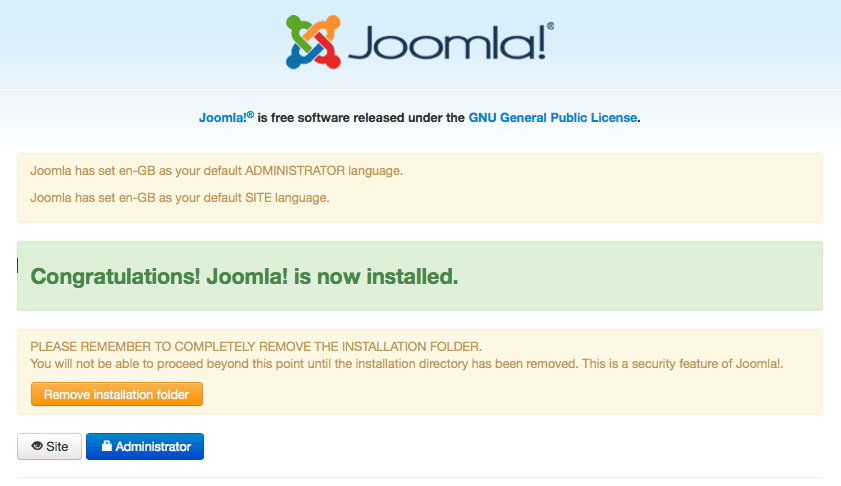

# Joomla! 3新特性 - 安装Joomla时同步在线安装语言包

Multithumb found errors on this page:  
  
There was a problem loading image http://community.joomla.org/images/translationteams/install\_step1.png  
There was a problem loading image http://community.joomla.org/images/translationteams/install\_step2.png  
There was a problem loading image http://community.joomla.org/images/translationteams/install\_step3.png  
There was a problem loading image http://community.joomla.org/images/translationteams/install\_step4.png  
There was a problem loading image http://community.joomla.org/images/translationteams/install\_step5.png

自从Joomla! 2.5.7更新之后，Joomla! 中新增了一项在线更新功能，当然也包括了语言包在线安装、更新的功能，那么现在我们又将在语言包在线安装、更新功能添加到了安装Joomla! 主程序的过程中，具体如下

1. 在安装Joomla! 主程序最后一步时，会有一个新的选择：在线安装语言包

2. 如后台一样会显示所有官方认证的语言包，不同寻常地是官方此次出的解释是以简体中文为示例，在清单中选择你想要的语言包进行安装，如下图

*Note 1:* 如果DIY了语言包的话，可能会有冲突的哦  
 *Note 2:* 当然你当前使用的安装程序，对应的语言包只是当前的版本，比如Joomla! 3.0.3，所以如果翻译团队对语言包做了更新，那么还需要您在后台进行更新安装，如何更新安装语言包请参考：[Joomla 1.7升级至2.5，1.7模板可直接使用](joomla17-update-to-joomla25.md)

3. 此时会有一个进度条显示您正在下载Joomla! 语言包哦

4. 这个时候您可以选择哪个语种为默认的后台语言

5. 就这样安装完成了，像以前一样删除installation文件夹

---

除特殊标明文章转自第三方网站，文章均由JOOMLASK.COM原创提供  
欢迎友情转载，请务必保留本文出处并引用本文链接： [Joomla! 3新特性 - 安装Joomla时同步在线安装语言包](http://www.joomla178.com/joomla-share/research-and-development/installation-of-language-packs-when-installing-joomla.html)
