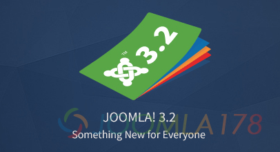
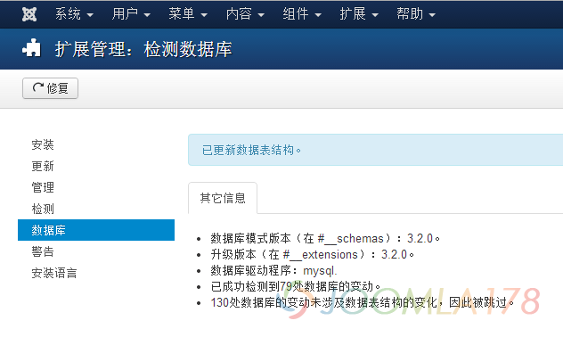
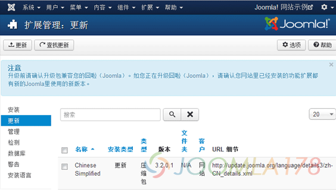
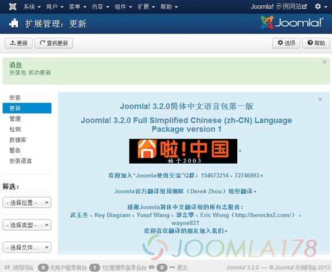
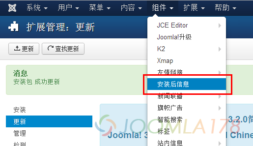
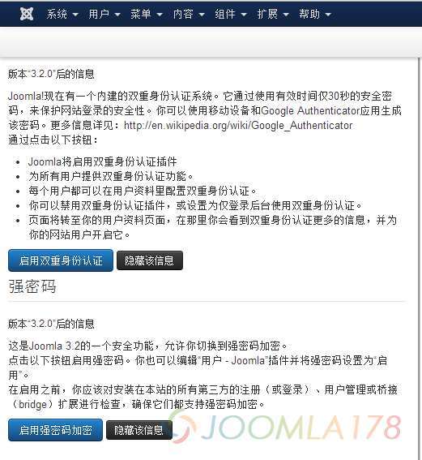
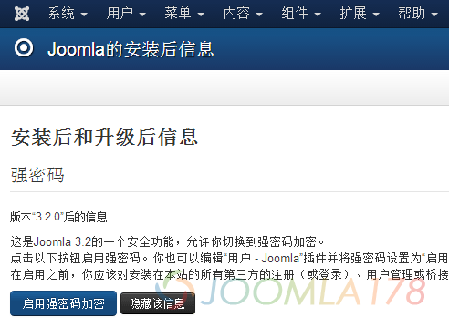
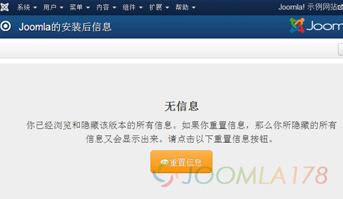

# Joomla! 3.1.x升级至Joomla! 3.2后网站崩溃及其它问题

早先Joomla!官方团队隆重[**发布了全新的Joomla! 3.2.0正式版**](http://www.joomla178.com/news/joomla-news/610-joomla-3-2-0-stable-released.html)，升级自然是大家关心的问题，当然我们知道Joomla!在2代时已添加一键升级功能，参考：[领略强大的Joomla!一键更新](joomla-one-click-updates.md)，不过小编还是给大家带来一篇由Joomla! 3.1.x升级到Joomla! 3.2.0正式版的教学

当然网站是Joomla! 3.1.x的用户会在后台首页看到提示，或者参考[领略强大的Joomla!一键更新](joomla-one-click-updates.md)文中的升级说明，进入升级界面

**补充一下，升级过程中遇到的问题**

本地环境的用户一般会遇到无法下载、或者本地环境权限不够写入的事情，所以我们建议先把[更新补丁包](http://joomlacode.org/gf/project/joomla/frs/?action=FrsReleaseBrowse&frs_package_id=6783)下载到 /tmp/目录下，然后再执行[Joomla!一键更新](joomla-one-click-updates.md)，这样就会很顺利，此法百错百解

服务器环境如果也遇到报错，通常也是写入权限问题，一般建议检查网站设置的临时目录是否为tmp，或者该目录有无写入权限

**升级完成后我们还要做一些工作**

**第一步、修复数据库**

进入 扩展 - 扩展管理 - 选择“数据库”选项卡，再点击“修复”，如下图，直到提示“已更新数据表结构”

**第二步、升级简体中文语言包**

进入 扩展 - 扩展管理 - 选择“更新”选项卡，通常我们会收到Chinese Simplified 简体中文包的更新提示，如果没有收到，请参考：[领略强大的Joomla!一键更新](joomla-one-click-updates.md)，如下图，我们勾选“Chinese Simplified”选项，再点击上面的“更新”，等待即可

更新完成后提示汉化团队的介绍，如下图

**第三步、查看“安装后信息”**

进入 组件 - 安装后信息

即可看到官方团队给出的两条最重要的消息，分别是“双重身份验证”和“强密码”两项，可以从中看出这是为了加强安全性，小编都启用

再次启用“强密码”

提示是否重置“安装后信息”，汉化团队翻译的很容易理解，小编不再需要重置信息

**第四步、开启“Joomla!3.2扩展库应用市场”**

我们知道，这次更新其中有一点非常值得关注，就是将原来我们艰幸地找扩展变成容易的下载扩展，就像手机应用市场那样！所以这个功能应该说是Joomla!一个时代的标志吧，具体关于“Joomla!3.2扩展库应用市场”的使用方法，请参考：“[Joomla!3.2扩展库应用市场亲测体验](joomla-3-2-0-extensions-app-store-test.md)”

完成这些，我们就可以完整的使用全新的Joomla! 3.2.0 CMS

---

除特殊标明文章转自第三方网站，文章均由JOOMLASK.COM原创提供  
欢迎友情转载，请务必保留本文出处并引用本文链接： [Joomla! 3.1.x升级至Joomla! 3.2后网站崩溃及其它问题](http://www.joomla178.com/joomla-share/research-and-development/joomla-3-1-x-update-joomla-3-2-0.html)
