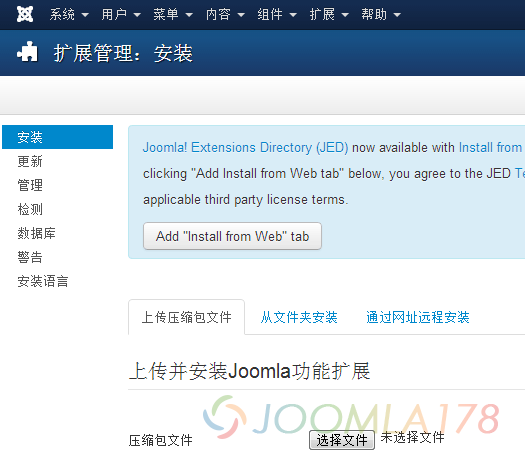
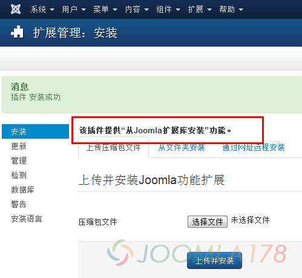
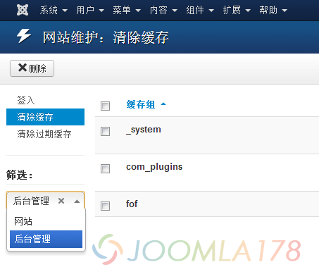
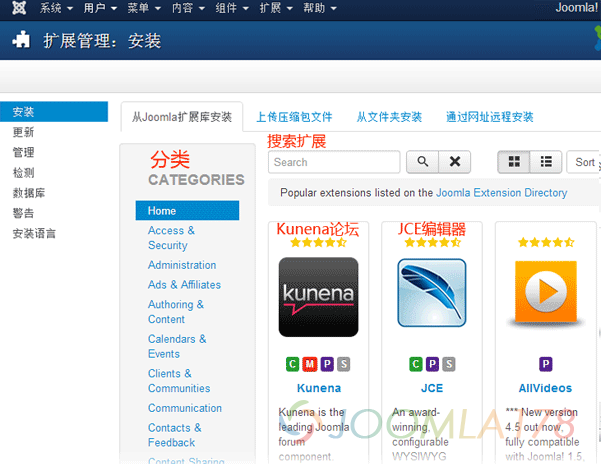
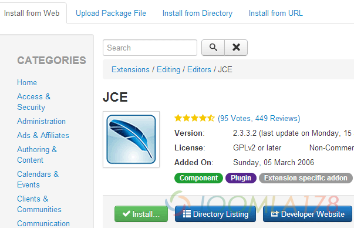
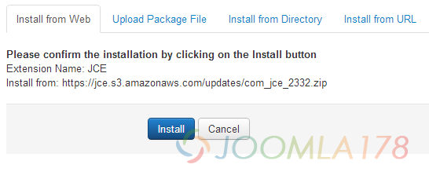
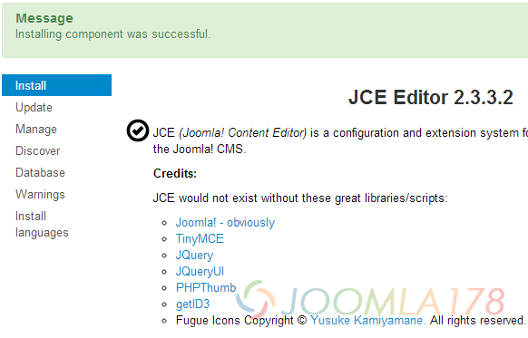
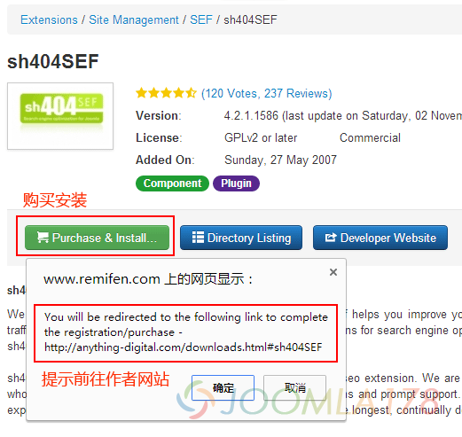

# Joomla! 3.2 扩展库应用市场亲测体验

在刚刚过去的11月6日，[**Joomla!发布了全新的Joomla! 3.2.0正式版**](http://www.joomla178.com/news/joomla-news/610-joomla-3-2-0-stable-released.html)，其中有一个令人耳目一新的新功能，就是Joomla! 扩展库应用市场 - Joomla! Extensions Directory (JED)，这就意味着你可以像下载手机应用那样，给你的网站安装Joomla! 扩展库应用市场提供的扩展，下面小编带着大家亲自体验一下这个新特色

刚刚升级过后在扩展 - 扩展管理中，小编发现，后台在简体中文下可以看到一行新的提示：Joomla! Extensions Directory (JED) now available with Install from Web on this page. By clicking "Add Install from Web tab" below, you agree to the JED Terms of Service and all applicable third party license terms.，意思为Joomla! 扩展应用市场(JED)正式开放，并且在扩展安装界面可以显示，点击下方“Add Install from Web tab”按钮，不过得同意第三方授权条款，如下图

点击之后，说明该功能安装成功，当然还可以在插件中找到最新的插件：安装器 - 从Joomla扩展库安装(Installer - Install from Web)，并开启该插件，不过小编操作之后下方并未有变化，如图

当然放心这不是因为简体中文语言包的问题，细心查找发现了原来是小编开启了插件缓存(System-cache)的原因，关于缓存的详细介绍，请参考[**Joomla! 缓存的合理利用最大化网站效率**](joomla-cache-more-information.md)，回到正题，那么其实后台的模块也会有缓存，所以这个时候我们清除一下后台的缓存就可以了，如下图，找到缓存管理、选择后台管理，全选删除缓存即可

然后我们再回到 扩展 - 扩展管理，这个时候我们看到一个全新的选项卡“从Joomla扩展库安装”，这个就是Joomla! 3.2最具意义的新功能

图上我们也能看到Joomla! 扩展库应用市场中仍然是英文为主，左边分类、右边上面是搜索扩展名，下面就是扩展的清单，比如第一个是kunena论坛，第二个是JCE编辑器，我们这里以JCE编辑器安装为示例，点击JCE扩展，进入之后如下图

点击上图中的Install...安装按钮，看到下图的提示界面，继续点击下图中Install安装按钮

因为JCE是免费扩展，所以这里我们安装没有任何特别的提示，稍等一会之后，我们看到JCE安装成功提示Installing component was successfull，表示组件安装成功

上面我们举的是免费扩展的例子，但是收费扩展就不是那么容易了，我们在扩展库中找到sh404SEF扩展，会看到原有的Installing变成了Purchase & Install...，表示该扩展需要付费购买安装，点击之后也会弹出提醒前往作者网站下载，如下图

好啦，我们可以看到这个Joomla! 扩展库应用市场在未来会变的很强大，甚至会是一个很成熟的生态市场，让我们期待吧

---

除特殊标明文章转自第三方网站，文章均由JOOMLASK.COM原创提供  
欢迎友情转载，请务必保留本文出处并引用本文链接： [Joomla! 3.2 扩展库应用市场亲测体验](http://www.joomla178.com/joomla-share/research-and-development/joomla-3-2-0-extensions-app-store-test.html)
