# Joomla! 3 中的内容版本控制详解

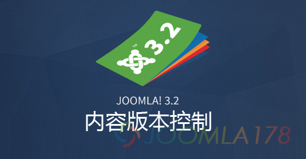

在Joomla! 3.2以前，Joomla!的内容管理和大多数CMS一样，保存之后的内容就是最新的了，如果想恢复恐怕只能在找sql备份了，不过在Joomla! 3.2中纳入了如同SVN一样的版本控制管理，简单来说，文章如果被有意或无意的修改后，仍然能恢复到之间的版本。这就是Joomla! 3.2中的新特性，其它相关的特性请参考：[**Joomla! 3.2.0正式版发布 一个全新的CMS**](http://www.joomla178.com/cn/news/joomla-news/610-joomla-3-2-0-stable-released.html)

### 文章的版本控制示例

1、前往 内容 - 文章管理

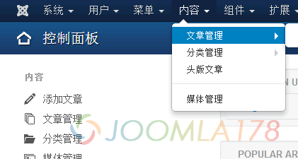

2、点击“选项”确认一下是否开启“版本控制（保存历史）”，还有版本的最大数量（保存最近多少个版本）

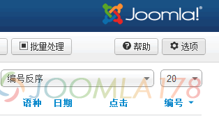

3、进入之后点击“编辑页面的布局”选项卡，查看如下截图处，如果“保存历史”项是“否”的话，请点击“是”，下面“版本的最大数量”默认是保存最近的10个版本，可修改为期望的数值，当然理论上数量越大，占的数据库空间越大，所以建议保存为最近的5个版本，设置完成后，点击最上面的“保存”。

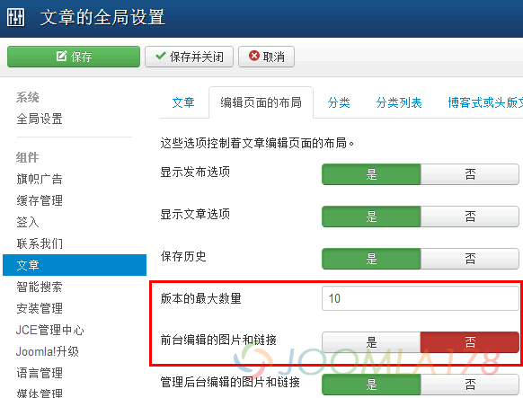

4、以文章“Joomla! 3.2.2发布更新”为示例，进入之后对内容做微调修改，比如我们示例修改了图片。

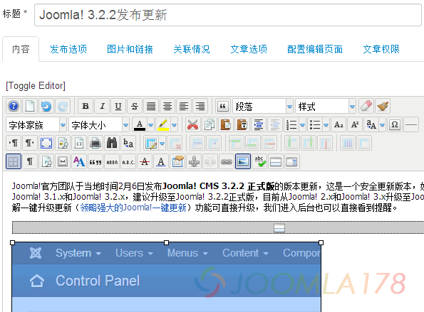

5、点击“保存”，会显示文章保存成功，那么这个时候我们可以点击右上方的“版本”，来查看保存的版本。

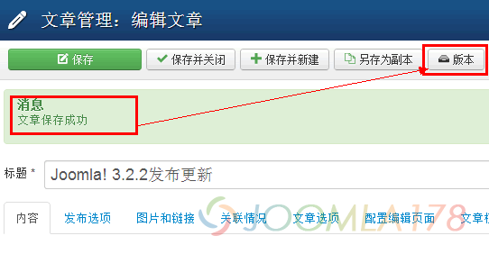

6、打开后显示“内容版本历史”对话框，可以看到下方列表

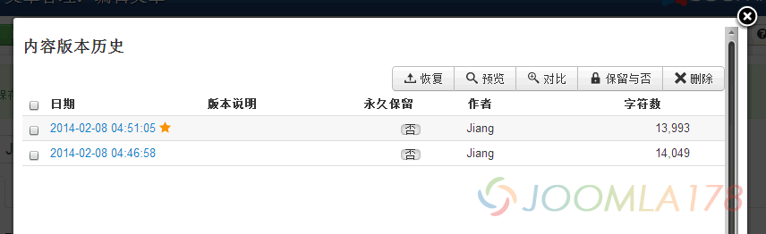

7、右侧则有一排菜单，例如“恢复”、“预览”、“对比”、“保留与否”、“删除”等多个操作，以“对比”为例，全选下面两个列表，点击“对比”

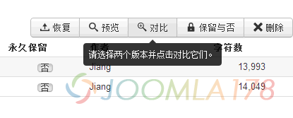

8、在弹出新的弹框中我们可以看到下面的修改记录，右上角还有“已修改记录”、“显示HTML源代码”两个选项。点击“显示HTML源代码”可以看到更具体的html修改

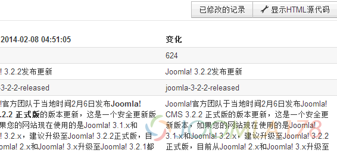

9、回到版本列表，我们注意到有一列为“永久保留”项，是则为永久保留，否则会自动删除

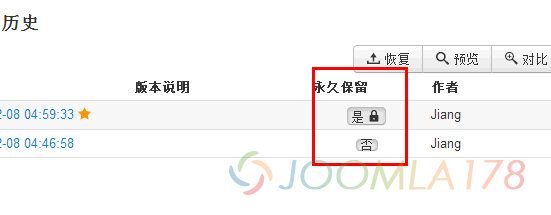

10、这里我们可以选择一个历史版本，点击“恢复”按钮进行恢复，点击之后内容编辑器会覆盖为该版本的内容。

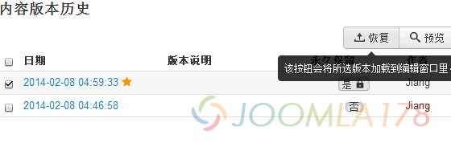

### 总结

综上可以看出，这种类似协同工作的版本控制系统无疑是CMS中的一大亮点，也是有效地对网站进行了备份，是利是弊还要等以后普遍应用后才知晓啊！

---

除特殊标明文章转自第三方网站，文章均由JOOMLASK.COM原创提供  
欢迎友情转载，请务必保留本文出处并引用本文链接： [Joomla! 3 中的内容版本控制详解](http://www.joomla178.com/joomla-share/research-and-development/joomla-3-content-version.html)
