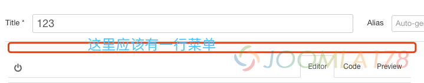
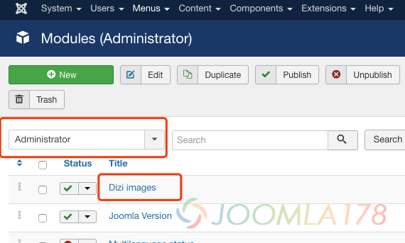
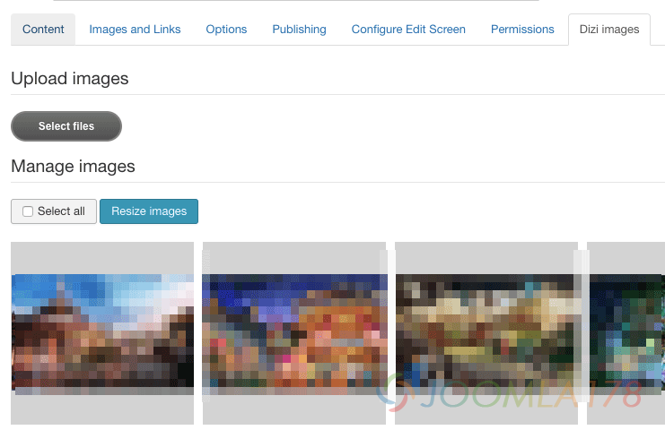

# 升级Joomla! 3.8导致Dizi images gallery无法工作

Dizi images gallery是个好用的组件，用来在文章中展示群组图片，前台带有fancybox轮播控件，并且支持响应式，但组件最新更新日期2016年6月，近日升级Joomla! 3.8发现了后台不能正常工作，原因如下。

要说Joomla!笨重，也情有可缘，组件开发者要使用前端框架的话，有时候经常和主模板的前端框架冲突，于是这个问题就来自于Joomla! 3.8后台模板isis所使用的Bootstrap升级到3.0+了，而Dizi使用的前端框架是jQuery UI 1.9.2，两者在tooltip上有冲突，于是报出如下错误：

```
jquery.min.js?3761097dded572cb67cfff19b668809c:2 Uncaught Error: cannot call methods on tooltip prior to initialization; attempted to call method 'destroy'
```

JS报错了，自然后台添加文章时候Dizi无法正常工作，如下图，原本的文章管理页签都不显示了。



解决方法很简单，就是调整Boostrap和jQuery UI的顺序，而Dizi后台管理是个Joomla! 后台模块，所以模块永远是在html的body标签中，调顺序难度较大，也不易于维护。



我们要做的只是重新定义前端tooltip变量，像下方一样重定义tooltip

```javascript
<script type="text/javascript">var _tooltip = jQuery.fn.tooltip;</script><script src="/jquery-ui-1.9.2.custom.min.js" type="text/javascript"></script><script type="text/javascript">jQuery.fn.tooltip = _tooltip;</script>
```

然后找到后台的Dizi模块代码 /administrator/modules/mod\_images/tmpl/default.php 第17行

```javascript
<link rel="stylesheet" href="/<?php echo JUri::root(); ?>media/com_di/js/jquery-ui-1.9.2.custom/css/smoothness/jquery-ui-1.9.2.custom.min.css" type="text/css" /><script src="/<?php echo JUri::root(); ?>media/com_di/js/jquery-ui-1.9.2.custom/js/jquery-ui-1.9.2.custom.min.js" type="text/javascript"></script>
```

前后加上重定义代码即可，如下：

```javascript
<link rel="stylesheet" href="/<?php echo JUri::root(); ?>media/com_di/js/jquery-ui-1.9.2.custom/css/smoothness/jquery-ui-1.9.2.custom.min.css" type="text/css" /><script>var _tooltip = jQuery.fn.tooltip;</script><script src="/<?php echo JUri::root(); ?>media/com_di/js/jquery-ui-1.9.2.custom/js/jquery-ui-1.9.2.custom.min.js" type="text/javascript"></script><script>jQuery.fn.tooltip = _tooltip;</script>
```

然后备份保存，防止更新组件后覆盖，生效如下图：



---

除特殊标明文章转自第三方网站，文章均由JOOMLASK.COM原创提供  
欢迎友情转载，请务必保留本文出处并引用本文链接： [升级Joomla! 3.8导致Dizi images gallery无法工作](http://www.joomla178.com/joomla-share/research-and-development/joomla-38-dizi-images-error.html)
