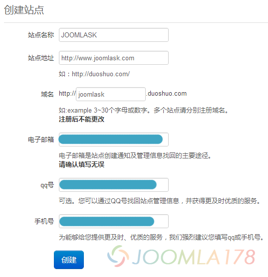

# Joomla! 添加多说评论系统

由于大多[Joomla!](http://www.Joomla178.com/) 评论扩展都是由外国开发者制作，本土化特色太少 ， 纵使安装了外国的评论扩展，鉴于评论都是即时性的内容，所以文章就不太好用[Joomla!](http://www.Joomla178.com/) [静态化缓存（system-cache）](system-cache-make-joomla-site-runningnn-fast.md)机制 ，那么没有开启[静态化缓存（system-cache）](system-cache-make-joomla-site-runningnn-fast.md)的[Joomla!](http://www.Joomla178.com/) 站点的访问速度就很不理想了，当下流行的社会化评论就是最好的解决方案了，比如我们现在要推荐的“多说社会化评论系统”，就解决了[Joomla!](http://www.Joomla178.com/) 没有本土化评论扩展的尴尬了。

多说可以用新浪微博、腾讯QQ、人人、豆瓣多帐号登录，帮助网站进行社会化媒体优化，让评论更活跃、互动性更强的评论系统，永久免费且容易安装，喜欢的朋友请查看演示下载：**[演示传送门](http://www.joomla178.com/joomla-extensions/chinese-joomla-extensions/duoshuo-for-joomla.html)**，当然你也可以自己DIY。

**第一步：获取多说代码：**

1. 进入http://duoshuo.com/create-site/，用你的任意一个第三方知名社区的账号登录，这里我们以新浪微博账号为示例，登录后如下：



2. 进入http://Joomla178.duoshuo.com/admin/tools/get-code/joomla/（以Joomla178.duoshuo.com域名为示例，请自行修改duoshuo子域名）获取[Joomla!](http://www.Joomla178.com/)相关引用代码，请区分[Joomla!](http://www.Joomla178.com/) 1.5和[Joomla!](http://www.Joomla178.com/) 2.5引用代码。

**[Joomla!](http://www.Joomla178.com/) 2.5对应的引用代码（以Joomla178.com为示例）：**

```
<!-- Duoshuo Comment BEGIN -->	<div class="ds-thread" data-thread-key="<?php echo $this->item->id;?>" 	data-title="<?php echo $this->escape($this->item->title);?>"></div>	<script type="text/javascript">	var duoshuoQuery = {short_name:"Joomla178"};	(function() {		var ds = document.createElement('script');		ds.type = 'text/javascript';ds.async = true;		ds.src = 'http://static.duoshuo.com/embed.js';		ds.charset = 'UTF-8';		(document.getElementsByTagName('head')[0] 		|| document.getElementsByTagName('body')[0]).appendChild(ds);	})();	</script><!-- Duoshuo Comment END -->
```

**[Joomla!](http://www.Joomla178.com/) 1.5对应的引用代码（以Joomla178.com为示例）：**

```
<!-- Duoshuo Comment BEGIN -->	<div class="ds-thread" data-thread-key="<?php echo $this->article->id;?>" 	data-title="<?php echo $this->escape($this->article->title);?>"></div>	<script type="text/javascript">	var duoshuoQuery = {short_name:"Joomla178"};	(function() {		var ds = document.createElement('script');		ds.type = 'text/javascript';ds.async = true;		ds.src = 'http://static.duoshuo.com/embed.js';		ds.charset = 'UTF-8';		(document.getElementsByTagName('head')[0] 		|| document.getElementsByTagName('body')[0]).appendChild(ds);	})();	</script><!-- Duoshuo Comment END -->
```

**第二步：将多说代码安装到[Joomla!](http://www.Joomla178.com/)文章中：**

我们以[Joomla!](http://www.Joomla178.com/)文章评论为示例，其它扩展原理等同

1. 打开文章对应的模板文件：/template/jk\_Joomla178/html/content/article/default.php，并找到下述代码：

Joomla! 2.5对应的代码是：

```
<?php echo $this->item->text; ?>
```

Joomla! 1.5对应的代码是：

```
<?php echo $this->article->text; ?>
```

2. 在上面代码下方插入多说引用代码，结果如下(以[Joomla!](http://www.Joomla178.com/) 2.5为例）：

```
<?php echo $this->item->text; ?><!-- Duoshuo Comment BEGIN -->	<div class="ds-thread" data-thread-key="<?php echo $this->item->id;?>" 	data-title="<?php echo $this->escape($this->item->title);?>"></div>	<script type="text/javascript">	var duoshuoQuery = {short_name:"Joomla178"};	(function() {		var ds = document.createElement('script');		ds.type = 'text/javascript';ds.async = true;		ds.src = 'http://static.duoshuo.com/embed.js';		ds.charset = 'UTF-8';		(document.getElementsByTagName('head')[0] 		|| document.getElementsByTagName('body')[0]).appendChild(ds);	})();	</script><!-- Duoshuo Comment END -->
```

**补充说明：**

1. 注意到多说代码中的两个参数非常重要，data-thread-key是用来获取[Joomla!](http://www.Joomla178.com/) 文章ID用途，如果ID获取不正确，将导致评论和文章不对号，data-title是用来获取文章标题，需要注意的是[Joomla!](http://www.Joomla178.com/) 1.5和[Joomla!](http://www.Joomla178.com/) 2.5的区别在于$this->article和$this->item的区别。

2. ID获取正确的前提下，出现每篇文章相同评论，目前发现 <link rel="canonical" href="http://www.Joomla178.com">会导致此BUG，如果有的话清注意清除。

3. 如果你的文章模板曾经修改过，比如是别的什么/template/jk\_Joomla178/html/content/article/Joomla178.php，那么都要作修改，关于如何创建自定义文章 模板，请参考[Joomla! 1.7模板多样化进阶](../joomla-templates-tutorials/joomla17-template-info-2.md)相关内容。

4. 如果模板并非自己制作，如果修改文章模板请参考制作者说明文档，如果是基于T3,Gantry等框架的话，请参照官方的说明文档。

5. 多说的评论都是来自社会化的社区平台，不用注册账号，也不占用网站数据库，可以放心开启[Joomla!](http://www.Joomla178.com/)的[静态化缓存（system-cache）](system-cache-make-joomla-site-runningnn-fast.md)，后台独立管理，很多独立设置，比如审核、关键词屏蔽、常规的编辑操作。

---

除特殊标明文章转自第三方网站，文章均由JOOMLASK.COM原创提供  
欢迎友情转载，请务必保留本文出处并引用本文链接： [Joomla! 添加多说评论系统](http://www.joomla178.com/joomla-share/research-and-development/joomla-add-duoshuo-commit-system.html)
