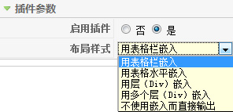
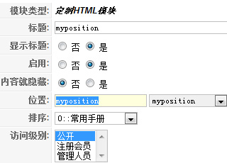
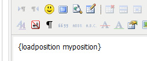

# Joomla文章中插入模块实现方法

**（原创文章转载请标明出处，请引用本文地址）**

如果想在某篇特定的文章中插入你要的模块，很简单，不必借助什么别的插件！Joomla1.5中就自带了这样的一个插件：Content - Load Module

1、那么先需要到后台中的 扩展（extensions）->插件（plugin）->Content - Load Module  并启用它

2、简介的使用方法说的太简单，现在需要到 扩展（extensions）->模块（module）中创建一个你需要的模块，比如mod\_custom，创建的时候，选择位置（position）的时候，不需要选择已有的position，随意输入一个position的名字，例如: myposition，这是必须要输入的，而且不能和模板中已有的position重复。

3、参照第1条的使用方法，在你想要的某篇文章处插入内容：，不难发现，第2条创建的position名为myposition就有用了！保存刷新前台

---

除特殊标明文章转自第三方网站，文章均由JOOMLASK.COM原创提供  
欢迎友情转载，请务必保留本文出处并引用本文链接： [Joomla文章中插入模块实现方法](http://www.joomla178.com/joomla-share/research-and-development/joomla-article-insert-module.html)
