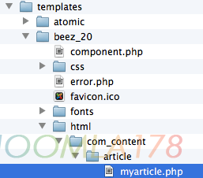
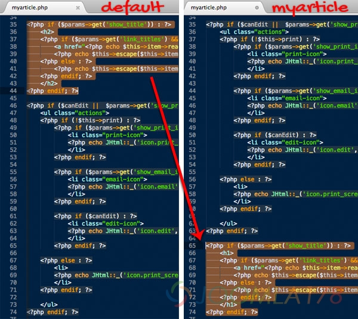
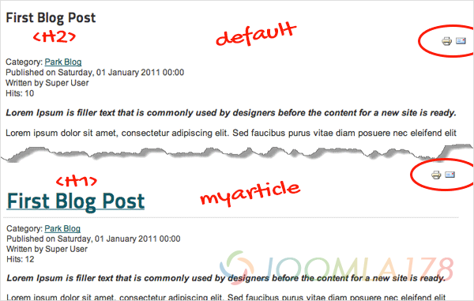
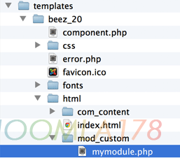
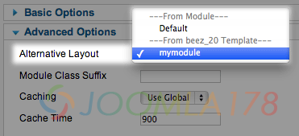

# Joomla!文章和模块使用可变布局

如果你曾经创建过一个模板，你会发现本文创建可变布局的方法与创建模板很相似。唯一的不同在于可变布局会在你的默认布局旁显示为一个可选的项目，而不是完全覆盖你的默认布局。下面的示例是基于Joomla2.5.x的，也可以在Joomla3.x中使用。

本文来自：[IT开源学习](http://www.3body.tk/iblog/) 由作者翻译自：[Tutorial: Taking Advantage of Alternative Layouts for Articles and Modules](http://magazine.joomla.org/issues/issue-feb-2013/item/1059-tutorial-taking-advantage-of-alternative-layouts-for-articles-and-modules)，该文和本站教学[Joomla! 2.5.x 文章布局、分类布局模板释疑](../joomla-templates-tutorials/joomla25-article-layout-and-blog-layout.md)为同一类型的解释，大家可以相互学习参考

### 给文章加入可变布局

1. 在路径“components/com\_content/views/article/tmpl/default.php”下找到你的文章默认布局文件。
2. 将这个文件拷贝到你模板的html文件夹下:“templates/[your\_template]/html/com\_content/” , 如果这个文件夹不存在要创建一个。
3. 修改文件名。比如改为“myarticle.php”

你可以在新的布局文件“myarticle.php”中做任意修改。比如，我想要将【打印】和【发送邮件】的图标从文章标题下方移到上方。并且将文件的标题标签改为H1。如下图：

要使用你刚才创建的新的布局，只要在文章选项中将Alternative Layout指定为你创建的布局即可。

下面是一个对比图，显示最终的效果：

### 给模块加入可变布局

下面我们使用同样的流程来为模块添加可变的布局。使用Custom HTML模块来演示。 1. 在路径“/mod\_custom/tmpl/default.php”中找到模块的布局文件。 2. 将这个文件拷贝到“templates/[your\_template]/html/mod\_custom/”目录下。 3. 修改这个文件名，比如“mymodule.php”。

你新加入的布局可以在模块设置的选项“Advanced Options > Alternative Layout”中找到。

可变布局几乎可以用在所有的模块中，JCM的作者Steve Burge做了一个非常棒的demo来演示如何改变Menu Module的布局。你可以在这个blog上观看：[How to Use Joomla's Alternative Layouts for Modules](http://www.ostraining.com/blog/joomla/alternative-layouts-for-modules/)。

**注意：当你真正有需要的时候才创建可变布局，比如编辑html标签或者改变元素的位置。如果只是改变样式或者颜色，最好是通过CSS文件去修改。你可以使用Module Class Suffixes和Page Classes 来修改样式。**

希望这篇文章能够给你帮助，事实上核心布局里的所有内容都可以根据你的需要进行修改。

如果你是一个模块开发者，可以考虑在你的模板中加入可变布局的支持，这是一个被很多模块开发者忽略的特性。

现在就开始使用可变布局吧，亲！

---

除特殊标明文章转自第三方网站，文章均由JOOMLASK.COM原创提供  
欢迎友情转载，请务必保留本文出处并引用本文链接： [Joomla!文章和模块使用可变布局](http://www.joomla178.com/joomla-share/research-and-development/joomla-article-module-layout.html)
