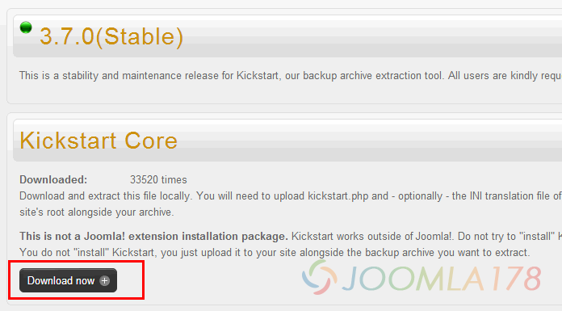
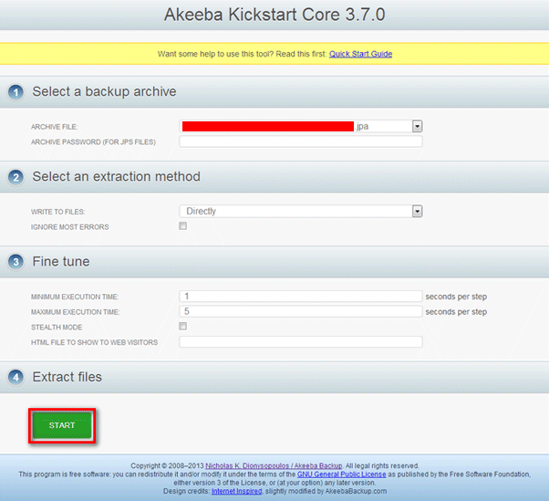
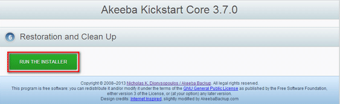
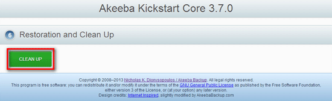
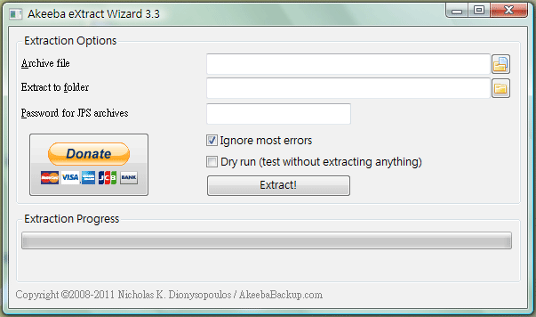

# Joomla!备份工具Akeeba Backup详解之还原篇

前文[Joomla!备份工具Akeeba Backup详解之备份篇](joomla-backup-tools-akeeba-bakcup-info.md) 中主要介绍了Akeeba Backup及使用方法，由于Akeeba Backup备份出来的是特定的打包文件，例如JPA、JPS、ZIP等格式，还原我们备份的文件目前Akeeba官方推出两种解决方案，下面我们就详细讲解

### Akeeba Kickstart在线解压缩

Akeeba Kickstar并非是Joomla!的一个扩展，而是一款基于PHP的在线解压程序，可以在服务器中运行并解压Akeeba Backup备份出来的JPA、JPS、ZIP格式压缩包。

**1、下载Akeeba Kickstart**

前往官方下载页：[传送门](https://www.akeebabackup.com/downloads/akeeba-kickstart/akeeba-kickstart-3-7-0.html)，选择当前的最新版3.7.0(Stable)，点击DownLoad Now，当然我们也提供网盘下载：[kickstart-core-3.7.0.zip](http://dl.vmall.com/c0vy56ujhi)

**2、使用Akeeba Kickstart**

将压缩包上传至网站根目录，压缩包中有多国语言包，如果不希望文件过多，只需上传zh-CN.kickstart.ini就可以了

再将Akeeba Backup生成的备份文件上传到网站根目录，浏览器中输入 http://www.yourdomain.com/kickstart.php（域名和网址看自己需求吧）

选择预置的JPA压缩包，点击“开始”

点击运行安装包，像安装Joomla!那样安装程序填好所有资料后，点击恢复数据库！完成

还原完成后，别忘了清除Akeeba Kickstart

然后。。。就完了！

### Akeeba eXtract Wizard本地解压

这个在当年JoomlaPack大家最为熟悉的工具，Akeeba eXtract Wizard这款工具并非Akeeba Backup的Joomla!扩展，可以在Windows, Linux 32/64-bit和Mac OS X 10.5的PC操作系统中使用，并解压Akeeba Backup压缩产生的JPA、ZIP格式的文件，解压之后再上传至服务器安装还原。

下载Akeeba eXtract Wizard：[**传送门**](https://www.akeebabackup.com/downloads/akeeba-extract-wizard.html)，DBANK网盘传送门（Windows版）：**[SetupAkeebaExtractWizard.exe](http://dl.vmall.com/c09is83etv)**

最后，我们知道备份的目录中有很多多余的文件，这种情况下我们的再次备份的压缩包会更大，在[Joomla!备份工具AkeebaBackup详解之备份篇](joomla-backup-tools-akeeba-bakcup-info.md "Joomla!备份工具Akeeba Backup详解之备份篇")前文中我们说过更改目录可以解决这个问题，另外我们还是推荐新手玩家渐渐学会SQL、网站文件分离式备份还原，具体请参考：[Joomla!网站迁移备份全过程](joomla-backup-all-step.md)

---

除特殊标明文章转自第三方网站，文章均由JOOMLASK.COM原创提供  
欢迎友情转载，请务必保留本文出处并引用本文链接： [Joomla!备份工具Akeeba Backup详解之还原篇](http://www.joomla178.com/joomla-share/research-and-development/joomla-backup-tools-akeeba-bakcup-info-restore.html)
