# Joomla!备份工具Akeeba Backup详解之备份篇

在这之前，笔者认为Joomla!的网站备份迁移应该用手动方式备份迁移，故撰文[Joomla!网站迁移备份全过程](joomla-backup-all-step.md)，但不曾想对于使用者或者叫维护者来说，更应该用一种具有人文关怀或者具有友好的用户体验工具来操作备份， 在Joomla!中这款最好的工具无疑就是 Akeeba Backup for Joomla! ，本文就Akeeba Backup 的备份进行详细解释。

### 什么是Akeeba Backup？

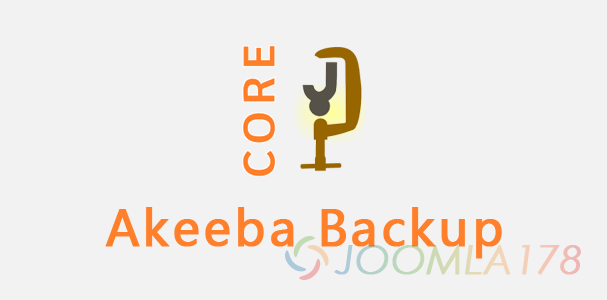

Akeeba Backup的前身是JoomlaPack，由于开发团队的运营策略调整，故改名为Akeeba Backup，念起来也是蛮拗口。

Akeeba Backup主要是用于Joomla!中的一款备份扩展，Joomla!用户安装了这个扩展之后，在后台可直观的进行整站备份操作，此外Akeeba Backup还支持服务器的Cron计划任务实现定时备份。

除了Akeeba Backup的Joomla!扩展之外，Akeeba Backup配套有强大的在线还原解压工具[Akeeba Kickstart](https://www.akeebabackup.com/downloads/akeeba-kickstart.html)，便于用户在远程主机中直接进行解压ZIP、JPA 、JPS等备份包，另外Akeeba Backup针对用户用于本地开发测试时的[Akeeba eXtract Wizard](https://www.akeebabackup.com/download/akeeba-extract-wizard.html)客户端工具，这样在Windows, Linux, MacOS中都可以将备份好的ZIP、JPA等格式的备份包，关于如何解压，我们在[Joomla!备份工具Akeeba Backup详解之还原篇](http://www.Joomla178.com/)详细解释。

由于Akeeba Backup是一款备份工具，有直接读写Joomla!网站一些目录的权限，所以官方团队更新速度是非常快的，避免给Joomla!网站带来漏洞，当前更新的版本为[3.7.10正式版](https://www.akeebabackup.com/download/akeeba-backup/3-7-10.html)，这个版本及以后的版本都对服务器环境有所要求：PHP 5.3或更高版本，Joomla! 2.5.6+和Joomla! 3.1+，此外Akeeba Backup还提示收费的专业版，关于免费版和收费版的区别请参考：[Akeeba Core vs. Professional](https://www.akeebabackup.com/products/46-software/405-akeeba-core-vs-professional.html)

### 下载安装Akeeba Backup

**1、下载Akeeba Backup**

前往Akeeba Backup下载官方正式版本（请注意，慎用第三方网站版本，我能理解你要中文语言包，下文会告诉你的，这个扩展是涉及到网站安全的扩展）：<https://www.akeebabackup.com/download/akeeba-backup.html>，点击Take me to the downloads for this version前往下载Akeeba Backup 3.7.10

注意！当前版本3.7.10要求服务器环境中的php版本为5.3或5.3以上

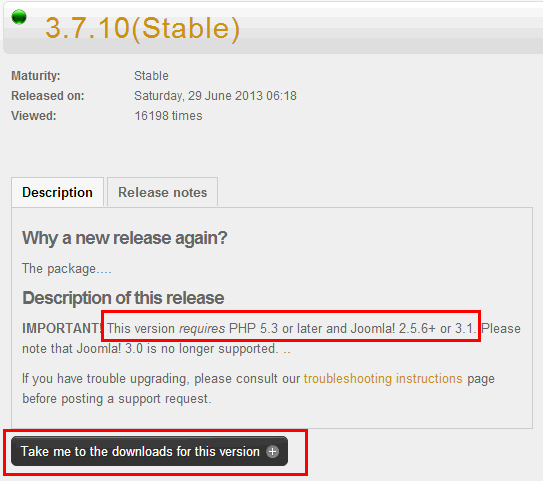

看到Akeeba Backup Core，就是我们要下载的免费版本，点击Download now等待几秒即可下载，鉴于有些同学网络慢，或者出现无法访问的，本站下载一份未经任何修改的版本在网盘中，请自行前往Dbank网盘下载：[Akeeba Backup 3.7.10](http://dl.vmall.com/c0y6t4gx8f)。

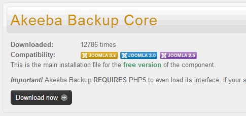

**2、安装Akeeba Backup**

安装比较简单，进入后台 - 扩展 - 扩展管理 - 安装，选择安装包，上传并安装即可完成安装，安装成功后如下图：

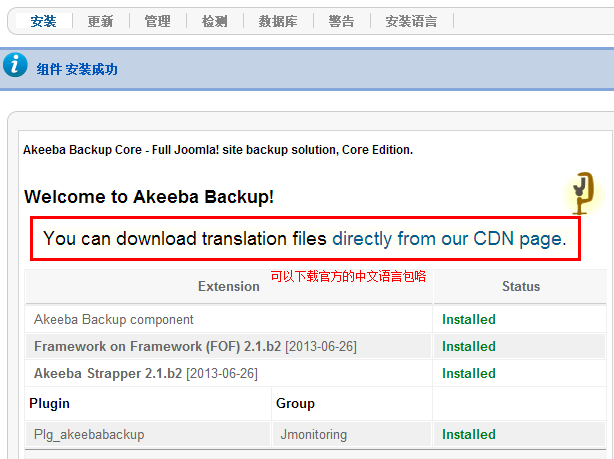

其中有一句很重要的提醒：**You can download translation files** [directly from our CDN page](http://cdn.akeebabackup.com/language/akeebabackup/index.html).，意为你可以从我们的CDN页面中下载语言包，与就是我们前文说了不需要在第三方网站下载，下载页面：<http://cdn.akeebabackup.com/language/akeebabackup/index.html>，找到我们的简体中文语言包（当然兄弟语言包也在下面）

照旧，如果访问不了，或者下载不了，忍不住要强调一下当前形势就是这样，大家应该都懂！ DBANK网盘下载：[akeebabackup-zh-CN-j25.zip](http://dl.vmall.com/c0xaouloim)

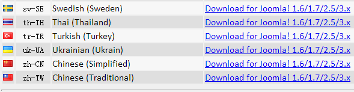

再次进入后台 - 扩展 - 扩展管理 - 安装，选择简体中文安装包，这样中文语言包就安装完成、

### 使用Akeeba Backup

进入后台 - 组件 - Akeeba Backup 网站备份/迁移工具，所有默认选项，如果“运行配置向导”没有勾选，记得勾选

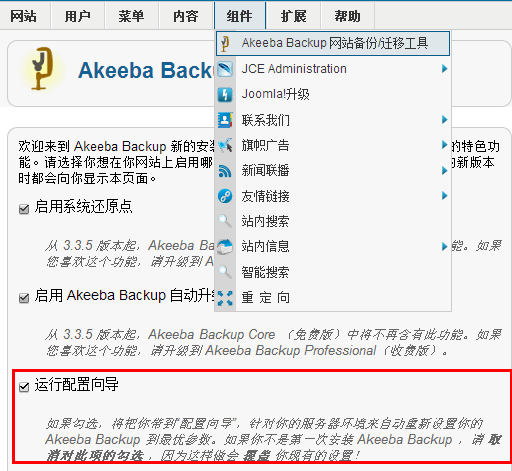

默认选项之后，点击：  Accept the mandatory information and apply preferences

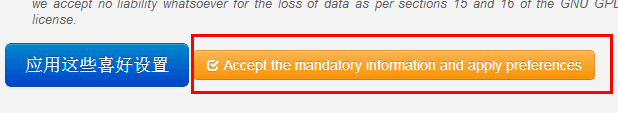

下一步，如下图，扩展会先检测一下：

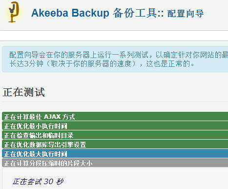

检测完成后，如下图，可以选择立即备份，或者设置一下具体选项什么的。

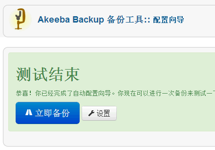

先不设置了，直接点击“立即备份”先备份一套再说：

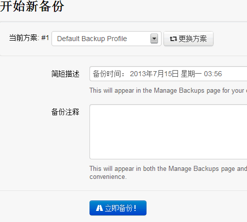

备份过程中不要关闭页面，不要做其它任何操作咯：

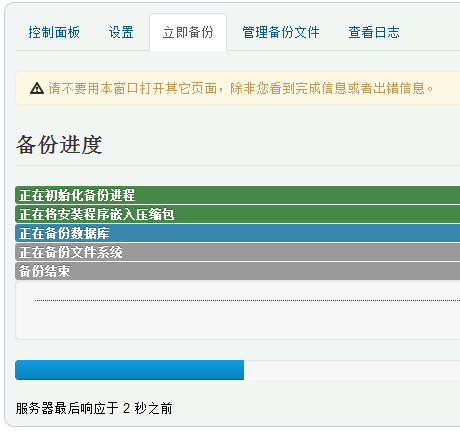

多等一会，如图，备份完成

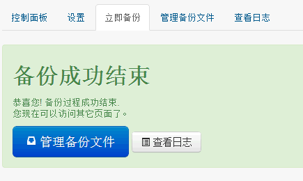

我们可以点击“管理备份文件”来查看本次备份，一目了然，下载、删除都可以：

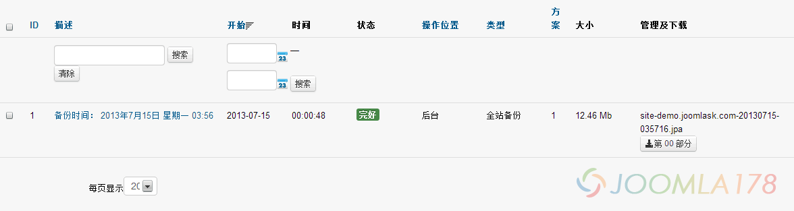

不过值得一提的是，上面我们没有进行“设置”，该备份文件的默认administrator/components/com\_akeeba/backup 目录下，感觉不太安全？

第一个办法，可以修改.htaccess文件来限制读取，打开.htaccess第一行添加代码：deny from all，保存即可

第二个办法，修改保存目录，进入进入后台 - 组件 - Akeeba Backup 网站备份/迁移工具 - 设置，如下截图中“输出目录”选项可自定义输出目录！

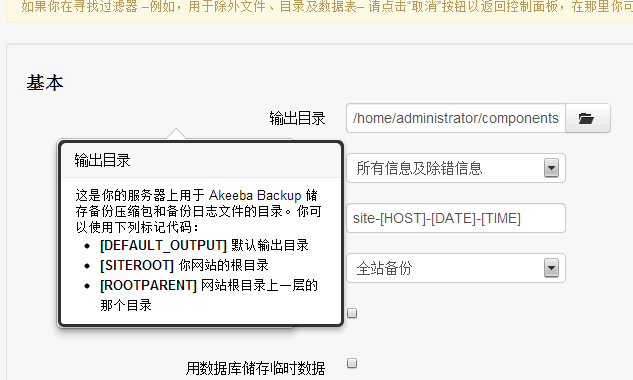

其它一些设置自行慢慢研究研究！关于Joomla!网站如何使用Akeeba Backup还原请关注：[Joomla!备份工具Akeeba Backup详解之还原篇](joomla-backup-tools-akeeba-bakcup-info.md)

---

除特殊标明文章转自第三方网站，文章均由JOOMLASK.COM原创提供  
欢迎友情转载，请务必保留本文出处并引用本文链接： [Joomla!备份工具Akeeba Backup详解之备份篇](http://www.joomla178.com/joomla-share/research-and-development/joomla-backup-tools-akeeba-bakcup-info.html)
