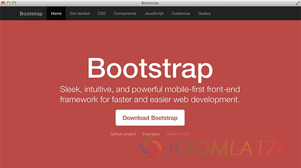

# Joomla!中的BootStrap版本问题



在基于Joomla!3.x和BootStrap3.x开发网站的时候会发现各种BootStrap组件失效的情况，比如dropmenu下拉菜单点击跳转的问题，另外tooltips也会有一些功能上的问题，究其原因是因为Joomla!3.x中的JUI引入了BootStrap库，而当前Joomla!3.3.6及以前版本中引入的BootStrap都是基于BootStrap2.x库的版本。

笔者在component/com\_content/views/当中寻求移除bootstrap组件方法，屡试无果，发现bootstrap调用与否主要与<jdoc:include type="head" />有关，无奈之下只好将<jdoc:include type="head" />当中的/media/jui/js/bootstrap.min.js插件库直接移除，方法简单，和偶看给出的方案是一样，见此文：[移除Joomla的mootools-core.js和JCaption](remove-joomla-mootools-core-and-jcaption.md)，我们这里首先在模板文件/template/joomla178/index.php段首中增加代码

```
unset($doc->_scripts[JURI::root(true) . '/media/jui/js/bootstrap.min.js']);
```

再在其后增加自定制的BootStrap 3.x版本，bootstrap.min.js放到模板文件夹中

```
$doc->addScript('templates/'.$this->template.'/js/bootstrap.min.js');
```

所有问题迎刃而解。

2015年即将到来，祝所有Joomla!粉丝们在新的一年里事业顺利、万事如意

---

除特殊标明文章转自第三方网站，文章均由JOOMLASK.COM原创提供  
欢迎友情转载，请务必保留本文出处并引用本文链接： [Joomla!中的BootStrap版本问题](http://www.joomla178.com/joomla-share/research-and-development/joomla-bootstrap-version-problem.html)
