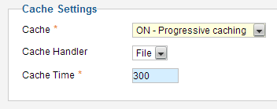
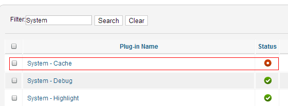
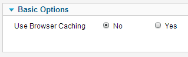
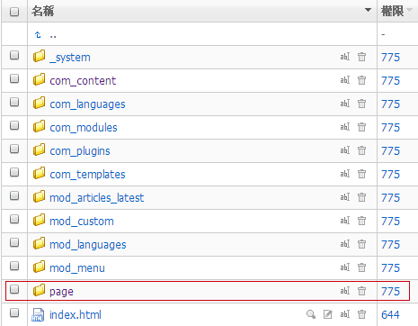
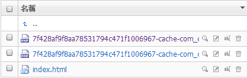

# Joomla! 缓存的合理利用最大化网站效率

[Joomla!](http://www.Joomla178.com/)系统通过缓存机制来实现像国产CMS那样的“静态生成”，和伪静态不是一个概念，[Joomla!](http://www.Joomla178.com/)的缓存又分为两种缓存，这两种缓存起到不同的用途，下面分别针对性的细述一下。

首先，缓存的意思就是浏览者浏览网站的时候程序并不是每次都会读数据库的内容，而是给用户展示“缓存”好的内容，这样既加快了浏览速度，又避免服务器压力过大。

**全局缓存**

全局缓存意为全局设置中的缓存设置，进入Site-Global Configuration，切换到System选项卡中，我们看到图1中有三个选项：

第一项Cache有三个选择，第一个OFF - Caching disabled自然就是关闭缓存的意思，第二个ON - Conservative caching意为开启，但是是保守的缓存，意思就是只是缓存文章内容；第三个ON - Progressive caching意为开启进步的缓存，进步的缓存会同时缓存包括第三方组件、模块等内容，如果那些模块的高级配置里面选用的是全局设置，这里就默认开启了所有模块缓存，所以这里我们开放的是进步的缓存。

第二项Cache Handler，缓存形式目前到[Joomla!](http://www.Joomla178.com/) 2.5.x仍然只是文件形式

第三项Cache Time缓存时间，单位是分钟，比如我们这里填写的是300分钟，意思在300分钟后会逐一清理缓存并重新生成缓存。

  
图1.

**插件缓存**

曾经我们在[System-cache让Joomla网站速度再翻倍,像子弹在飞](system-cache-make-joomla-site-runningnn-fast.md)一文中有说到[Joomla!](http://www.Joomla178.com/) 1.5.x时代的一款系统自带插件System-Cache，进入Extensions-Plug-in Manager，在Filter:中输入System查找这款插件，如图2示，第一个搜索结果就是System-Cache，，默认的Status是不启用的状态。

  
图2.

进入**System-Cache设置后只需将Status状态改为Enable启用状态即可**，右边的Use Browser Caching选择否，因为我们希望将缓存是以文件的方式存在于服务器上，以便于以后所有的用户都是通过文章服务器上的这些缓存来浏览，我们不能保证用户不会清除本地浏览器的缓存。如图3

  
图3.

**缓存到底是以什么形式存在的？**

上面我们说了如何开启两种缓存，我们再到网站目录下探个究竟

那么在网站根目录中，我们进入cache目录会发现图如4所示的缓存目录，注意如果没有开启上述的插件缓存System-Cache是看不到/cache/page/目录的，言下之意，除page之外的其它缓存目录都是全局缓存对应的缓存目录。

  
图4.

我们就以文章缓存为例，进入com\_content缓存目录，如果你这个时候没有访问过一篇文章，那这里可能就是空的，那么我们试着访问两篇文章，再刷新com\_content缓存目录，不难发现，此时多了两个一大串名称的php文件，如图5示，这就是全局缓存的缓存文件。

  
图5.

随便编辑其中的一个文件，看到其中的代码如下：

```
<?php die("Access Denied"); ?>....<div class="item-page...和一大串看不懂的参数
```

这里想必大家都明白了，这是把文章内容对应文章内容部分<div>全显示出来，如此缓存就和国产CMS的html静态文件相似，但是只是局部html，而且是一个带很多参数的php文件。

我们再回到上一级目录，进入插件缓存目录中再看看插件缓存和全局缓存的区别，进入/cache/page/，然后先在网站前端随意打开一篇文章，如同图5一样，会有几个一大串名称的php文件，这就是插件缓存生成的缓存文件，随便打开一个，发现如下代码：

```
<?php die("Access Denied"); ?>....<!DOCTYPE html PUBLIC "-//W3C//DTD XHTML 1.0 Transitional//EN" "http://www.w3.org/TR/xhtml1/DTD/xhtml1-transitional.dtd"><html xmlns="http://www.w3.org/1999/xhtml" xml:lang="zh-cn" lang="zh-cn" dir="ltr" ><head>  <base href="http://www.Joomla178.com/..." />  ....</head><body>....</body></html>
```

不难发现，这些代码是一个完整的html，也是多了一些参数的php文件。

**我们综合一下以下几点：**

1、全局缓存实际上是将内容生成局部html代码，然后会定期系统清除，或者因配置更改、新加文章、修改内容等重新生成，插件缓存则是将每一个文章生成完成的html代码，而且不会系统清除，需要人工清除（Site-Maintenance-Clear Cache）

2、插件缓存System-Cache会使网站速度倍增，完全将内容静态化/缓存化，但是遇上带互动类的扩展，比如K2的留言功能，就不会即时显示浏览者的留言了。而全局缓存反之，速度会稍逊，但对于互动扩展而言，就不会遇到不即时的尴尬了。所以如果制作者打算用[Joomla!](http://www.Joomla178.com/)做成一个新闻发布的站点，可以考虑开启插件缓存，如果打算用[Joomla!](http://www.Joomla178.com/)做个网店、社区之类的站点，要慎用插件缓存。

3、[Joomla!](http://www.Joomla178.com/)的缓存大部分都是要靠浏览者来帮助生成缓存，比如插件缓存System-Cache就是需要靠第一个浏览者浏览网页后才会生成，那么第一个浏览者浏览的时候会感网站稍慢，后面就会飞快，所以生成缓存的时候可以借助其它工具来浏览每个页面，或者干脆就让浏览者来实现缓存。

4、[Joomla!](http://www.Joomla178.com/)的缓存是以文件形式存在于网站根目录，如果你的空间是50MB那种，[Joomla!](http://www.Joomla178.com/) 自己+模板+图片一般常规站点30MB肯定需要的，所以50MB空间就有些捉襟见肘，因为你得留很多的空间用来放这些缓存文件。

所以我们有时候想想[Joomla!](http://www.Joomla178.com/)的开发者们是真的用心在做CMS，对于 我们这些二次使用者来说，可选择性非常广，还等什么呢，赶紧享受缓存吧。

---

除特殊标明文章转自第三方网站，文章均由JOOMLASK.COM原创提供  
欢迎友情转载，请务必保留本文出处并引用本文链接： [Joomla! 缓存的合理利用最大化网站效率](http://www.joomla178.com/joomla-share/research-and-development/joomla-cache-more-information.html)
