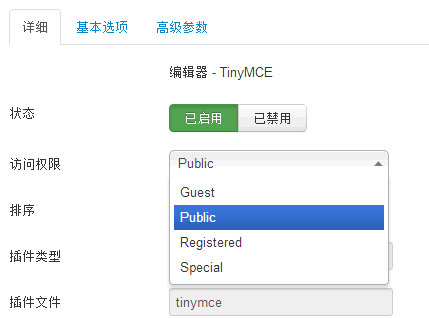
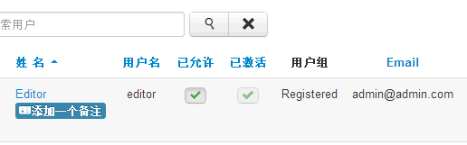
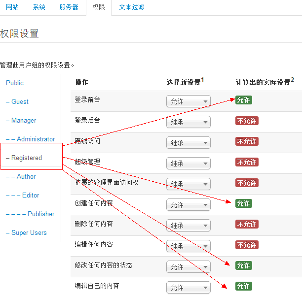
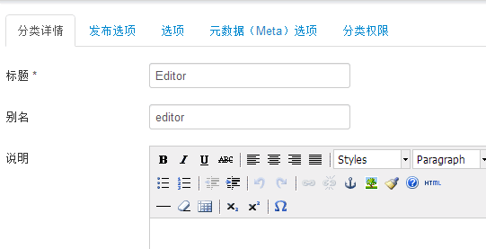
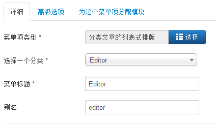
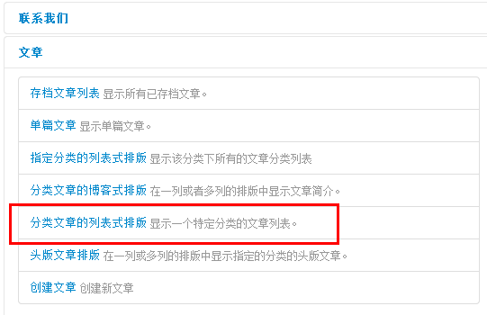
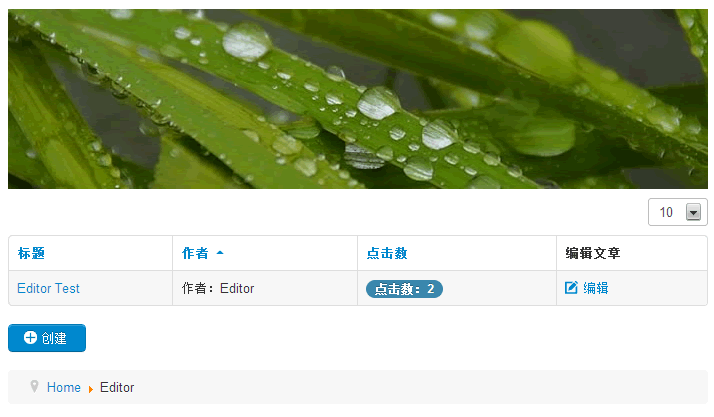
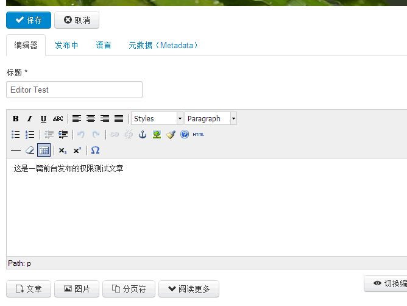
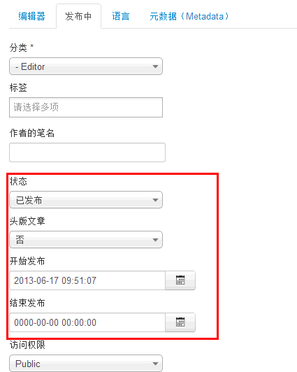

# Joomla! 前台编辑及权限控制实战应用

Joomla!设计之初就已经为实施者想到了，比如作为一个服务商，如何让客户更方便的在网站中添加内容，而不用去理解复杂的后台，那么在Joomla! 的前台编辑中就能实现，今天我们拿Joomla! 3作为实例给大家详细阐述Joomla! 的前台编辑。

在探究之前，我们应该了解一下[Joomla 2.5 权限控制系统](joomla25-acl-system.md)，在Joomla! 3中，充分的继承了Joomla! 2.5时代的权限控制，而前台编辑的使用者就是权限控制系统中的一员。编辑自然要用到编辑器，我们按照编辑器分类来说明。

### Joomla! 默认的TinyMCE编辑器权限及使用方法

1. Joomla! 3 中仍保留了默认的内容编辑器TinyMCE，进入后台 扩展 -> 插件管理 -> 编辑器 - TinyMCE，我们发现“访问权限”一栏中默认的是Public权限，那实际上我希望每个注册用户都能有权限创建、编辑文章，并能够使用TinyMCE编辑器，就在此将“访问权限”一栏改成Registered，言下之意注册用户能够使用TinyMCE。

2. 现在需要注册一个新的注册者账户，下图中我们已经注册了一个名为Editor的用户，用户组为Registered

3. Joomla! 默认情况下Registered只有前台登入权限，并没有前台编辑的权限，那么我们要赋予Registered组的编辑权限，进入后台 -> 系统 -> 全局设置 ->选择“权限”选项卡，并选中Registered用户组，默认仅有“登录前台”，我们分配权限后显示如下图。

如果我们不给Registered组开放“修改任何内容的状态”权限，那么注册用户发布的新文章默认是未发布状态，也就是需要管理员审核，我们在示例中是可以“修改任何内容的状态”

4. 上面只是一些准备工作，现在注册用户Editor在网站前台登录后仍然看不到任何创建按钮，因为默认的文章、分类都是Super User才有权限，因此我们要给注册用户开辟一个新的分类。

进入后台 -> 内容 -> 分类管理 -> 添加新类别，创建一个名为Editor的新的分类，其它参数均默认，比如“分类权限”中的Registered权限就继承有上面全局设置中的权限。

5. 再针对上面创建的分类Editor创建一个对应的菜单，这样注册用户能明确到该分类下发表文章

进入后台-> 菜单 -> Main Menu -> 添加新的菜单，“选择一个分类”一栏中，选择我们刚才创建的新分类“Editor”

并且要在“菜单项类型”中选择“分类文章的列表式排版”，其它选项，注册用户在对应分类下看不到创建新文章按钮，其它选项均默认。

6. 打开前台网址http://yourdomain.com/editor.html，或者打开首页，点击右侧菜单Editor，进入该分类文章列表下，我们看到如图：

其中我们已经创建过一篇名为Editor Test的文章，我们注意到下方仍然有“创建”按钮，而且已创建的文章我们也是有编辑权限。

7. 编辑自己创建过的文章，点击上图中的“编辑”，看到如下结果：

切换到“发布中”选项卡，我们特别要强调的是，下图中的红圈部分是第3步中给Registered组开放“修改任何内容的状态”权限前提下，才能看到，如果没有此权限，这里的发布状态、发布时间是无法看到的，此处根据服务需要自行选择是否开放。

8. 最后其它功能以及Joomla! 2.5中的使用方法基本雷同，大家可以在实战中学习如何操作，这样才能深刻理解Joomla! 的权限使用方法。

---

除特殊标明文章转自第三方网站，文章均由JOOMLASK.COM原创提供  
欢迎友情转载，请务必保留本文出处并引用本文链接： [Joomla! 前台编辑及权限控制实战应用](http://www.joomla178.com/joomla-share/research-and-development/joomla-front-editor-and-acl.html)
