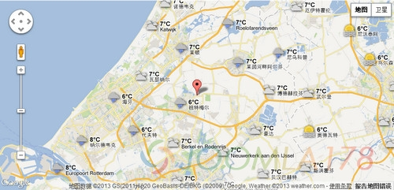

# Joomla Googlemaps Plugin Joomla!谷歌地图插件介绍

偶看今天给大家介绍的是Joomla Googlemaps Plugin 囧啦谷歌地图插件，Joomla Googlemaps Plugin是在一个或者多个内容页面展示谷歌地图的Joomla 模块或组建，兼容Joomla 1.5.x,2.5.x和3.x版本。

最新的Joomla Googlemaps Plugin版本是3.1，而旧版本2.2，由于Google Maps API升级，已经停止开发。

一、在Joomla管理后台——扩展管理：安装——上传压缩包文件;plugin\_googlemap\_J25\_J3x.v3.1.zip

二、安装成功后，进入：扩展——插件管理——搜索Google——激活：System – Google Maps。激活Google Maps后，点击插件标题进入插件设置界面，默认是英文的，目前还没有中文翻译包。

三、在Google Maps插件的设置界面——描述选项卡，可以看到《How to use the plugin in content》，教我们如何使用谷歌地图插件。

我们可以自定义的参数有：

1、地图的宽度和高度，无论多大都可以，当然，如果地图太小可能就看不清楚了。

2、经度和纬度

3、地图显示范围为0（世界）到19（详细）

3、地图样式可以为正常（默认值）、卫星、混合、地形和地球

4、地图文本标记，在地图上显示一个小气球。如果您不想显示文本，可以使用text=”，这样文本只会在当前定位点显示。如果想要显示一个地址或者超链接，可以使用代码; <a href=linkAddress target=linkTarget title=linkTitle>linkName</a>。不要使用双引号！

5、开始信息窗口（1 默认）或者管理信息窗口（0）

6、在maps.google.com可以查询到所有目的地的坐标

7、提示标记是指当鼠标放置在标记之上时会有提示（不要使用HTML）

8、地址是指一个地址所对应的坐标

9、Kml需要链接一个kml文件，可以制作多个标记在地图上形成一条线路

四、在编辑文章的时候，切换到源代码模式，插入代码:{mosmap gmv=’3.13′|weather=’1′}，这是一个可以查看天气的地图模式。众多的演示代码可以查看：<http://tech.reumer.net/Google-Maps/Demo-Google-Maps-V3/>

项目地址：<http://extensions.joomla.org/extensions/1147/>

---

除特殊标明文章转自第三方网站，文章均由JOOMLASK.COM原创提供  
欢迎友情转载，请务必保留本文出处并引用本文链接： [Joomla Googlemaps Plugin Joomla!谷歌地图插件介绍](http://www.joomla178.com/joomla-share/research-and-development/joomla-googlemaps-plugin.html)
