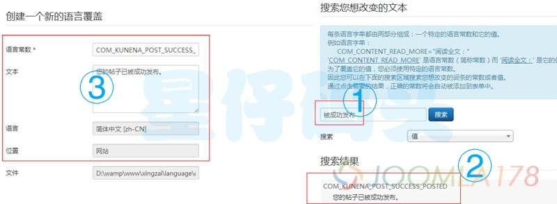

# Joomla! 语言覆盖

[Joomla](http://www.xingzai.org) 的多语言是通过对同一个词条做出不同的翻译实现的，在 Joomla 的前端和后台源码里面经常可以看到这样的代码：

```
JText::_('TPL_PROTOSTAR_BACKTOTOP')
```

这里面的TPL\_PROTOSTAR\_BACKTOTOP就是需要被翻译的词条。对于同一个字符串的翻译，不同的人有不同的理解。当你使用别人提供的语言包，有可能需要自己修正翻译的词条，一般人可能直接就想到：修改INI语言文件不就行了？这种方法有个毛病，就是后台更新语言包以后，你做的修改将被覆盖。所以 Joomla 为我们提供了语言覆盖的功能。

打开后台【扩展管理】-【语言管理】可以看到【语言覆盖】的菜单，打开，点击新建，如下图：



每条语言字串都由两部分组成：一个特定的语言常数和它的值。例如语言字串：COM\_CONTENT\_READ\_MORE="阅读全文："  
'COM\_CONTENT\_READ\_MORE' 是语言常数（简称常数）而 '阅读全文：' 是它的值。为了覆盖它的值，您必须使用特定的语言常数。因此您可以在下面的搜索区域搜索您想改变的词条的常数或者值。通过点击需要的结果，正确的常数将会自动被添加到表单中。例如我的Kunena论坛发帖成功后的提示是：您的帖子已被成功发布，我觉得这个翻译比较拗口，所以我就可以通过这个方法修改它，在左边的文本框里面输入我想要的翻译结果：您的帖子已经成功发布。

这种方法修改的翻译词条是不会被覆盖的，除非Kunena等的源码修改了COM\_KUNENA\_POST\_SUCCESS\_POSTED这个词条。

---

除特殊标明文章转自第三方网站，文章均由JOOMLASK.COM原创提供  
欢迎友情转载，请务必保留本文出处并引用本文链接： [Joomla! 语言覆盖](http://www.joomla178.com/joomla-share/research-and-development/joomla-language-cover.html)
