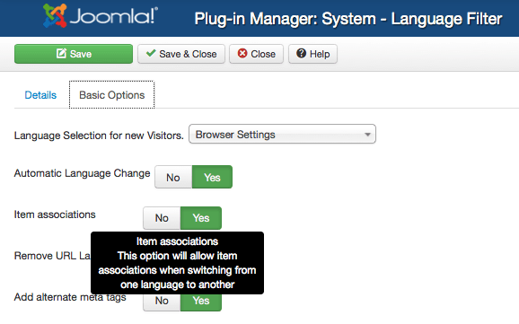
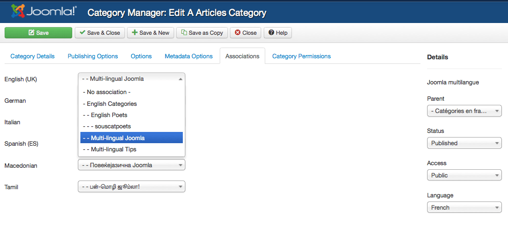
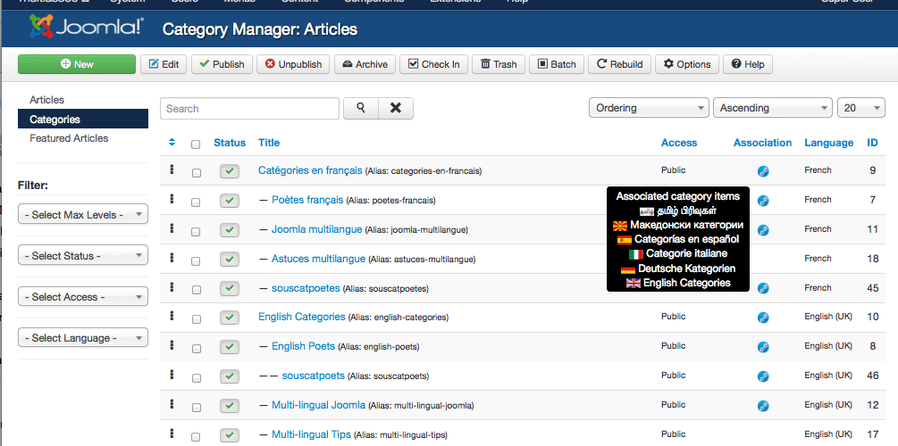
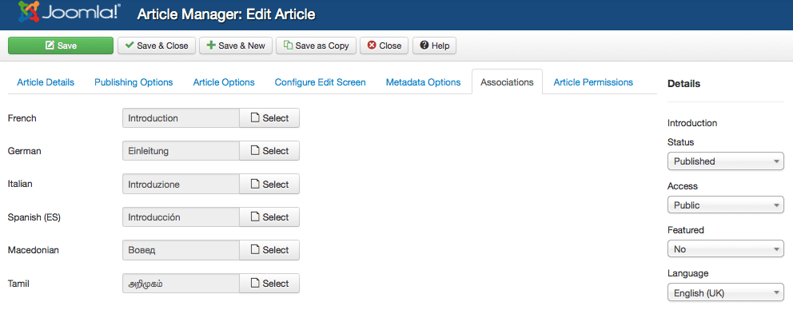
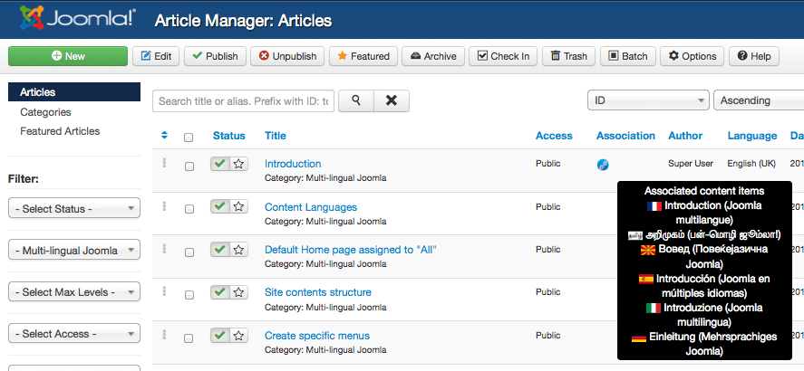
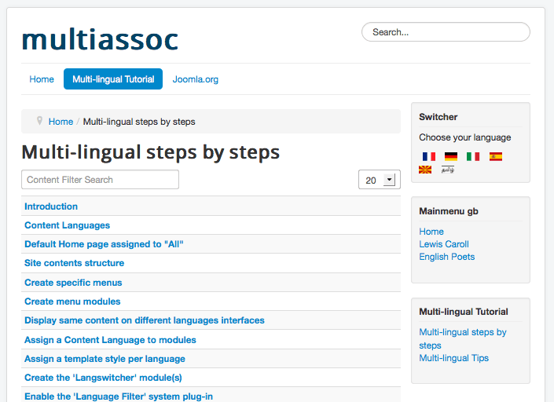
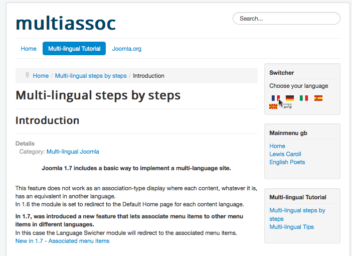
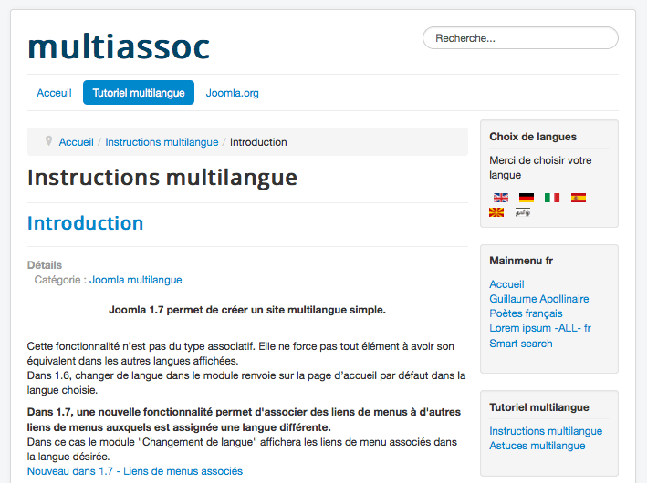

# Joomla! 语言快捷筛选器使用教程

Multithumb found errors on this page:  
  
There was a problem loading image http://community.joomla.org/images/translationteams/paramslangfilter.png  
There was a problem loading image http://community.joomla.org/images/translationteams/paramsassociatedcategories.png  
There was a problem loading image http://community.joomla.org/images/translationteams/associatedcategoriesmanager.png  
There was a problem loading image http://community.joomla.org/images/translationteams/articlesassociatedparams.png  
There was a problem loading image http://community.joomla.org/images/translationteams/articlesassociatedmanager.png  
There was a problem loading image http://community.joomla.org/images/translationteams/siteengblist.png  
There was a problem loading image http://community.joomla.org/images/translationteams/introengbpointer.png  
There was a problem loading image http://community.joomla.org/images/translationteams/introfr.png

Joomla官方发布的最新版本中增加了一个语言筛选的新特性，显得非常方便，有了这个功能，如果你想快速改变指定文章或者分类所属的语言，只要选择指定文章或者分类进行快速更改，不用再像以往那样点开文章、分类再去编辑语言属性。

新特性依然向下兼容，需要先确保菜单项都指定了特定语言，然后在语言插件中重新保存一次。  
 截图是基于3.0.2 ( See 2.5 version here:<http://multilingual-joomla-demo.cloudaccess.net/> )

### 如何工作的?

1. 设定语言筛选插件并确保Items associations项为Yes

2. 分配文章分类语言  
 插件设置成功后在分类选项中查看有新的选项卡“ Associations”.。这时候所有的语言都出现在此选项卡界面中，右侧即可为每个语言选项指定分类。

  
 3. 设定好语言对应分类后，回到分类列表，一个名为“Associations”新的属性出现在分类管理的表格中（小地球图标），这个时候点击这个小地球即可快速为分类设定语言。

4. 分配文章语言  
 编辑某一篇文章也会发现一个新的选项卡“Associations”出现。点击此选项卡即可设置文章语言。

  
 5. 回到文章管理列表，一个名为“Association”新的列属性出现在文章管理列表中，与分类等同的是，通过点击小地球进行语言设定。

6. 菜单中也是如此哦。

下文为前台演示，比较基本。

7. 前台通过语言筛选可以显示特定语言文章（英文）。

8. 点击“Introduction”文章。

9. 切换至法语后，看看变化。

10. 这就是快捷语言筛选器

---

除特殊标明文章转自第三方网站，文章均由JOOMLASK.COM原创提供  
欢迎友情转载，请务必保留本文出处并引用本文链接： [Joomla! 语言快捷筛选器使用教程](http://www.joomla178.com/joomla-share/research-and-development/joomla-language-quick-set-info.html)
