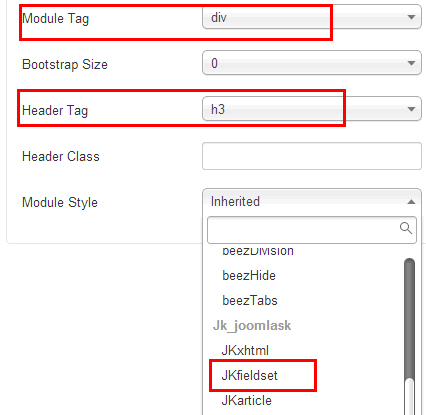

# Joomla! 加载模块插件深入运用


我们知道在Joomla!中有这样一个系统默认的插件：内容-加载模块 （Content - Load Modules） ，专门解决想在文章中插入一个特定模块，比如你可能想在文章中介绍你开发的一个模块，而且其用法也是非常简单，在文章编辑器中插入下面两种语法的代码，根据需要：

```
{loadposition yourposition}
```

此语法的意思是在文章中插入一个指定好了模块位置的模块，例如在创建模块的时候，模块位置项自己写成yourposition，名称根据自己喜好来即可，这样就在这篇文章中只显示创建在yourposition模块位置的模块了。

```
{loadmodule mod_login}
```

此语法的意思是在文章中插入所有已创建好的mod\_login模块，比如你要是已经创建过两个mod\_login的登陆模块，那么都会在这篇文章中显示 ，一般这种用法不太多，除非你这个各类的模块只有这么一个，那么在创建这个模块的时候，最好也是用自定义的模块位置，比如yourposition

关于这个基础用法，大家可以去体验一下，本文的主旨并非仅于此，根据最近遇到的一个实战应用，深入运用这个插件。

比如我们现在需要在所有的文章中插入一个“旗帜广告模块（mod\_banner）”，首先每个文章都写一个{loadposition yourposition}不太现实，那么有人会说直接在/templates/jk\_Joomla178/html/com\_content/article/default.php（还不知道是什么意思吗，请参考：[Joomla! 2.5.x 文章布局、分类布局模板释疑](../joomla-templates-tutorials/joomla25-article-layout-and-blog-layout.md)，原理都等同） 中直接插入代码，这不失为一个好办法，但是广告管理起来就麻烦了，下次换广告，又得改模板代码。

所以我们想个办法，把这个{loadposition yourposition}代码放在文章模板文件/templates/jk\_Joomla178/html/com\_content/article/default.php中，但是我们在测试后发现在此文件中直接添加{loadposition yourposition}的话，该插件就失效了。

搜索找到一文：[How can I display Joomla modules within a component?](http://stackoverflow.com/questions/4044216/how-can-i-display-joomla-modules-within-a-component)，该问答站中有网友回复用下方代码可在文章模板中正常显示插件

```
<?php echo JHTML::_('content.prepare', '{loadposition yourposition}');?>
```

故从此处可知要使用官方的一个API：JHTML，搜索得知官方文档：[Triggering\_content\_plugins\_in\_your\_extension](http://docs.joomla.org/Triggering_content_plugins_in_your_extension)中有关于在运行内容插件（加载模块Content - Load Modules就是一个内容插件）的示例语法：

```
$text = JHtml::_('content.prepare', $text);
```

如果对于其它的内容触发器，需要添加代码：

```
$dispatcher = JDispatcher::getInstance();  $item->text = your_text_area_item;    $item->params = clone($params);  JPluginHelper::importPlugin('content');   $dispatcher->trigger('onPrepareContent', array (& $item, & $item->params, 0));
```

大致有所了解，我们开始在网站中施工：

打开文章的模板文件：/templates/jk\_Joomla178/html/com\_content/article/default.php，找到文章输出内容的代码

```
<?php echo $this->item->introtext; ?>
```

在其下面添加输出加载模块插件后的代码如下（本处以文章结尾为示例，其它位置请参考）

```
<?php echo $this->item->introtext; ?><?php echo JHTML::_('content.prepare', '{loadposition yourposition}');?>
```

我们在Joomla! 2.5中测试结果，在所有文章中显示在yourposition模块位置的模块正常显示，但是我们又会有个新问题，这个模块的所有样式都是调用的默认模块样式，如何自定义模块样式呢，以前我们有学过[Joomla1.6+1.7添加自定义更多（More）方案](http://www.Joomla178.com/joomla-share/research-and-development/366-add-more-on-joomla-17.html)（Joomla! 2.5和Joomla! 3.x和此文原理相同），其中有提到/templates/jk\_Joomla178/html/modules.php这个文件，我们先按照此文中的办法创建一个自定义的样式，比如叫modChrome\_JKarticle，专门用来自定义文章中的模块样式。

然后我们知道前面的代码中加载模块代码确实不能像模板文件/templates/jk\_Joomla178/index.php那样自定义模块样式，在以前[Joomla模板制作实战教程-创建各种模块位置](../joomla-templates-tutorials/joomla-templates-tutorials-creat-a-modules-position.md)和[Joomla1.6+1.7添加自定义更多（More）方案](http://www.Joomla178.com/joomla-share/research-and-development/366-add-more-on-joomla-17.html)中，都有关于模块的布局自定义，例如下述代码，style="JKArticle"，就是说明这个模块要调/templates/jk\_Joomla178/html/modules.php中的modChrome\_JKarticle样式布局

```
<jdoc:include type="modules" name="jkcustom" style="JKArticle" />
```

但是，在/templates/jk\_Joomla178/html/com\_content/article/default.php中是没办法按照这种语法来写模块，所以前文中的官方文档[Triggering\_content\_plugins\_in\_your\_extension](http://docs.joomla.org/Triggering_content_plugins_in_your_extension)就显得有作用了

在[星仔码头](http://www.xingzai.org/)的帮助之下，改良了加载模块代码如下：

```
<?php echo $this->item->introtext; ?><?php echo	$cxItem = &JModuleHelper::getModules( 'yourposition' );/*定义变量$cxItem为获取模块位置*/	foreach ($cxItem as $cx) {		$_options = array( 'style' => 'JKarticle' );/*加载JKarticle的模块样式*/		echo JModuleHelper::renderModule($cx,$_options);	};
?>
```

但是后来发现Joomla! 3.x中就不用这么麻烦了，因为Joomla! 3.x的模块中都有这些自定义模块样式的功能，随便打开一个模块中的配置- 高级配置可以看到下方有关于自定义的选项：



---

除特殊标明文章转自第三方网站，文章均由JOOMLASK.COM原创提供  
欢迎友情转载，请务必保留本文出处并引用本文链接： [Joomla! 加载模块插件深入运用](http://www.joomla178.com/joomla-share/research-and-development/joomla-load-module.html)
