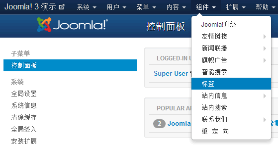
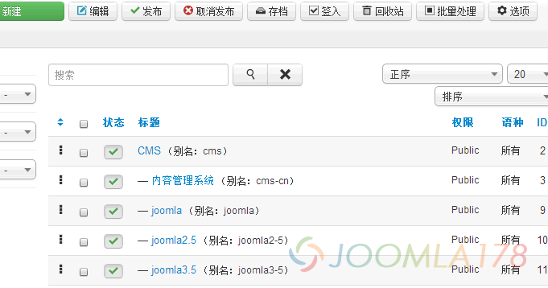
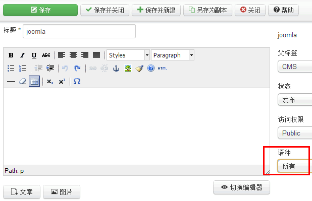
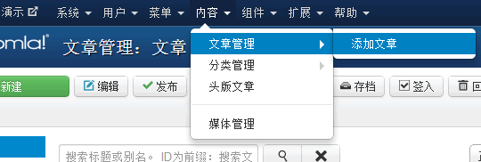
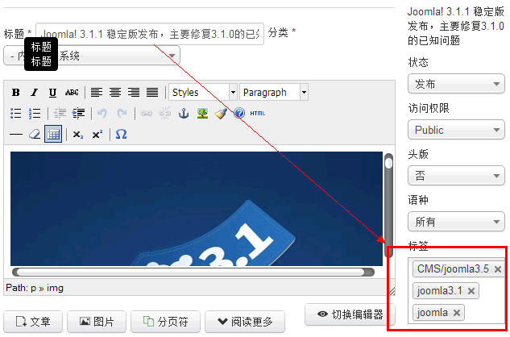
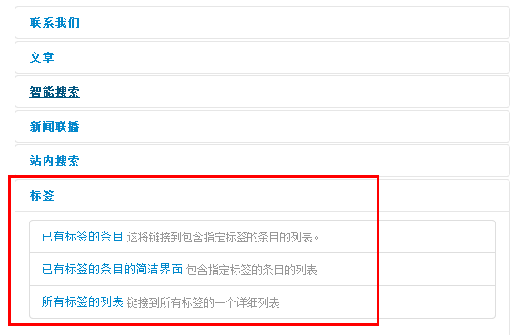
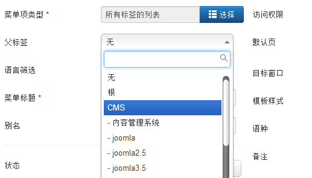

# Joomla!新功能Tags/标签实例运用

我们之前了解到Joomla! 3中将引入一个新特性：Tags/标签（[Joomla! 3新特性：Tags标签](joomla3-new-features-tags.md)），Tags在WordPress中是最基本的组成元素，而在Joomla! 2.5中才初见端倪，我们在[Joomla! 3中的11大新特色](joomla3-new-11-features.md) 一文中特别提到Joomla! 2.5中有一个相关文章的模块，但要保证文章中必须要有meta相关属性值，才能让相关文作用，从本质上讲，Joomla! 2.5是希望通过文章Meta+相关文章模块来实现Tags/标签，不过2.5中的这一功能基本废弃。

相信Joomla!开发团队意识到Tags/标签为民心所向，在Joomla! 3中正式地引入了这个最基本的文章关联元素：Tags/标签

### 认识Joomla!的Tags/标签

我们打开Joomla! 3的后台 - 组件 - 选择“标签”一栏

进入之后，我们看到了我们预设的几个Tags/标签

在这里Tags/标签就像Joomla! 中的文章一样，可以新建、编辑、发布、删除、批量操作等，还有如无限级分类Tags/标签强大的类别管理功能。

对于多语言网站来说，Joomla!的Tags/标签还支持多语种Tags/标签，点击上图中的任意一个Tags/标签，进入编辑如下图：

### 使用Joomla!的Tags/标签

Tags/标签，自然是要和文章内容挂勾，也是文章之间实现交叉关联的重要元素，下面我们看看到底如何使用，文章分类也同样支持Tags/标签管理，甚至所有的Joomla!内容性组件都支持Tags/标签，例如“友情链接”、“新闻联播”，开发者在开发组件的时候也可以设置为支持Tags/标签，这里我们仅以文章为例：

在上面介绍Tags/标签的时候，我们看到预设的Tags/标签实际上都是我们在创建文章的时候创建好的，进入后台 - 内容 - 文章管理 - 添加新文章

添加下面一篇新文章，注意到右下角有一块标签栏

和WordPress一样，我们根据文章标题输入Joomla! 3.1后面再加上英文逗号，自动就生成了标签，自然多个Tags/标签是用英文逗号分开，这个时候组件中的Tags/标签并未创建新的，我们要在文章界面保存之后，Tags/标签才会生效。

我们再回到上面的 组件 - 标签 中进行分类管理、语言化归类等操作，那么同样道理，文章支持Tags/标签，文章的分类使用标签、友情链接和新闻联手也是同样的使用方法。

### 优化Joomla!的Tags/标签

Tags/标签自然好用，但是切记滥用，如何用好Tags/标签在网上也是很多相关文章，使用好Tags/标签分类、避免重复Tags/标签是最常见的处理办法。

另外Tags/标签在Joomla! 中是以组件形式存在，Tags/标签自然是支持菜单关联、智能搜索（暂不支持普通搜索），我们在[Joomla!搜索功能美化、SEO优化及OpenSearch应用](joomla-search-diy-seo-opensearch.md)一文中专门为搜索做了SEO优化，那么Tags/标签同样道理，也应该有一个友好网址的菜单配置

进入后台 - 菜单 - MainMenu - 添加新的菜单项

在菜单项一栏中，我们选择“标签”下相关的内容，例如设置“所有标签的列表”

别名alias设置为tags，这样我们在访问网址的时候就是 http://www.yourdomain.com/tags 形式的友好网址，标签同样可以选择我们之前说的分类

保存后，我们回到前台的主菜单上，进入http://www.yourdomain.com/tags 页面，可以查看所有的Tags/标签，点击之后可以查看任意Tags/标签所关联的文章，或者分类、友情链接等。

最后还是要记着慎用Tags/标签，它既是SEO的好帮手，用不好它就成为网站流量的破坏者！另外如果网站是Joomla! 2.5的站点，应该尽快考虑将来升级至Joomla! 3的时候如何处理Tags/标签。

---

除特殊标明文章转自第三方网站，文章均由JOOMLASK.COM原创提供  
欢迎友情转载，请务必保留本文出处并引用本文链接： [Joomla!新功能Tags/标签实例运用](http://www.joomla178.com/joomla-share/research-and-development/joomla-new-tags.html)
