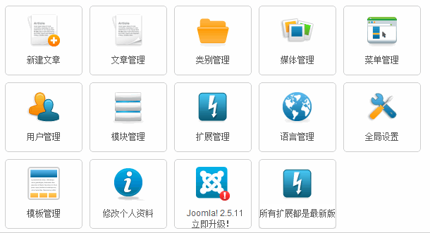
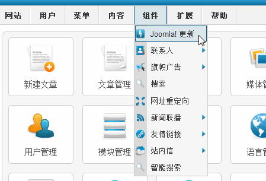
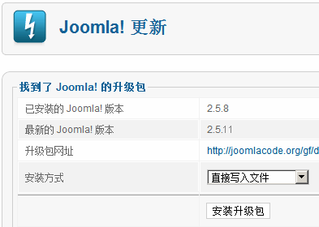
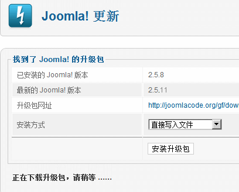
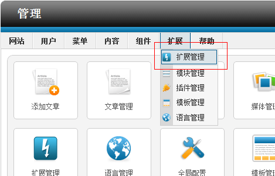
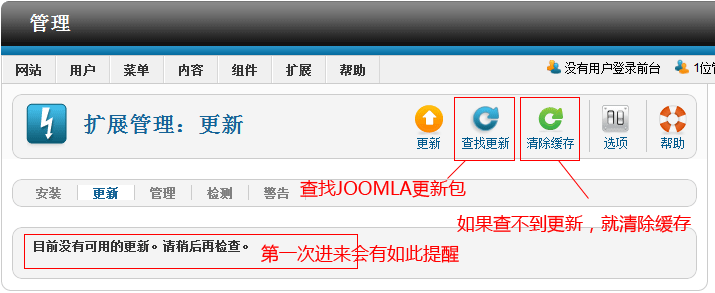
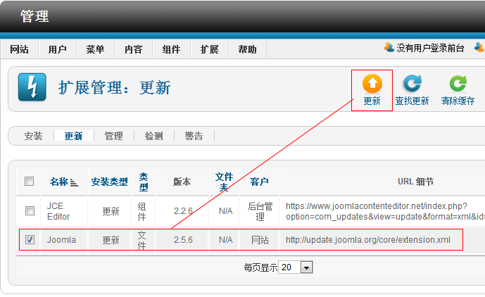
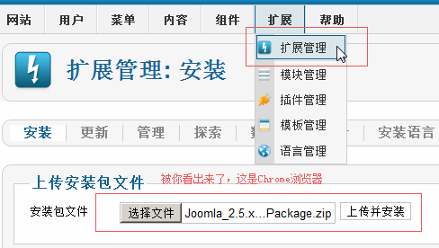

# 领略强大的Joomla!一键更新

Joomla!在过渡产品Joomla!1.7时代已经加入了一键更新功能，详细参考[Joomla 1.7升级至2.5，1.7模板可直接使用](joomla17-update-to-joomla25.md)，自此后Joomla! 2.5.x 以及未来的Joomla! 3.5.x主要更新方式仍然为一键更新，当然除了方便的一键更新外，避免有些环境不支持（例如本地）一键更新，还有额外的手动更新办法，以下细说：

### Joomla! 一键更新

正在使用 Joomla! 2.5.4及以前版本的用户是看不到下图的，反之Joomla! 2.5.5+中，当你登录到 Joomla 后台的时候，将会看到自动显示升级提醒，如图

这个升级通知主要由com\_joomlaupdate组件实现的，如上所述，Joomla! 2.5.4及以前版本是看不到更新通知，这就要在后面第二种手动更新方法中说明了。

进入后台 - 组件，你也能看到这个“Joomla 更新”组件：

点击“立即升级”按钮，或者点击组件菜单上的“Joomla 更新”项目，系统自动查找是否存在 Joomla 升级包，如果发现有升级包，会如下显示

点击“安装升级包”的按钮。点击此按钮，就能开始自动升级的过程：

系统自动下载自动安装，如果服务器环境不支持，请往后看

如果看不到那个Joomla! 更新，就在“扩展管理”中的“更新”子菜单中完成更新：

进入扩展管理之后，请参考下图，第一次进来会提醒“目前没有可用的更新，请稍后再检查”，那么直接点击“查找更新”，如果查找不到更新，请点击“清除缓存”

在上面查到更新包后，勾选“Joomla”选项，再提交“更新”，如果有扩展更新了，也会有提示扩展升级，如下图中的JCE

### Joomla! 手动升级

篇首说了，环境可能会导致无法一键升级，那就下载官方升级补丁包，自己根据当前版本前往官方下载：[Joomla! 发行项目地址（可翻页查找老版本）](http://joomlacode.org/gf/project/joomla/frs/?action=index&__gads=ID=e974a589cfe1a44b%3AT=1362982064%3AS=ALNI_MYXDaK39c3oWp0tYpgZrjkhz84wyQ&__utma=13354156.66669921.1362981986.1367561537.1369796394.12&__utmb=13354156.3.10.1369796395&__utmc=13354156&__utmz=13354156.1369796395.12.10.utmcsr=Joomla178.com|utmccn=(referral)|utmcmd=referral|utmcct=/joomla-share/research-and-development/457-joomla17-update-to-joomla25.html&_br_pkgrls_total=50&_br_pkgrls_page=2)

无需解压这个升级包，进入后台“扩展管理”

收工，升级完成

---

除特殊标明文章转自第三方网站，文章均由JOOMLASK.COM原创提供  
欢迎友情转载，请务必保留本文出处并引用本文链接： [领略强大的Joomla!一键更新](http://www.joomla178.com/joomla-share/research-and-development/joomla-one-click-updates.html)
