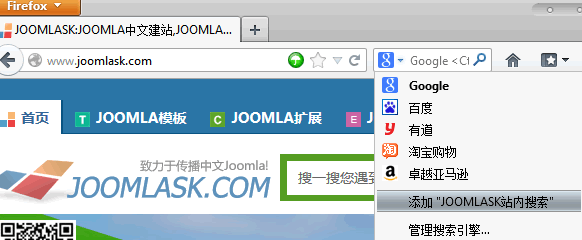
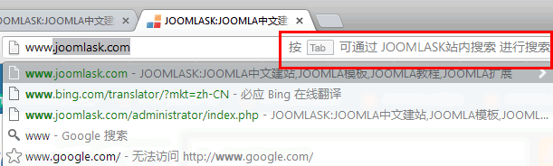
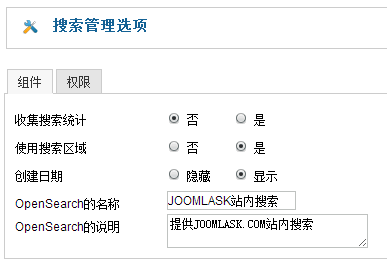
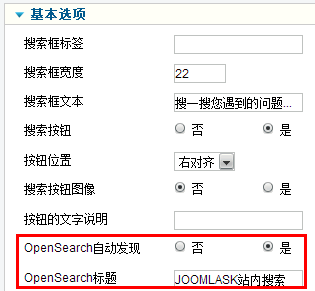
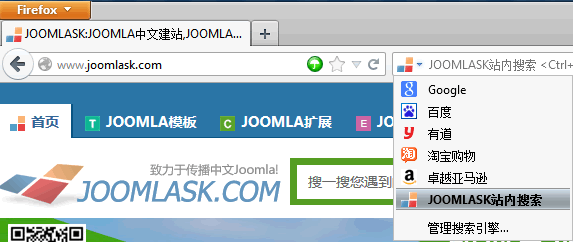
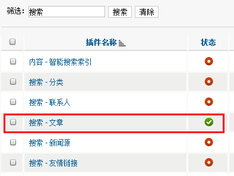
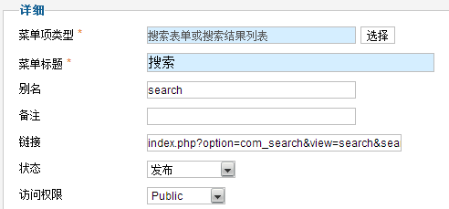
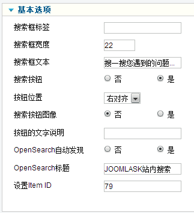
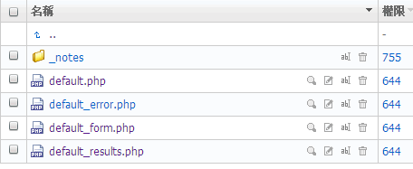

# Joomla!搜索功能美化、SEO优化及OpenSearch应用

每个网站都要具备搜索功能，当网站内容具有一定数量级的时候搜索就必不可少了，方便用户更快的查询到想要的信息，Joomla! 的搜索方式依旧继承了西式搜索，国内用户常常想要的分类搜索功能至今还未增加！不过Joomla! 的搜索功能还是可以满足一个门户网站级别的搜索需求，下面我们就详细的讲讲Joomla! 搜索的实战应用及SEO优化。

Joomla! 搜索功能主要由 搜索组件、搜索插件、搜索模块 三大类构成，都发挥各自强大的作用，在这里我们主要讲的是站内搜索，由于智能搜索功能并不是期望中的强大，而且还存在一些观念上的误区，所以智能搜索不在本文范畴。

### 一、Joomla!中的OpenSearch功能

在Joomla! 2.5中增加了新的OpenSearch功能，例如用户访问<http://www.Joomla178.com>的时候，该网站具备搜索功能，因为Joomla! 系统遵循OpenSearch规范的代码，那么支持OpenSearch功能的浏览器（目前有IE7、IE8、Firefox、Chrome）就能够自动发现并提示添加新的搜索插件/扩展到浏览器的搜索栏中，如下图中的Firefox的搜索引擎管理一栏中就可以看到 添加“JOOMLA178站内搜索”。按照OpenSearch在Joomla!中的设计，理论地址应该是http://www.Joomla178.com/search.opensearch（Joomla178换成你的域名）

不过在Chrome浏览器中，和Firefox有些不同，Chrome会提醒用户按"Tab" 可通过JOOMLA178站内搜索进行搜索，详看下图：

进入后台 - 组件 - 站内搜索 - 点击“选项”，看到下图，其中有一个OpenSearch的名称、OpenSearch的说明比较惹眼，我们先按图中填入对应的信息，这是按照OpenSearch的的标准。

然后我们要创建一个搜索模块，进入后台 - 扩展 - 模块管理 - 创建一个新的搜索模块，在基本选项中我们也可以看到OpenSearch的设置，将OpenSearch自动发现 设置为“是”，然后OpenSearch的标题设置为简短的“JOOMLA178站内搜索”，如果这里不设置的话，届时添加的搜索引擎名称将按照网站的TITLE显示，所以这里我们应该简化之

组件、模块都设置成功后，在Firefox浏览器中打开网站前台，在下图中不难发现JOOMLA178站内搜索成为了你配置的其中一个搜索引擎，如果大家希望更准确的找到Joomla178.com的资源、教学，推荐添加JOOMLA178站内搜索。

### 二、Joomla! 搜索范围设置

Joomla! 的搜索内容提供搜索文章、分类、联系人、新闻源、友情链接等多个组件的搜索，如果安装了第三方扩展如K2，那么K2的开发者必然也开发了K2的搜索插件，我们在后台插件中能够对这些组件的搜索插件进行管理。

进入后台 - 扩展 - 插件管理，筛选中填入“搜索”，看到如下图！我们网站希望只让用户搜索“文章”，那么其它几个搜索插件就可以禁用（注意和智能搜索区分，本文不针对智能搜索讲解）

### 三、Joomla! 搜索的SEO优化

上述第二大点中我们已经设置了搜索范围，第一大点中我们也创建过了一个搜索模块，那么我们还需要给搜索创建一个菜单。由于我们开启了SEF，也就是Joomla! 的SEO友好网址形式，那么如果不创建搜索菜单的话，搜索结果就是 /component/search/.... 这样的网址方式，而最好的网址应该把/component/隐藏，那么在Joomla! 的机制就是，组件如果没菜单，就按照/component/的方式显示，所以这个解释具有普遍适用性

进入后台 - 菜单 - MainMenu，创建一个新的菜单，菜单项类型应该是“搜索表彰或搜索结果列表”，别名/alias 填入search，这样SEF后的搜索网址就是 /search.html 或者/search

创建成功后，我们开启SEF后，在前台可以浏览例如 <http://www.Joomla178.com/search.html>，如果没开启后缀则是：<http://www.Joomla178.com/search>

到这里还没完哦！这个时候通过前台的模块搜索，搜索的结果还将是 /component/seach/，那么应该怎么解决呢，回到我们第一大点中创建的搜索模块，其中有一项“设置Item ID”就是专门管这个的，这个ID是来自于我们刚才创建的搜索菜单ID，回到前面找到那个搜索菜单管理员中，就可以看到该ID，在这里我们示例的是79

### 四、美化Joomla!搜索结果页面

大家可以在<http://www.Joomla178.com>的搜索区域测试搜索内容为“搜索”，结果传送门<http://www.Joomla178.com/search.html?searchword=搜索&searchphrase=all>，这里需要插播一下，大家可能会遇到“关键词最少3个字符，最多20个字符”这样的提示，请看：[Joomla! 搜索字符限制解决方案](joomla-search-limit-word-solution.md)

想得到上面的搜索美化页面？非常简单，我们在前文[Joomla! 1.7模板多样化进阶](../joomla-templates-tutorials/joomla17-template-info-2.md)和[Joomla! 2.5.x 文章布局、分类布局模板释疑](../joomla-templates-tutorials/joomla25-article-layout-and-blog-layout.md)都有对组件的多样化美化有详细说明，原理等同

我们复制/components/com\_search/views/search/tmpl 下面的4个php文件到：/templates/your\_template/html/com\_search/search/ 目录下，然后对这4个文件进行DIY，default.php基本不用管，default\_error.php是搜索结果出错的页面，default\_form.php 是搜索表单的页面，default\_results.php就是搜索的结果页面。还有搜索模块的美化也是同样道理，大家可以亲自尝试一下

做好这些工作后，剩下的就是发挥你的DIV+CSS专业知识的时候了！到此我们搜索相关的东西都讲完了，文章无法写到面面俱全，旨在抛砖引玉！

---

除特殊标明文章转自第三方网站，文章均由JOOMLASK.COM原创提供  
欢迎友情转载，请务必保留本文出处并引用本文链接： [Joomla!搜索功能美化、SEO优化及OpenSearch应用](http://www.joomla178.com/joomla-share/research-and-development/joomla-search-diy-seo-opensearch.html)
