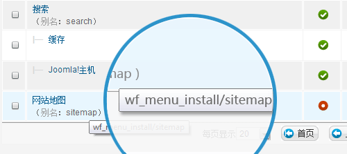

# Joomla! SEO友好链接移除wf_menu_install和wf_menu_profiles

近日在Joomla! 2.5中调整菜单时无意中发现一个怪象：在开启SEF搜索引擎友好链接的前提下，当变更菜单所属分类时，明明菜单的别名(alias)写的是正确的英文，比如sitemap，但是前台网址却变成了wf\_menu\_xxx/sitemap 形式，xxx目前发现有两个神奇可能值，wf\_menu\_install 和wf\_menu\_profiles。

搜索相关资料(<http://wayofjoomla.com/discipline/79-joomla-tips-a-tricks>)得知，其中菜单管理中有一个“重建(Rebuild)”功能，这个是专门解决菜单的数据库出错的按钮，我们之前在[Joomla!升级至Joomla! 2.5的常见错误解决办法](joomla-upgrade-joomla25-error-resolve.md)中有了解到“扩展 - 扩展管理”中有一个数据库修复的选项，但此功能却无法解决菜单数据库出错。

移除wf\_menu\_install和wf\_menu\_profiles的办法很简单：在后台 - 菜单 中选中出问题的菜单，或者选择所有菜单，点击右上角“重建”即可修复此问题

笔者尚不知为何为出现这种问题，但可以肯定的是，这不是一个BUG，就像扩展中的“数据库修复”一样！需要大家去发现并解决。

---

除特殊标明文章转自第三方网站，文章均由JOOMLASK.COM原创提供  
欢迎友情转载，请务必保留本文出处并引用本文链接： [Joomla! SEO友好链接移除wf\_menu\_install和wf\_menu\_profiles](http://www.joomla178.com/joomla-share/research-and-development/joomla-sef-remove-wf_menu_install-wf_menu_profiles.html)
